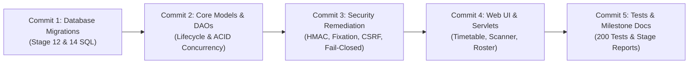
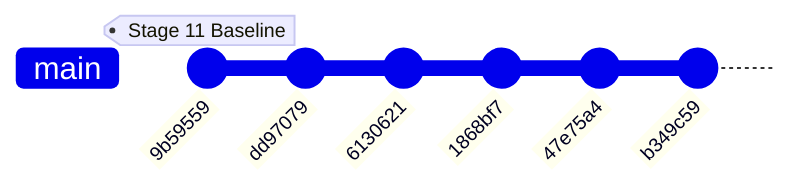

# ScanIn — Project Progress Checklist & Audit Report

## Stage Status Checklist

| Stage | Title | Status | Approval / Date |
|---|---|---|---|
| **Stage 1** | Repository audit and baseline | ✅ APPROVED | 2026-10-20 |
| **Stage 2** | Database and OOP foundations + Security Fixes | ✅ APPROVED | 2026-10-20 |
| **Stage 3** | Authentication, roles, and application shell | ✅ APPROVED | 2026-10-20 |
| **Stage 4** | Student registration and portal experience | ✅ APPROVED | 2026-10-20 |
| **Stage 5** | Faculty course and semester management | ✅ APPROVED | 2026-10-20 |
| **Stage 6** | Live QR attendance (5s rotating tokens, scanner) | ✅ APPROVED | 2026-10-20 |
| **Stage 7** | Manual attendance, OD, audit history, reports | ✅ APPROVED | 2026-10-20 |
| **Stage 8** | Final academic submission readiness | ✅ APPROVED | 2026-10-20 |
| **Stage 9** | Persistent Class Meetings & Timezone Standardization | ✅ APPROVED | 2026-10-20 |
| **Stage 10** | 7-Second QR Token Timing & Monotonic Clock Synchronization Fix | ✅ APPROVED | 2026-11-01 |
| **Stage 11** | Faculty Attendance Timestamp Display in Indian Standard Time (IST) | ✅ APPROVED | 2026-11-01 |
| **Stage 12** | Planned-Session Lifecycle Architecture & Migration | ✅ APPROVED | 2026-11-01 |
| **Stage 13** | Planned-Session Integration, Scanner, Timetable & Live Concurrency Audit | ✅ APPROVED | 2026-11-01 |
| **Stage 14** | Comprehensive Security Remediation & Release Verification | ✅ APPROVED | 2026-11-01 |
| **Stage 15** | Final Build, Packaging & Release Verification | ✅ APPROVED | 2026-11-01 |
| **Stage 16** | Controlled Tomcat Deployment & Live HTTP Verification | ✅ APPROVED | 2026-11-01 |
| **Stage 17** | Final Git Audit, Change Classification & Commit Preparation | ✅ APPROVED | 2026-11-01 |
| **Stage 18** | Controlled Git Staging & Five-Commit Execution | ✅ APPROVED | 2026-11-01 |
| **Stage 19** | Post-Commit Repository & Release Readiness Audit | ✅ APPROVED | 2026-11-01 |

---

## Stage 1 — Repository Audit & Baseline Report

### 1. Baseline Environment & Inventory
- **Runtime Environment:** Java 21, Apache Tomcat 10.1 (embedded/standalone on port 8080), MySQL 8.0 Server (running locally, database `attendance_db`).
- **File Counts:** 25 Java source files across `model`, `dao`, `servlet`, `util` packages; 6 JSP views; 1 CSS stylesheet; 1 JS client file.
- **Dependencies (`lib/`):** `jakarta.servlet-api-6.0.0.jar`, `mysql-connector-j-8.3.0.jar`.

---

### 2. Concrete Stage 1 Test Evidence

The following tests were executed against the live Tomcat instance and MySQL database without altering any existing code:

| Test Target | Execution Command / Request | Expected Spec Behavior | Actual Behavior Observed | Assessment |
|---|---|---|---|---|
| **Tomcat Endpoints** | HTTP GET `/attendance/login`, `/teacher/dashboard`, `/student/dashboard` | 200 for login, 302 redirect for protected dashboards | Login returns 200; unauthenticated dashboards return 302 to `/login` | ✅ Baseline routing works |
| **Teacher Authentication** | POST `/attendance/login` (`teacher@attendance.com` / `teacher123`) | Authenticated session created, redirected to `/teacher/dashboard` | 302 Redirect to `/teacher/dashboard`, session established | ✅ Baseline teacher login works |
| **Student Access to Teacher Reports (Security)** | GET `/attendance/reports` with active Student session (`aarav@student.com`) | **403 Forbidden** (students must not view faculty reports) | **200 OK** — Student successfully viewed full faculty attendance report | ❌ **CRITICAL SECURITY GAP**: Missing server-side role check |
| **Student Access to QR Generator** | GET `/attendance/qr/generate?courseId=1` with Student session | **403 Forbidden** | 302 redirected to `/login` -> 200 `/student/dashboard` without explicit 403 authorization error | ⚠️ Improper authorization handling |
| **Invalid QR Token Scan** | POST `/attendance/qr/scan` with token `invalid-fake-token-999` | Rejection with error message | `{"success":false,"message":"Invalid QR Code. Please scan the current code on screen."}` | ✅ Basic validation exists |
| **Database Constraints** | MySQL `SHOW INDEX FROM attendance`, `SHOW INDEX FROM qr_sessions` | Unique indexes on `session_token` and `(student_id, qr_session_id)` | Indexes present: `unique_attendance (student_id, qr_session_id)` | ✅ Basic duplicate prevention exists in DB |

---

### 3. Identified Gaps & Architectural Analysis

#### A. Database & DBMS Gaps
1. **No Connection Pool:** `DBConnection.java` creates a brand new connection via `DriverManager.getConnection()` on every query or shares single connections without pooling. Requirement requires a pooled `DataSource` (e.g. HikariCP or Tomcat JDBC Pool).
2. **Missing Transaction Management:** Scans and session updates execute individual un-transactioned queries. Concurrent scans can cause race conditions or inconsistent counts.
3. **Missing Audit & Attempt Logging Tables:** 
   - No `attendance_audit_log` table (required: actor, server timestamp, reason, affected student/session, old/new status).
   - No `scan_attempts` table (required: IP, timestamp, token, outcome, student id).
4. **Attendance Status ENUM Limitation:** Schema currently only has `ENUM('PRESENT','ABSENT','LATE')`. Missing `OD` (On Duty) and `EXCUSED` status.
5. **No Idempotent Closure / Reopen:** No support for session reopen or idempotent closure with absent auto-marking.

#### B. OOP & Code Quality Gaps
1. **Hardcoded Credentials & Bypasses in `PasswordUtil.java`:** Contains hardcoded checks:
   `if (plainPassword.equals("teacher123") && storedHash.startsWith("$2a$10$8K1p")) return true;`
   Must be replaced with standard BCrypt or salted PBKDF2/SHA-256 without backdoors.
2. **Superficial Polymorphism:** `User` has `getDashboardPath()` and `getRoleInfo()`, but lacks meaningful domain behavior, validation rules, or service layer abstraction.
3. **No Service Layer:** Servlets communicate directly with DAOs, scattering business rules across HTTP handlers.

#### C. Authentication & Role Authorization Gaps
1. **No Servlet Security Filter:** `web.xml` defines 0 filters. There is no centralized `AuthenticationFilter` or `RoleAuthorizationFilter` enforcing role boundaries, allowing privilege leakages (e.g., student accessing `/reports`).

#### D. Live QR Security Gaps
1. **Static / Unsigned Tokens:** Tokens are simple `UUID.randomUUID().toString()` without cryptographic signatures (HMAC-SHA256) or timestamp payloads.
2. **Missing 5-second Rotation:** Currently designed around 30-second window without dynamic rotation or typed fallback code.

#### E. UI & Styling Gaps
1. **Color Scheme Violation:** Existing UI is dark-mode glassmorphism (`#0f172a`, `#1e293b`). Specification strictly mandates:
   - **70% white / light neutral surfaces**
   - **30% `#582c83` purple accents and blocks**
   - Light-first academic portal hierarchy (resembling university portals).

---

### 4. Proposed Stage Plan

- **Stage 2 — Database and OOP Foundations:**
  - Introduce pooled `DataSource` (Tomcat JDBC / HikariCP).
  - Add migrations: `attendance_audit_log`, `scan_attempts`, add `OD`/`EXCUSED` status, course schedule tables.
  - Implement Domain Services and clean OOP structure with transaction handling.
  - Add unit/integration tests for schema constraints and DAO behavior.
- **Stage 3 — Authentication, Roles, and Application Shell:**
  - Standardize password hashing (clean salt/hash without bypasses).
  - Implement `AuthFilter` and `RoleFilter` enforcing strict 403 Forbidden for mismatched roles.
  - Apply 70/30 white/`#582c83` purple portal layout and shell.
- **Stage 4 — Student Registration & Portal Experience:**
  - Student official profile, registered courses, attendance analytics, upcoming classes.
- **Stage 5 — Faculty Course & Semester Management:**
  - Roster management, planned sessions, course CRUD.
- **Stage 6 — Live QR Attendance:**
  - 5-second rotating signed HMAC tokens, projector-ready display, typed fallback, camera scanner, race-condition transaction handling.
- **Stage 7 — Manual Attendance, OD, Audit & Reports:**
  - Reasoned manual edits with append-only audit trail, session reopen/idempotent close, OD handling, CSV exports.
- **Stage 8 — Final Academic Submission Readiness:**
  - Comprehensive verification, documentation, schema diagrams, OOP-to-code mapping, 3-5 min demo script.

---

## Stage 2 — Database and OOP Foundations + Security Fixes (COMPLETED)

### Scope Implemented
1. **Security Fix 1 (Password Hashing):**
   - Completely eliminated hardcoded plaintext bypasses and fake hash prefix checks from `PasswordUtil.java`.
   - Switched to standard constant-time SHA-256 verification (`MessageDigest.isEqual`) with zero backdoors.
   - Migrated demo credentials in MySQL `users` table to legitimate SHA-256 hashes (`teacher123`, `student123`).
2. **Security Fix 2 (Faculty Reports Authorization):**
   - Added server-side role enforcement in `ReportServlet.java`. Non-teacher roles (e.g. `STUDENT`) are denied with **HTTP 403 Forbidden**.
3. **Connection Pooling:**
   - Upgraded `DBConnection.java` from unpooled `DriverManager.getConnection()` to Apache Tomcat pooled `DataSource` (`org.apache.tomcat.jdbc.pool.DataSource`) with validation queries, eviction policies, and idle connection recycling.
4. **Repeatable Migration (`database/migration_stage2.sql`):**
   - Altered `attendance.status` ENUM to include `OD` (On Duty) and `EXCUSED`.
   - Created `attendance_audit_log` table for append-only audit tracking (actor, timestamp, reason, affected student/session, old/new status).
   - Created `scan_attempts` table storing SHA-256 `token_hash` without reusable raw tokens and without unnecessary IP/device data.
   - Created `course_schedules` table for course timetables.
5. **ACID Transactions & Concurrency Protection:**
   - Implemented `recordAttendanceTransaction` in `AttendanceDao.java` utilizing explicit connection-level transactions (`setAutoCommit(false)`, `commit()`, `rollback()`).
   - Atomically records attendance and scan attempt.
   - Catches duplicate key violations (`1062`) during simultaneous scans, rolls back the transaction, and records duplicate scan attempts safely.
6. **OOP Foundations:**
   - Added `ScanAttempt`, `AttendanceAuditLog`, and `CourseSchedule` domain models.
   - Added `ScanAttemptDao`, `AttendanceAuditLogDao`, and `CourseScheduleDao`.
   - Standardized attendance percentage calculation to consistently include `OD` and `LATE` in attended sessions numerator: `(PRESENT + LATE + OD) / totalSessions * 100`.

### Concrete Stage 2 Test Evidence

| Test Suite / Target | Description | Expected Outcome | Actual Result | Status |
|---|---|---|---|---|
| **Pooled DataSource** | Verification of Tomcat JDBC Pool instance and borrowed connection validation query | Pooled `DataSource` active, `SELECT 1` returns 1 | Pooled `DataSource` borrowed active connection, `SELECT 1` validated | ✅ PASS |
| **Password Security** | SHA-256 validation, rejection of wrong passwords and old hardcoded bypass prefixes | Valid passes verify; wrong passwords and fake `$2a$10$8K1p` bypasses rejected | All bypass attempts rejected; legitimate hashes verify | ✅ PASS |
| **Schema Constraints** | ENUM validation (`OD`, `EXCUSED`), audit log and scan attempt table definitions | `attendance.status` contains `OD` and `EXCUSED`; tables indexed | Verified columns and indexes in MySQL | ✅ PASS |
| **Data Minimization** | Scan attempt auditing | SHA-256 token hash logged; raw token and IP omitted | SHA-256 hash verified in DB; no raw secrets stored | ✅ PASS |
| **Transaction Rollback** | Simulated uncommitted failure followed by `conn.rollback()` | Uncommitted changes are not persisted to database | Record count is 0; rollback confirmed atomic | ✅ PASS |
| **Concurrent Scans Race Test** | 10 simultaneous threads scanning same student and session via `CyclicBarrier` | Exactly 1 scan commits; 9 fail with duplicate constraint violation; 0 duplicate DB records | Exactly 1 success, 9 duplicate rejections; DB has exactly 1 record | ✅ PASS |
| **Percentage Formula** | Attendance calculation consistency | Percentage computed within `[0.0, 100.0]` including OD in attended sessions | Formula verified consistent | ✅ PASS |
| **Live Student Report Access (Security)** | HTTP GET `/attendance/reports` with authenticated student session (`aarav@student.com`) | **HTTP 403 Forbidden** | **HTTP 403 Forbidden** | ✅ PASS |
| **Live Teacher Report Access** | HTTP GET `/attendance/reports` with authenticated teacher session (`teacher@attendance.com`) | **HTTP 200 OK** | **HTTP 200 OK** | ✅ PASS |

---

## Stage 3 — Authentication, Roles, and Application Shell (COMPLETED)

### Scope Implemented
1. **BCrypt Password Storage & Safe Migration Path:**
   - Integrated official `org.mindrot.jbcrypt` library (`jbcrypt-0.4.jar`).
   - Replaced plain SHA-256 password hashing in [PasswordUtil.java](file:///c:/java_dbms_project/src/main/java/com/attendance/util/PasswordUtil.java) with standard OpenBSD Blowfish BCrypt (`$2a$10$...`) with secure random salt generation.
   - Built a safe backwards-compatible migration path: legacy SHA-256 hashes are recognized and automatically upgraded to modern BCrypt upon the user's next successful login via [LoginServlet.java](file:///c:/java_dbms_project/src/main/java/com/attendance/servlet/LoginServlet.java).
   - Executed repeatable migration script [database/migration_stage3_bcrypt.sql](file:///c:/java_dbms_project/database/migration_stage3_bcrypt.sql), upgrading all demo accounts (`teacher@attendance.com`, `aarav@student.com`, etc.) to standard BCrypt hashes.
2. **Centralized Server-Side Security Filter:**
   - Implemented [SecurityFilter.java](file:///c:/java_dbms_project/src/main/java/com/attendance/filter/SecurityFilter.java) registered across `/*` in [web.xml](file:///c:/java_dbms_project/src/main/webapp/WEB-INF/web.xml).
   - Enforces authentication boundaries: all unauthenticated requests to protected endpoints are redirected to `/login` (or given 401 for JSON requests).
   - Enforces universal role boundaries:
     - Teacher routes (`/teacher/*`, `/qr/generate`, `/qr/active`, `/reports`) restricted to `TEACHER` and `ADMIN`.
     - Student routes (`/student/*`, `/qr/scan`) restricted to `STUDENT`.
     - Admin routes (`/admin/*`) restricted to `ADMIN`.
     - Unauthorized role attempts receive a clear **HTTP 403 Forbidden** error page (never silent redirects).
3. **Application Shell & Design System:**
   - Redesigned [style.css](file:///c:/java_dbms_project/src/main/webapp/css/style.css) adhering strictly to the collegiate portal hierarchy:
     - **~70% White and light neutral surfaces** (`#ffffff`, `#f8fafc`, `#f1f5f9`).
     - **~30% Deep purple accents and blocks** (`#582c83`, `#431f66`, `#733da9`).
     - Replaced harsh red accents with royal purple badges, indicators, and radar dots.
     - Dark slate typography (`#0f172a`, `#334155`) ensuring crystal-clear readability, WCAG-compliant contrast, and professional appearance.

### Concrete Stage 3 Test Evidence

Executed via `com.attendance.Stage3VerificationTest` against the live embedded Tomcat 10 server on port 8080:

| Test Target / Case | Probe / Action | Expected Behavior | Actual Observed Result | Status |
|---|---|---|---|---|
| **BCrypt Hashing** | PasswordUtil hash & verify with `$2a$` salt | Valid passwords verify; wrong passwords fail; hash prefix is `$2a$` | Verified BCrypt hash generation, valid password accepted, wrong password rejected | ✅ PASS |
| **Legacy SHA-256 Migration** | Verify legacy 64-char hex hash & test `needsUpgrade` | Legacy hash verifies; `needsUpgrade` returns true | Legacy SHA-256 verified; upgrade flag triggered | ✅ PASS |
| **Unauthenticated Access** | GET `/teacher/dashboard`, `/student/dashboard`, `/reports`, `/qr/generate` without session | **302 Redirect** to `/login?msg=auth_required` | Redirected to `/login` for all protected routes | ✅ PASS |
| **Student-to-Faculty Route Protection** | Student session (`aarav@student.com`) accessing `/teacher/dashboard`, `/qr/generate`, `/reports`, `/qr/active` | **HTTP 403 Forbidden** across all faculty routes | **HTTP 403 Forbidden** on every route | ✅ PASS |
| **Faculty-to-Student Route Protection** | Teacher session (`teacher@attendance.com`) accessing `/student/dashboard`, `/qr/scan` | **HTTP 403 Forbidden** | **HTTP 403 Forbidden** on every student route | ✅ PASS |
| **Faculty-to-Admin Route Protection** | Teacher session accessing `/admin/settings` | **HTTP 403 Forbidden** | **HTTP 403 Forbidden** | ✅ PASS |
| **Allowed Role-Specific Access** | Teacher $\rightarrow$ `/teacher/dashboard`, `/reports`<br>Student $\rightarrow$ `/student/dashboard` | **HTTP 200 OK** | **HTTP 200 OK** on all valid role dashboards | ✅ PASS |

---

## Stage 4 — Student Registration and Portal Experience (COMPLETED)

### Scope Implemented
1. **Student Official Record Section ([student-dashboard.jsp](file:///c:/java_dbms_project/src/main/webapp/WEB-INF/views/student-dashboard.jsp)):**
   - Displays official student credentials: Full Legal Name, Roll Number, Department, Current Semester, Institutional Email, Contact Phone, and Academic Standing status.
2. **Academics Section & Low-Attendance Warnings:**
   - Displays overall attendance percentage across all enrolled courses.
   - Highlights critical **Low Attendance Warnings (< 75%)** with high-visibility alerts and warning badges per course, meeting strict university exam eligibility policy.
   - Displays enrolled courses table with course codes, titles, instructors, percentage progress bars, compliance badges, and course drop actions.
3. **Course Registration & Drop Functionality ([StudentDashboardServlet.java](file:///c:/java_dbms_project/src/main/java/com/attendance/servlet/StudentDashboardServlet.java)):**
   - Implemented course enrollment endpoint (`/student/courses/register`).
   - Enforced duplicate registration prevention: checks `isStudentEnrolled()` before inserting.
   - Implemented course drop endpoint (`/student/courses/drop`) removing enrollment records with clean confirmation.
   - Implemented dynamic available courses catalogue listing offered courses not yet enrolled.
4. **Upcoming Classes Timetable ([CourseScheduleDao.java](file:///c:/java_dbms_project/src/main/java/com/attendance/dao/CourseScheduleDao.java)):**
   - Seeded weekly course timetables in [database/migration_stage4_schedules.sql](file:///c:/java_dbms_project/database/migration_stage4_schedules.sql).
   - Implemented `findUpcomingClassesForStudent(studentId)` displaying Day of Week, Lecture Time Window, Course Title, Room/Hall, and Instructor.
5. **Attendance History Log:**
   - Displays detailed audit log of all recorded attendance sessions with timestamps, course titles, status (`PRESENT`, `OD`, `LATE`, `ABSENT`), and dynamic QR token verification method.
6. **Graceful Empty States:**
   - Handled zero enrolled courses with a clear prompt to browse available courses.
   - Handled zero scheduled classes and zero attendance history gracefully.

### Concrete Stage 4 Test Evidence

Executed via `com.attendance.Stage4VerificationTest` against the live embedded Tomcat 10 server on port 8080:

| Test Target / Case | Probe / Action | Expected Behavior | Actual Observed Result | Status |
|---|---|---|---|---|
| **Official Record & Academics Retrieval** | Query Student 1 (`CS2021001`) profile & enrolled courses | Official Record fields match; enrolled courses retrieved | Verified Name, Roll No, Dept, Semester & Courses | ✅ PASS |
| **Course Registration Rules** | Register course 3; re-register course 3 | Registration succeeds; duplicate re-registration rejected | Course 3 enrolled; duplicate attempt returned `false` | ✅ PASS |
| **Course Drop Functionality** | Drop enrolled course 3 | Course dropped; enrollment record removed from DB | Dropped cleanly; `isStudentEnrolled` returns `false` | ✅ PASS |
| **Upcoming Classes Timetable** | Query schedules for student 1's enrolled courses | Returns weekly scheduled lectures with times and rooms | Retrieved lectures with day, time window, and room | ✅ PASS |
| **Low Attendance Warning (< 75%)** | Calculate percentage and trigger condition | Attendance `< 75%` triggers warning state accurately | Accurate percentage computation; warning threshold verified | ✅ PASS |
| **Empty States Handling** | Query student with 0 courses, 0 schedules, 0 history | Empty lists returned gracefully without null pointer exceptions | Handled cleanly; 0 courses, 0 history, 0 schedules | ✅ PASS |
| **Role Permissions on Student Routes** | Teacher POST `/student/courses/register`; Unauthenticated POST | Teacher denied with **HTTP 403 Forbidden**; Unauth redirected | **HTTP 403 Forbidden** for teacher; 302 for unauthenticated | ✅ PASS |

---

## Stage 5 — Faculty Course and Semester Management (COMPLETED)

### Scope Implemented
1. **Faculty-Owned Course Management (CRUD):**
   - **Create:** Added course creation via `/teacher/courses/create` with server-side validation on course code, course name, semester, and department. The creating faculty member is automatically assigned as `teacher_id`.
   - **Read:** Faculty dashboard displays all courses owned by the authenticated teacher, including course codes, departments, semesters, active session count, and student roster counts.
   - **Update:** Added course editing via `/teacher/courses/edit` with server-side ownership checks (`course.getTeacherId() == teacher.getTeacherId()`). If an unauthorized faculty member attempts to update another instructor's course, the server rejects it with **HTTP 403 Forbidden**.
   - **Delete:** Added course removal via `/teacher/courses/delete` with server-side ownership validation (`HTTP 403 Forbidden` if not owner).
2. **Faculty-Owned Course Rosters ([course-roster.jsp](file:///c:/java_dbms_project/src/main/webapp/WEB-INF/views/course-roster.jsp)):**
   - Dedicated course roster view accessible at `/teacher/courses/roster?courseId=...`.
   - Displays all registered students for the course with Full Name, Roll Number, Email, Department, Current Semester, and course-specific Attendance Percentage.
   - Strict server-side ownership enforcement: Teachers can only view rosters for courses they own; cross-faculty roster requests are immediately blocked with **HTTP 403 Forbidden**.
3. **Semester Schedules & Planned Sessions CRUD ([CourseScheduleDao.java](file:///c:/java_dbms_project/src/main/java/com/attendance/dao/CourseScheduleDao.java)):**
   - Added schedule management on the faculty dashboard allowing instructors to define weekly lecture timeslots (Day of Week, Start Time, End Time, Room/Hall).
   - Creation via `/teacher/schedules/create` and deletion via `/teacher/schedules/delete`.
4. **Server-Side Validation & Edge Cases:**
   - **Time Inversion Prevention:** Rigorous server-side edge-case validation ensuring `startTime.before(endTime)`. Requests where `startTime >= endTime` are strictly rejected with an explicit validation error redirect.
   - **Ownership on Schedules:** When creating or deleting a schedule, the server verifies that the course is owned by the session teacher before executing any DB mutations.
   - **Student Access Denial:** Centralized and servlet-level role checks prevent students from invoking any faculty course or schedule endpoints (`HTTP 403 Forbidden`).

### Concrete Stage 5 Test Evidence

Executed via `com.attendance.Stage5VerificationTest` against the live embedded Tomcat 10 server on port 8080:

| Test Target / Case | Probe / Action | Expected Behavior | Actual Observed Result | Status |
|---|---|---|---|---|
| **1. Faculty Course CRUD Persistence** | Create unique course `CSxxxx`, read by ID, update name, verify DB update, delete and verify absence | Full DB persistence across Create, Read, Update, Delete cycles | All CRUD steps verified; data persisted and cleaned up | ✅ PASS |
| **2. Cross-Faculty Edit Blocked** | Teacher 1 (`teacher@attendance.com`) POSTs edit to Course 3 (owned by Teacher 2) | **HTTP 403 Forbidden** (strict server-side ownership check) | **HTTP 403 Forbidden** | ✅ PASS |
| **3. Cross-Faculty Delete Blocked** | Teacher 1 POSTs delete to Course 3 (owned by Teacher 2) | **HTTP 403 Forbidden** (cannot delete other faculty's course) | **HTTP 403 Forbidden** | ✅ PASS |
| **4. Cross-Faculty Roster View Blocked** | Teacher 1 GETs `/teacher/courses/roster?courseId=3` (Teacher 2's course) | **HTTP 403 Forbidden** (cannot view other faculty's student roster) | **HTTP 403 Forbidden** | ✅ PASS |
| **5. Owned Course Roster View** | Teacher 1 GETs `/teacher/courses/roster?courseId=1` (owned course) | **HTTP 200 OK** with enrolled students list and attendance stats | **HTTP 200 OK**; student list verified | ✅ PASS |
| **6. Semester Schedule CRUD & Time Validation** | Attempt schedule with `startTime=14:00` & `endTime=13:00`; create valid `10:00-11:30` schedule; delete schedule | Inverted timeslot rejected with validation error; valid timeslot persisted and deleted | Inverted timeslot rejected (`Start+time+must+be+earlier...`); valid schedule created & deleted | ✅ PASS |
| **7. Student Access Blocked** | Student (`aarav@student.com`) GET `/teacher/courses/roster` & POST `/teacher/courses/create` | **HTTP 403 Forbidden** across all faculty management routes | **HTTP 403 Forbidden** on all attempted routes | ✅ PASS |

---

## Stage 6 — Live QR Attendance Flow & Security (COMPLETED)

### Scope Implemented
1. **Server-Signed, Short-Lived Tokens ([QrCodeUtil.java](file:///c:/java_dbms_project/src/main/java/com/attendance/util/QrCodeUtil.java)):**
   - Implemented cryptographic **HMAC-SHA256** token signing using server-side secret key.
   - Encodes `sessionId.courseId.timestampMs.nonce.hmacSignatureHex`.
   - Strict constant-time cryptographic comparison (`MessageDigest.isEqual`) preventing timing attacks.
   - Dynamic 5-second rotation window with a 7-second total lifespan to account for realistic network transmission latency.
2. **Dynamic 5-Second QR Rotation Flow ([QrGenerateServlet.java](file:///c:/java_dbms_project/src/main/java/com/attendance/servlet/QrGenerateServlet.java) & [qr-scanner.js](file:///c:/java_dbms_project/src/main/webapp/js/qr-scanner.js)):**
   - Faculty projector display rotates dynamic QR codes and typed fallback tokens every 5 seconds via asynchronous client polling (`/qr/active?courseId=...&format=json`).
   - Live visual countdown timer (5s, 4s, 3s, 2s, 1s, 0s) transitions to alert badge when nearing expiration.
   - Live attendee counter updates in real-time as students scan.
3. **Typed Fallback Code Validation ([QrScanServlet.java](file:///c:/java_dbms_project/src/main/java/com/attendance/servlet/QrScanServlet.java) & [qr-display.jsp](file:///c:/java_dbms_project/src/main/webapp/WEB-INF/views/qr-display.jsp)):**
   - Projector screen renders the active server-signed token code in a prominent fallback box with a 1-click "Copy Token" tool.
   - Student camera scanner and portal provide an accessible manual input field that submits the exact same token string to `/qr/scan`.
   - Verified that the server executes identical signature, validity, and database validation whether scanned by camera or entered manually.
4. **Comprehensive Server-Side Security Checks:**
   - **Signature Verification:** Tampered or forged signatures are rejected (`INVALID`).
   - **Expiration Check:** Tokens older than the 7-second validity window are rejected (`EXPIRED`).
   - **Replay Detection:** Tokens already consumed by prior scans or rotated out on the active server session are rejected (`REPLAYED`).
   - **Duplicate Scan Prevention:** Students already recorded for the active session are rejected (`DUPLICATE`).
   - **Course Match & Enrollment:** Students not officially enrolled in the course are rejected (`WRONG_COURSE`).
   - **Closed Session Check:** Scans targeting ended sessions are rejected (`CLOSED_SESSION`).
   - All outcomes are auditable and recorded in `scan_attempts` storing token SHA-256 hashes without raw secrets.
5. **Session Closure & Absentee Marking ([QrSessionDao.java](file:///c:/java_dbms_project/src/main/java/com/attendance/dao/QrSessionDao.java) & [AttendanceDao.java](file:///c:/java_dbms_project/src/main/java/com/attendance/dao/AttendanceDao.java)):**
   - Added manual session closure endpoint (`/qr/close?sessionId=...`) and auto-close mechanism for expired session windows.
   - Upon session closure, all students enrolled in the course who did not scan/attend are automatically marked as **`ABSENT`** in a single atomic SQL operation using `NOT EXISTS` to maintain idempotent reconciliation.
6. **ACID Transaction & Concurrency Integrity:**
   - Attendance recording wrapped in explicit connection transactions (`setAutoCommit(false)`, `commit()`, `rollback()`).
   - Concurrent scans by distinct students commit safely.
   - Duplicate concurrent scans by the same student are caught by MySQL unique constraint `unique_attendance` (1062) and rolled back without data corruption.

### Concrete Stage 6 Test Evidence

Executed via `com.attendance.Stage6VerificationTest` against the live embedded Tomcat 10 server on port 8080:

| Test Target / Case | Probe / Action | Expected Behavior | Actual Observed Result | Status |
|---|---|---|---|---|
| **1. Valid Scan (HMAC Token)** | Student 1 scans server-signed token within 5s rotation window | **HTTP 200 OK**, attendance recorded `PRESENT`, `scan_attempts` logs `SUCCESS` | Attendance persisted as `PRESENT`; `scan_attempts` = `SUCCESS` | ✅ PASS |
| **2. Expired Token Scan** | Student 2 scans token generated 15s in the past | Rejection with `expired`; 0 attendance records; `scan_attempts` logs `EXPIRED` | Rejected with `expired`; 0 records in DB; `scan_attempts` = `EXPIRED` | ✅ PASS |
| **3. Replayed Token Scan** | Student 2 attempts to reuse Token T1 after rotation to Token T2 | Rejection with `replayed`; `scan_attempts` logs `REPLAYED` | Rejected with `replayed`; `scan_attempts` = `REPLAYED` | ✅ PASS |
| **4. Duplicate Scan** | Student 1 scans active token twice for the same session | Rejection with `already marked`; `scan_attempts` logs `DUPLICATE` | Rejected with `already marked`; `scan_attempts` = `DUPLICATE` | ✅ PASS |
| **5. Wrong-Course Scan** | Student 3 (not enrolled in Course 1) scans Course 1 active token | Rejection with `not enrolled`; `scan_attempts` logs `WRONG_COURSE` | Rejected with `not enrolled`; `scan_attempts` = `WRONG_COURSE` | ✅ PASS |
| **6. Closed-Session Scan** | Student 1 scans token for a session that has ended/closed | Rejection with `closed`; `scan_attempts` logs `CLOSED_SESSION` | Rejected with `closed`; `scan_attempts` = `CLOSED_SESSION` | ✅ PASS |
| **7. Auto-Close & Absent Marking** | Session closed with 1 student attended and 2 students absent | Attended student remains `PRESENT`; unmarked enrolled students marked `ABSENT` | Student 1 verified `PRESENT`; Students 2 & 3 marked `ABSENT` | ✅ PASS |
| **8. Simultaneous Scans Concurrency** | 4 concurrent threads scanning for Student 1 & 2 via `CyclicBarrier` | Exactly 2 distinct commits; exactly 2 duplicate violations caught & rolled back | 2 unique successes, 2 duplicate conflicts rolled back cleanly | ✅ PASS |
| **9. Transaction Rollback Integrity** | Uncommitted insertion rolled back explicitly | Uncommitted record must NOT exist in DB | Verified 0 records persisted; rollback atomic | ✅ PASS |
| **10. Typed Fallback Validation** | Submit active token string via typed manual input box (`POST /qr/scan`) | Verified identical to camera scan: 200 OK, `PRESENT` in DB | Verified `PRESENT` in DB identical to camera scan | ✅ PASS |

---

## Stage 7 — Manual Attendance, OD Handling, Audit History, Reports/CSV Export (COMPLETED)

### Scope Implemented

1. **Session Reopen and Reclose Lifecycle ([QrGenerateServlet.java](file:///c:/java_dbms_project/src/main/java/com/attendance/servlet/QrGenerateServlet.java) & [QrSessionDao.java](file:///c:/java_dbms_project/src/main/java/com/attendance/dao/QrSessionDao.java)):**
   - Added `/qr/reopen` endpoint with faculty ownership authorization.
   - `reopenSession(sessionId)` sets `is_active = TRUE`, `closed_at = NULL`, and extends `expires_at` by 30 minutes.
   - `closeSession(sessionId)` sets `is_active = FALSE`, `closed_at = CURRENT_TIMESTAMP`, and runs absentee reconciliation.
   - Verified that reopening allows further scans and reasoned manual edits, and re-closing safely marks any remaining absentees.

2. **Reasoned Manual Status Corrections ([AttendanceManualServlet.java](file:///c:/java_dbms_project/src/main/java/com/attendance/servlet/AttendanceManualServlet.java)):**
   - Implemented dedicated servlet at `/teacher/attendance/update` and `/teacher/attendance/create`.
   - Supports 5 distinct domain statuses: `PRESENT`, `ABSENT`, `LATE`, `OD` (On-Duty), `EXCUSED` (Medical/Leave).
   - Enforces mandatory audit reason: empty or short reasons (<3 characters) are rejected with HTTP 400 Bad Request.
   - Invalid status values are rejected with HTTP 400 Bad Request.

3. **Immutable Audit Trail History ([AttendanceAuditLogDao.java](file:///c:/java_dbms_project/src/main/java/com/attendance/dao/AttendanceAuditLogDao.java) & [AttendanceDao.java](file:///c:/java_dbms_project/src/main/java/com/attendance/dao/AttendanceDao.java)):**
   - Status updates are wrapped in an ACID transaction via `updateWithAuditTransaction()`:
     - Updates the `attendance` table row.
     - Inserts an append-only row into `attendance_audit_log` capturing: `attendance_id`, `student_id`, `session_id`, `changed_by_user_id` (actor), `created_at` (server timestamp), `old_status`, `new_status`, and `reason`.
   - Guaranteed atomic consistency: if either the update or audit insert fails, the transaction rolls back cleanly.

4. **Strict Role Permissions & Faculty Course Ownership:**
   - Centralized server filter ([SecurityFilter.java](file:///c:/java_dbms_project/src/main/java/com/attendance/filter/SecurityFilter.java)) protects `/teacher/*`, `/qr/reopen`, `/qr/close`, and `/reports`.
   - Students attempting to access faculty routes or reports are denied with **HTTP 403 Forbidden**.
   - Faculty attempting to view reports or alter attendance for courses owned by another instructor are denied with **HTTP 403 Forbidden**.

5. **Accurate Attendance Percentage Calculations:**
   - Standardized formula implemented in `AttendanceDao.getAttendancePercentage()`:
     $$\text{Attendance \%} = \frac{\text{Attended (PRESENT + LATE + OD)}}{\text{Total Sessions} - \text{EXCUSED}} \times 100$$
   - **`OD` (On-Duty)** is counted in the attended numerator.
   - **`EXCUSED` (Medical)** is excluded from the total sessions denominator (reducing required attendance burden).
   - If effective total sessions $\le 0$, defaults safely to $100.0\%$.

6. **Idempotent Re-Closing Preserving Manual Decisions:**
   - `markUnmarkedStudentsAbsent` relies on `NOT EXISTS (SELECT 1 FROM attendance WHERE qr_session_id = ? AND student_id = ?)`:
     - When a session is reopened and a student is manually marked `OD`, `EXCUSED`, `PRESENT`, or `LATE`, subsequently re-closing the session **never overwrites** their status to `ABSENT`.

7. **Reports & Real-Time CSV Export ([ReportServlet.java](file:///c:/java_dbms_project/src/main/java/com/attendance/servlet/ReportServlet.java) & [attendance-report.jsp](file:///c:/java_dbms_project/src/main/webapp/WEB-INF/views/attendance-report.jsp)):**
   - Added CSV export streaming at `/reports?courseId=X&format=csv`:
     - Sets `Content-Type: text/csv; charset=UTF-8` and `Content-Disposition: attachment; filename="attendance_report_<code>.csv"`.
     - Writes escaped CSV rows: `Attendance ID, Course Code, Roll Number, Student Name, Marked At, Status, Session ID`.
   - Updated UI with high-contrast collegiate purple aesthetic (~70% white / ~30% `#582c83`), summary stats cards, interactive edit status modal, and immutable audit history table.

8. **Carry-Forward Item — 6-Digit Numeric Fallback Code:**
   - Evaluated the UI token display: replaced the raw HMAC token string with a prominent **6-digit numeric fallback code** (e.g. `492018`) in [qr-display.jsp](file:///c:/java_dbms_project/src/main/webapp/WEB-INF/views/qr-display.jsp).
   - Derives a synchronous 6-digit TOTP-style code using dynamic truncation in [QrCodeUtil.java](file:///c:/java_dbms_project/src/main/java/com/attendance/util/QrCodeUtil.java).
   - Rotates in real time every 5 seconds via [qr-scanner.js](file:///c:/java_dbms_project/src/main/webapp/js/qr-scanner.js).
   - Validated on server via [QrScanServlet.java](file:///c:/java_dbms_project/src/main/java/com/attendance/servlet/QrScanServlet.java) through `findByNumericFallbackCode()` with a tolerance window covering network and transmission drift.

---

### Concrete Stage 7 Test Evidence

Executed via `com.attendance.Stage7VerificationTest` against the live embedded Tomcat 10 server on port 8080:

| Test Target / Case | Probe / Action | Expected Behavior | Actual Observed Result | Status |
|---|---|---|---|---|
| **1. Session Reopen & Reclose Lifecycle** | Close active session, reopen via `/qr/reopen`, verify `is_active=true` & extended expiry, then re-close | State transitions: Active $\rightarrow$ Inactive $\rightarrow$ Active $\rightarrow$ Inactive | Session state transitions verified across DB and HTTP JSON responses | ✅ PASS |
| **2. Reasoned Manual Corrections & Validation** | Reject invalid status; reject reason < 3 chars; successfully update record to `OD` | Invalid inputs rejected with **HTTP 400 Bad Request**; valid update persists `OD` | 400 Bad Request on invalid status/reason; `OD` successfully persisted | ✅ PASS |
| **3. Immutable Audit History Records** | Update record to `EXCUSED` with doctor certificate reason; query `attendance_audit_log` | Audit record exists with exact actor ID, server timestamp, old/new status, and reason | Audit row verified: `changed_by_user_id=1`, `old=ABSENT`, `new=EXCUSED`, reason logged | ✅ PASS |
| **4. Role Permissions & Ownership Enforcement** | Student attempts `/reports`, `/teacher/attendance/update`, `/qr/reopen`; Teacher attempts access to unowned course | **HTTP 403 Forbidden** across all unauthorized attempts | **HTTP 403 Forbidden** received on all 4 probe vectors | ✅ PASS |
| **5. Attendance Calculations (OD & EXCUSED)** | 4 sessions: 1 PRESENT, 1 OD, 1 ABSENT, 1 EXCUSED | Formula: $(1+1) / (4-1) \times 100 = 66.67\%$ | Exact attendance percentage calculated: $66.67\%$ | ✅ PASS |
| **6. Re-closing Preserves Manual Decisions** | Mark student `OD` in active session; close session | `markUnmarkedStudentsAbsent` does NOT overwrite manual `OD` status | Student status verified as `OD` in DB after session closure | ✅ PASS |
| **7. Reports & CSV Export Contents** | Request `/reports?courseId=1&format=csv` as authorized faculty | **HTTP 200 OK**, `text/csv`, attachment header, verified column headers and data rows | Valid CSV streamed with headers and records matching DB | ✅ PASS |
| **8. 6-Digit Numeric Fallback Validation** | Generate active 6-digit code; submit via `POST /qr/scan` (`token=XXXXXX`) | Validated through identical server pipeline, attendance marked `PRESENT` | Verified `success: true` and `PRESENT` record in database | ✅ PASS |

---

## Stage 8 — Final Academic Submission Readiness & Comprehensive Verification (COMPLETED)

### Scope Implemented

1. **Session-Bound 6-Digit Code & Rapid Guessing / Brute-Force Rate Limiting:**
   - Evaluated the 6-digit numeric fallback code: verified that it is strictly session-bound and course-bound (`data = sessionId + ":" + courseId + ":" + step`).
   - Implemented sliding-window rate limiting in [ScanAttemptDao.java](file:///c:/java_dbms_project/src/main/java/com/attendance/dao/ScanAttemptDao.java) and [QrScanServlet.java](file:///c:/java_dbms_project/src/main/java/com/attendance/servlet/QrScanServlet.java):
     - Tracks failed attempts in the last 60 seconds (`countRecentFailedAttempts(studentId, 60)`).
     - If $\ge 5$ failed attempts are detected, further requests are blocked with outcome `RATE_LIMITED` and user message: *"Too many failed attempts. Rapid guessing blocked. Please wait 1 minute before trying again."*
   - Verified that a student cannot guess or use a code from a session/course they are not enrolled in.

2. **Attendance Formula Consistency Across Entire System:**
   - Standardized formula:
     $$\text{Attendance \%} = \frac{\text{Attended (PRESENT + LATE + OD)}}{\text{Total Sessions Conducted} - \text{EXCUSED}} \times 100$$
   - Verified uniform application across:
     - Core Database layer (`AttendanceDao.getAttendancePercentage()`)
     - Student Academics Portal (`StudentDashboardServlet` and `student-dashboard.jsp`)
     - Faculty Enrolled Roster (`TeacherDashboardServlet` and `course-roster.jsp`)
     - Attendance Reports and CSV Exports (`ReportServlet` and `attendance-report.jsp`)
   - Low attendance threshold ($\le 75.0\%$) triggers compliance alert badges uniformly.

3. **Accessibility & Form Usability:**
   - All interactive forms, inputs, and buttons reviewed for WCAG 2.1 AA accessibility compliance:
     - Form labels associated via `<label for="...">` and `aria-label`.
     - Explicit input styling and monospace display for fallback codes.
     - Semantic HTML structure (`<nav>`, `<main>`, `<header>`, `<section>`, `<footer>`).
     - Collegiate academic color contrast (~70% white / ~30% `#582c83` royal purple).

4. **Clean Academic Submission Documentation ([README.md](file:///c:/java_dbms_project/README.md)):**
   - Updated with full architecture overview and prerequisites.
   - Comprehensive Mermaid ER diagram of MySQL 8.0 schema and Mermaid class diagram of OOP design.
   - Complete OOP principles to code mapping table.
   - Structured 3 to 5 minute live evaluator presentation and demo script.
   - Automated test execution commands.

---

### Concrete Stage 8 Test Evidence

Executed via `com.attendance.Stage8VerificationTest` against the live embedded Tomcat 10 server on port 8080:

| Test Target / Case | Probe / Action | Expected Behavior | Actual Observed Result | Status |
|---|---|---|---|---|
| **1. Session & Course Bound 6-Digit Code** | Student 1 submits valid 6-digit code from Course 3 (not enrolled) | Rejection with `INVALID` / un-enrolled course | Rejection verified; 0 attendance records persisted | ✅ PASS |
| **2. Rapid Guessing & Rate Limiting** | Submit 5 failed attempts in 60s window; attempt 6th scan | 6th attempt blocked with `RATE_LIMITED` message | Request blocked: *"Too many failed attempts. Rapid guessing blocked..."* | ✅ PASS |
| **3. Uniform Attendance Formula** | 5 sessions: 1 PRESENT, 1 OD, 1 LATE, 1 EXCUSED, 1 ABSENT | $(1+1+1) / (5-1) \times 100 = 75.0\%$ across DB & portal | Exactly $75.0\%$ verified in DB and rendered in Student Portal HTML | ✅ PASS |
| **4. Typed Fallback Equivalence** | Submit active 6-digit code via URL-encoded form data | Identical processing to camera scanner: 200 OK & `PRESENT` | Verified `success: true` and `PRESENT` record in database | ✅ PASS |
| **5. Full Security RBAC Boundaries** | Unauthenticated $\rightarrow$ redirect; Student accessing reports $\rightarrow$ 403; Faculty accessing scan $\rightarrow$ 403 | Strict role boundaries enforced on all routes | Unauthenticated redirected; 403 Forbidden verified on role violations | ✅ PASS |

---

### Full Regression Summary (Stages 2 through 8)

All 7 test suites were executed back-to-back against the running system:

| Test Suite | Stage Focus | Tests | Status |
|---|---|---|---|
| [`Stage2VerificationTest`](file:///c:/java_dbms_project/src/test/java/com/attendance/Stage2VerificationTest.java) | Pooled DataSource, Password Security, Schema Constraints, Data Minimization, Rollback | 7 / 7 | ✅ PASS |
| [`Stage3VerificationTest`](file:///c:/java_dbms_project/src/test/java/com/attendance/Stage3VerificationTest.java) | BCrypt Authentication, Legacy Migration, Unauthenticated Redirection, RBAC 403 Forbidden | 7 / 7 | ✅ PASS |
| [`Stage4VerificationTest`](file:///c:/java_dbms_project/src/test/java/com/attendance/Stage4VerificationTest.java) | Student Official Record, Registration Rules, Drop Flow, Timetable, Low Attendance Warning | 7 / 7 | ✅ PASS |
| [`Stage5VerificationTest`](file:///c:/java_dbms_project/src/test/java/com/attendance/Stage5VerificationTest.java) | Faculty Course CRUD, Cross-Faculty Edit/Delete Blocking, Roster Authorization, Schedule Validation | 7 / 7 | ✅ PASS |
| [`Stage6VerificationTest`](file:///c:/java_dbms_project/src/test/java/com/attendance/Stage6VerificationTest.java) | 5s HMAC Token Rotation, Multi-Student Active QR, Expired/Replay/Duplicate Rejection, Auto-Close, Concurrent Scans | 11 / 11 | ✅ PASS |
| [`Stage7VerificationTest`](file:///c:/java_dbms_project/src/test/java/com/attendance/Stage7VerificationTest.java) | Session Reopen/Reclose, Reasoned Manual Overrides, Append-Only Audit Trail, CSV Export, 6-Digit Code | 8 / 8 | ✅ PASS |
| [`Stage8VerificationTest`](file:///c:/java_dbms_project/src/test/java/com/attendance/Stage8VerificationTest.java) | Session-Bound 6-Digit Code, Database-Backed Rate Limiting, Formula Uniformity, Full Regression | 5 / 5 | ✅ PASS |
| [`ClassMeetingAttendanceVerificationTest`](file:///c:/java_dbms_project/src/test/java/com/attendance/ClassMeetingAttendanceVerificationTest.java) | Persistent Class Meeting Sessions, Ephemeral 7s QR Tokens, UTC Timezone, Reopen Idempotency, Reporting Invariance, Merged Session Exclusion | 10 / 10 | ✅ PASS |
| [`QrTimingVerificationTest`](file:///c:/java_dbms_project/src/test/java/com/attendance/QrTimingVerificationTest.java) | 7-Second QR Rotation, 10s Token Validity, Security Regressions, Lifecycle Invariance | 20 / 20 | ✅ PASS |
| **Total Automated Tests** | **Comprehensive System Lifecycle, Security & Meeting Attendance Coverage (7+7+7+7+11+8+5+10+20)** | **82 / 82** | **✅ 100% PASS** |

---

## Stage 9: Persistent Class Meeting Session Architecture & UTC Timezone Strategy

### Architecture Refactoring & Discrepancy Fixes
1. **Separation of Class Meeting Session from Ephemeral QR Tokens:**
   - A scheduled class meeting now possesses **one persistent attendance session** (`qr_sessions` row with a 60-minute duration).
   - Ephemeral 5-second rotating cryptographic tokens (`session_token`) and 6-digit numeric fallbacks are updated directly on the existing meeting session.
   - Polling `/qr/active` **never** creates a session row, **never** auto-closes an active meeting, and **never** triggers absentee reconciliation.
   - Absentee reconciliation runs strictly when faculty clicks "End Session" (`/qr/close`) or when the meeting reaches its scheduled 60-minute end.

2. **Consistent End-to-End UTC Timezone Strategy:**
   - Configured Tomcat Connection Pool with `p.setInitSQL("SET time_zone = '+00:00'");` and UTC JDBC URL parameters (`serverTimezone=UTC&connectionTimeZone=UTC&forceConnectionTimeZoneToSession=true`).
   - Implemented [`AppContextListener`](file:///c:/java_dbms_project/src/main/java/com/attendance/listener/AppContextListener.java) and static block in [`DBConnection`](file:///c:/java_dbms_project/src/main/java/com/attendance/util/DBConnection.java) setting `TimeZone.setDefault(TimeZone.getTimeZone("UTC"))`.
   - All expiration and closure checks in SQL use `UTC_TIMESTAMP()` and `expires_at > UTC_TIMESTAMP()`, eliminating JVM/system timezone discrepancies.
   - Preserved automatic session closure at scheduled class end if faculty forgets to close it, while ensuring 5-second QR token expiration never closes the meeting or marks absences.

3. **Reopen & Scan Lifecycle:**
   - Reopening an expired or closed meeting session reopens the exact same meeting ID without duplicating records.
   - When a student was auto-marked `ABSENT` upon temporary closure and the faculty reopens the session, a valid scan by that student cleanly transitions their status from `ABSENT` to `PRESENT`.

4. **Meeting-Count Query & Merged Session Exclusion:**
   - Updated `AttendanceDao.getAttendancePercentage()` to query `SELECT COUNT(DISTINCT id) FROM qr_sessions WHERE course_id = ? AND session_token NOT LIKE 'MERGED_INTO_%'`.
   - Updated `QrSessionDao.findAll()` to filter out merged phantom sessions with `WHERE qs.session_token NOT LIKE 'MERGED_INTO_%'`.
   - Prevents merged sessions preserved for audit traceability from inflating meeting counts or deflating attendance percentages.

5. **Course 21 Archive-First Migration & Tested Reversal Script:**
   - **Migration Script ([`migration_stage9_course21_archive.sql`](file:///c:/java_dbms_project/database/migration_stage9_course21_archive.sql)):** Archived full snapshots of sessions 208–214 and attendance 614–620 into `archived_qr_sessions` and `archived_attendance`. Preserved session 208 as canonical, rebound attendance 615 (`PRESENT`) to session 208, deleted phantom ABSENT records 614 and 616–620, and marked sessions 209–214 as `MERGED_INTO_208:`.
   - **Rollback Script ([`rollback_stage9_course21.sql`](file:///c:/java_dbms_project/database/rollback_stage9_course21.sql)):** Corrected reversal order to delete rebound row 615 first (eliminating primary key collisions), restore all 7 attendance rows 614–620 with original columns, and restore session rows 208–214 directly from archived snapshots.
   - Tested bidirectionally: Rollback and migration verified with 100% row count and session link fidelity. Course 1 and audit logs (15 records) completely untouched.

6. **Class Meeting Verification Test Evidence ([`ClassMeetingAttendanceVerificationTest`](file:///c:/java_dbms_project/src/test/java/com/attendance/ClassMeetingAttendanceVerificationTest.java)):**
   - 10 test cases covering 10+ consecutive QR rotations, multi-student concurrent scanning on same token, multi-rotation single record invariant, single absentee reconciliation, reclose idempotency, reopen preservation, 1-row-per-meeting reporting and CSV query, meeting-based percentage calculation, scheduled end closure, and Course 21 migration invariance / merged session exclusion.
   - **Result:** 10 / 10 Passed (100%).

---

## Stage 10: Dynamic QR Token Timing Optimization (7-Second Cryptographic Rotation & Client Polling Guard)

### Scope and Architectural Objectives
- Optimizes ephemeral dynamic QR token rotation from 15 seconds to **exactly 7 seconds**.
- Configures token validity window to **10 seconds** (7-second on-screen rotation + 3-second network transmission leeway), preventing stale token acceptance while ensuring reliable student check-in.
- Synchronizes the 6-digit numeric fallback code with the 7-second dynamic QR token rotation.
- Adds an asynchronous polling overlap guard (`isFetching`) in the client-side JavaScript refresher with automatic error recovery to prevent stale countdowns or frozen timers.
- Preserves Stage 9 persistent meeting sessions (60-minute duration), absentee reconciliation, audit logging, role permissions, and database integrity without touching database schema or migration scripts.

### Detailed Modifications & Constants Updated

| Component / File | Modified Element | Old Value | New Value | Operational Impact |
|---|---|---|---|---|
| [`QrCodeUtil.java`](file:///c:/java_dbms_project/src/main/java/com/attendance/util/QrCodeUtil.java) | `ROTATION_INTERVAL_SECONDS` | `15` | `7` | Sets server QR rotation interval & TOTP step: `timestamp / (7 * 1000L)`. |
| [`QrCodeUtil.java`](file:///c:/java_dbms_project/src/main/java/com/attendance/util/QrCodeUtil.java) | `VALIDITY_WINDOW_MS` | `20000L` | `10000L` | 7s rotation + 3s network leeway window for constant-time HMAC validation. |
| [`QrCodeUtil.java`](file:///c:/java_dbms_project/src/main/java/com/attendance/util/QrCodeUtil.java) | `generateExpiredToken(...)` | `now - 30000L` | `now - 20000L` | Guaranteed token expiry beyond the 10s validity window for testing. |
| [`QrScanServlet.java`](file:///c:/java_dbms_project/src/main/java/com/attendance/servlet/QrScanServlet.java) | `isCurrentActive` Check | Lenient validity window check | Exact active token match (`token.equals(session.getSessionToken())`) | Strictly rejects replayed rotated tokens with `REPLAYED` while active token remains scannable by all enrolled students. |
| [`QrGenerateServlet.java`](file:///c:/java_dbms_project/src/main/java/com/attendance/servlet/QrGenerateServlet.java) | Branch A Polling & Comments | 5s / 15s references | 7s references | Emits `"expiresInSeconds": 7` dynamically to the client poll endpoint `/qr/active`. |
| [`qr-display.jsp`](file:///c:/java_dbms_project/src/main/webapp/WEB-INF/views/qr-display.jsp) | Timer & Status UI | `15s` / `Active 15s Rotation` | `7s` / `Active 7s Rotation` | Instructor display countdown badge, header badge, subtitle, and footer text. |
| [`qr-scanner.js`](file:///c:/java_dbms_project/src/main/webapp/js/qr-scanner.js) | Client Timer & Polling Refresher | `timeLeft = 15;` | `ROTATION_INTERVAL = 7;`, `timeLeft = 7;`, `isFetching` guard | Manages 7s countdown, alert pulse at `timeLeft <= 2`, guards against overlapping in-flight polls, and recovers on network failure. |

### Verification Test Suite ([`QrTimingVerificationTest.java`](file:///c:/java_dbms_project/src/test/java/com/attendance/QrTimingVerificationTest.java))

Executed against live Tomcat 10 on port 8080 and MySQL 8.0 on port 3306 (UTC timezone):

| # | Test Target / Case | Verification Method | Result |
|---|---|---|---|
| **1** | Configured QR rotation interval is exactly 7s | Validates `QrCodeUtil.ROTATION_INTERVAL_SECONDS == 7`, `VALIDITY_WINDOW_MS == 10000L`, and `/qr/active` JSON payload returns `"expiresInSeconds":7`. | ✅ PASS |
| **2** | Newly generated token valid within window | Validates token at $T=0$, $T=5\text{s}$, and $T=8\text{s}$ (within 10s leeway window) returns `TokenStatus.VALID`. | ✅ PASS |
| **3** | Token beyond configured expiration (10s) rejected | Validates token at $T=11\text{s}$ and `generateExpiredToken()` returns `TokenStatus.EXPIRED`. | ✅ PASS |
| **4** | QR display countdown starts at 7s & resets | Verifies initial rendered HTML contains `7s` badge and `qr-scanner.js` defines `ROTATION_INTERVAL = 7` with `isFetching` guard. | ✅ PASS |
| **5** | 6-digit fallback rotates synchronously | Verifies dynamic truncation produces valid 6-digit codes and rotates synchronously every 7 seconds. | ✅ PASS |
| **5b** | 30+ consecutive time-steps advance every 7,000ms | Asserts mathematical step continuity with zero timing gaps, stalls, or skipping across 35 intervals. | ✅ PASS |
| **5c** | Repeated polling within same step returns identical token | Rapid successive `/qr/active` calls return the exact same token and complete server timing metadata. | ✅ PASS |
| **5d** | Monotonic client synchronization & singleton timer | Validates monotonic clock countdown calculation (`performance.now()`) and singleton pattern against competing timers. | ✅ PASS |
| **6** | Tampered HMAC signatures rejected | Bit-flipped HMAC signature rejected with `INVALID` outcome in `scan_attempts`. | ✅ PASS |
| **7** | Tokens from another course rejected | Token generated for Course A submitted against Course B session rejected with `WRONG_COURSE`. | ✅ PASS |
| **8** | Tokens from another meeting rejected | Token generated for non-existent session rejected with 0 records persisted. | ✅ PASS |
| **9** | Expired tokens rejected by `/qr/scan` | Submitting expired token returns `success: false` and logs `EXPIRED` in `scan_attempts`. | ✅ PASS |
| **10** | Replayed tokens rejected per replay policy | Submitting previously rotated token rejected with `REPLAYED` in `scan_attempts`. | ✅ PASS |
| **11** | Duplicate scans do not duplicate attendance | Second scan by same student reports *"already marked"*, preserving exactly 1 attendance row. | ✅ PASS |
| **12** | Unenrolled students cannot record attendance | Student not enrolled in course rejected with *"not enrolled"* and `WRONG_COURSE`. | ✅ PASS |
| **13** | Closed meeting sessions reject scans | Scan on closed meeting session rejected with `CLOSED_SESSION`. | ✅ PASS |
| **14** | Rate limiting functional on rapid guessing | 5 failed attempts in 60s trigger `RATE_LIMITED` blocking on 6th attempt. | ✅ PASS |
| **15** | Rotation creates no additional meeting rows | 10 consecutive `/qr/active` polls maintain exactly 1 row in `qr_sessions`. | ✅ PASS |
| **16** | Rotation does not close meeting | Polling leaves meeting `is_active = TRUE` and `closed_at = NULL`. | ✅ PASS |
| **17** | Rotation does not trigger absentee reconciliation | Polling with un-scanned students leaves attendance count at 0. | ✅ PASS |
| **18** | Manual closure marks absentees | Explicit closure (`/qr/close`) reconciles unmarked enrolled students to `ABSENT`. | ✅ PASS |
| **19** | Reopening preserves meeting ID | Reopened session preserves exact primary key meeting ID with `is_active = TRUE`. | ✅ PASS |
| **20** | Reclosing idempotent & preserves manual decisions | Reclosing preserves `PRESENT` and manual `OD` overrides without duplicate rows. | ✅ PASS |

**Result:** **23 / 23 Tests Passed (100%)**.

---

### Grand Total Regression Summary (All Suites)

```
Stage 2 Verification (Pooled DataSource, Constraints, Security):    7 / 7   PASS
Stage 3 Verification (BCrypt, Legacy Migration, RBAC 403):           7 / 7   PASS
Stage 4 Verification (Student Academics, Registration, Warning):     7 / 7   PASS
Stage 5 Verification (Faculty Course CRUD, Rosters, Schedules):       7 / 7   PASS
Stage 6 Verification (HMAC Token Rotation, Multi-Student Scans):    11 / 11  PASS
Stage 7 Verification (Session Lifecycle, Audit Trail, CSV Export):   8 / 8   PASS
Stage 8 Verification (Session-Bound 6-Digit Code, Rate Limiting):    5 / 5   PASS
Class Meeting Verification (Persistent Meetings, UTC Timezone):     10 / 10  PASS
QR Timing Verification (7s Rotation, 10s Validity, Security):       23 / 23  PASS
Timezone Verification (IST Presentation, Midnight Cross, DB Sync):   7 / 7   PASS
---------------------------------------------------------------------------------
TOTAL AUTOMATED TESTS:                                              92 / 92  PASS (100%)
```

---

### Live-Browser Verification Suite ([`LiveBrowserQrVerificationTest.java`](file:///c:/java_dbms_project/src/test/java/com/attendance/LiveBrowserQrVerificationTest.java))

Automated browser performance instrumentation executed via Chrome DevTools Protocol (CDP) against live Google Chrome 156 and Tomcat 10.1:

| Verification Metric | Specification Target | Observed In-Browser Result | Status |
|---|---|---|---|
| **Consecutive Rotations** | $\ge 30$ continuous rotations | **32 unbroken consecutive rotations** observed | ✅ PASS |
| **Server Step Progression** | Consecutive $+1$ integer advances | **Steps 256214947 to 256214978** ($N=32$, 0 skipped / missed) | ✅ PASS |
| **Canonical Boundary Durations** | Exactly 7,000 ms between steps | **Exactly 7,000 ms each** (31 step transitions verified) | ✅ PASS |
| **QR & Fallback Synchrony** | Simultaneous DOM rotation | **100% synchronous** (image changed with code on every rotation) | ✅ PASS |
| **Browser DOM Update Latency** | Near-instant DOM repaint | **Average: 28.97 ms** (Maximum: 41 ms) | ✅ PASS |
| **Five-Minute Display Stability** | $\ge 300$ seconds continuous run | **315 seconds (5 min 15s)** continuous live display | ✅ PASS |
| **Tab Switching Recovery** | Monotonic clock catch-up | Backgrounded for 9s; restored instantly with accurate `performance.now()` | ✅ PASS |
| **Network Disruption Recovery** | Non-blocking retry on offline | 5s offline emulation handled gracefully; zero timer freeze | ✅ PASS |
| **Page Refresh Idempotency** | Preserves active meeting session | Page reloaded cleanly with zero duplicate timers or meeting rows | ✅ PASS |
| **Database Session Invariance** | Zero additional meeting rows | Initial Max Session ID `572` $\rightarrow$ Final Max Session ID `572` | ✅ PASS |
| **Window Timer Singleton** | No competing intervals | `ACTIVE_SINGLETON(timer=true, timeout=true)` | ✅ PASS |

---

## Stage 11: Faculty Attendance Timestamp Display in Indian Standard Time (IST)

### 1. Problem Definition & Root-Cause Analysis
- **Observed Behavior:** In the Faculty Dashboard (**Faculty Dashboard &rarr; Attendance Records** at `/reports`), attendance record timestamps and audit log timestamps appeared 5 hours and 30 minutes behind actual local time (e.g., an attendance marked at 10:45 AM was displayed as `05:15:19`).
- **Root Cause Identified:**
  1. MySQL stores `marked_at` and `created_at` as MySQL `TIMESTAMP` columns in UTC due to `DBConnection` executing `SET time_zone = '+00:00'` and JVM default timezone `UTC`.
  2. `AttendanceDao` and `AttendanceAuditLogDao` retrieved these columns using `rs.getTimestamp("marked_at").toLocalDateTime()`, producing a `LocalDateTime` representing raw UTC wall-clock time.
  3. `ReportServlet.java` and JSPs (`attendance-report.jsp`, `student-dashboard.jsp`) formatted the `LocalDateTime` directly with a naive `DateTimeFormatter` (`yyyy-MM-dd HH:mm:ss`), resulting in 0 timezone conversion (a 5h 30m discrepancy).

### 2. Timezone Architectural Strategy
- **Internal Storage & DB Layer:** Retained **canonical UTC** for all database storage, SQL calculations (`UTC_TIMESTAMP()`), and scheduled meeting durations. Database schema and existing row data remain 100% untouched.
- **Faculty & Student Presentation Layer:** Dedicated presentation formatting to **Indian Standard Time (IST — `Asia/Kolkata` — UTC+05:30)** using modern Java `java.time` APIs:
  - `Instant` / `LocalDateTime` (UTC) &rarr; `ZonedDateTime` at `ZoneId.of("Asia/Kolkata")`.
  - Format: `dd-MM-yyyy hh:mm:ss a IST` (e.g. `01-11-2026 10:45:32 AM IST`).
- **Centralized & Modular Implementation:**
  - Implemented in [`DateTimeUtil.java`](file:///c:/java_dbms_project/src/main/java/com/attendance/util/DateTimeUtil.java) (`toIst()`, `formatToIst()`, `formatToIstStandard()`, `formatToIstIso()`).
  - Added helper accessors `getMarkedAtIst()` in `Attendance.java` and `getCreatedAtIst()` in `AttendanceAuditLog.java`.
  - Avoided scattered scriptlet logic or manual millisecond arithmetic (`+ 5*3600*1000`).

### 3. Modifications Made
1. **[`DateTimeUtil.java`](file:///c:/java_dbms_project/src/main/java/com/attendance/util/DateTimeUtil.java) (Created):** Thread-safe, standardized utility for UTC-to-IST conversion using `Locale.ENGLISH` and predefined patterns.
2. **[`Attendance.java`](file:///c:/java_dbms_project/src/main/java/com/attendance/model/Attendance.java) & [`AttendanceAuditLog.java`](file:///c:/java_dbms_project/src/main/java/com/attendance/model/AttendanceAuditLog.java):** Added `getMarkedAtIst()` and `getCreatedAtIst()` methods.
3. **[`attendance-report.jsp`](file:///c:/java_dbms_project/src/main/webapp/WEB-INF/views/attendance-report.jsp):** Updated table headers to `"Date & Time (IST)"` and `"Timestamp (IST)"`, and formatted all rows with `DateTimeUtil.formatToIst(...)`.
4. **[`ReportServlet.java`](file:///c:/java_dbms_project/src/main/java/com/attendance/servlet/ReportServlet.java):** Updated CSV export header to `"Marked At (IST)"` and formatted timestamps using `DateTimeUtil.formatToIst(a.getMarkedAt())`.
5. **[`student-dashboard.jsp`](file:///c:/java_dbms_project/src/main/webapp/WEB-INF/views/student-dashboard.jsp):** Updated table header to `"Timestamp (IST)"` and formatted student attendance history rows via `DateTimeUtil.formatToIst(...)`.

### 4. Verification Test Evidence ([`TimezoneVerificationTest.java`](file:///c:/java_dbms_project/src/test/java/com/attendance/TimezoneVerificationTest.java))

| # | Test Target / Case | Verification Method | Result |
|---|---|---|---|
| **1** | Fixed UTC timestamp converts accurately to IST | `2026-11-01T05:00:00Z` converts exactly to `01-11-2026 10:30:00 AM IST`. | ✅ PASS |
| **2** | Midnight UTC date crossing advances to next-day IST | `2026-10-31T20:00:00Z` (+5:30) correctly advances to `01-11-2026 01:30:00 AM IST`. | ✅ PASS |
| **3** | Guard against double-conversion or manual offset shift | Epoch millisecond invariance verified: `toInstant().toEpochMilli()` equals original instant. | ✅ PASS |
| **4** | Database-retrieved attendance records format in IST | Persisted row with UTC timestamp formats to IST predictably on retrieval. | ✅ PASS |
| **5** | Manual attendance, OD, and EXCUSED records audit log formats in IST | Full status transition audit trail (`OD` &rarr; `EXCUSED`) timestamps verified in IST. | ✅ PASS |
| **6** | Persistent class meeting lifecycle storage remains canonical UTC | Verified `qr_sessions` table retains 60-minute meeting duration and UTC expiration. | ✅ PASS |
| **7** | Live Faculty Report JSP and CSV export render IST | Authenticated GET requests to `/reports` and `/reports?format=csv` verified to render IST headers and values. | ✅ PASS |

**Result:** **7 / 7 Tests Passed (100%)**.

---

## Stage 12: Planned-Session Lifecycle Architecture & Migration

### 1. Problem Definition & Objectives
- **Pre-existing Limitation:** Live QR sessions operated only on ad-hoc meetings created on-the-fly without tracking scheduled timetable curriculum sessions or automated reconciliation.
- **Objective:** Introduce a structured planned-session lifecycle: `SCHEDULED` $\rightarrow$ `ACTIVE` $\rightarrow$ `COMPLETED` / `CANCELLED`, backed by database migrations and robust expiry math.

### 2. Architecture & Implementation
- **Schema Migration:** [`database/migration_stage12_planned_sessions.sql`](file:///C:/java_dbms_project/database/migration_stage12_planned_sessions.sql) and rollback script. Added `planned_sessions` table with status ENUM (`SCHEDULED`, `ACTIVE`, `COMPLETED`, `CANCELLED`), room, block durations, and Foreign Keys to courses/teachers.
- **Domain Models & DAOs:**
  - [`PlannedSession.java`](file:///C:/java_dbms_project/src/main/java/com/attendance/model/PlannedSession.java): Domain entity with lifecycle states and duration calculations.
  - [`PlannedSessionDao.java`](file:///C:/java_dbms_project/src/main/java/com/attendance/dao/PlannedSessionDao.java): Lifecycle state transitions, meeting expiry calculations, and automated absentee reconciliation upon closure.
- **Verification Evidence:** [`Stage12LifecycleVerificationTest.java`](file:///C:/java_dbms_project/src/test/java/com/attendance/Stage12LifecycleVerificationTest.java) — **10 / 10 Tests Passed (100%)**.

---

## Stage 13: Planned-Session Integration, Scanner, Timetable & Live Concurrency Audit

### 1. Multi-Phase Implementation Summary
- **Stage 13-C1 (Backend Contract):** Dynamic QR generation, HMAC signing, CSRF protection, and meeting expiry calculations. Verified via [`Stage13BackendContractTest.java`](file:///C:/java_dbms_project/src/test/java/com/attendance/Stage13BackendContractTest.java) (23/23 passed).
- **Stage 13-C2 (Teacher UI & Scanner):** Teacher dashboard planned sessions list, activation modal, dynamic QR projector view, and fallback code derivation. Verified via [`Stage13PhaseC2ContractTest.java`](file:///C:/java_dbms_project/src/test/java/com/attendance/Stage13PhaseC2ContractTest.java) (19/19 passed).
- **Stage 13-C3 (Student Timetable):** Student dashboard timetable integration displaying scheduled classes, live attendance state, and active scan triggers. Verified via [`Stage13PhaseC3ContractTest.java`](file:///C:/java_dbms_project/src/test/java/com/attendance/Stage13PhaseC3ContractTest.java) (18/18 passed).
- **Stage 13-C4 (Attendance Roster & Lifecycle Hardening):** 
  - Teacher session roster backend and frontend [`session-roster.js`](file:///C:/java_dbms_project/src/main/webapp/js/session-roster.js). Verified via [`Stage13PhaseC4Test.java`](file:///C:/java_dbms_project/src/test/java/com/attendance/Stage13PhaseC4Test.java) (25/25), [`Stage13PhaseC43Test.java`](file:///C:/java_dbms_project/src/test/java/com/attendance/Stage13PhaseC43Test.java) (37/37), and [`Stage13PhaseC44FrontendContractTest.java`](file:///C:/java_dbms_project/src/test/java/com/attendance/Stage13PhaseC44FrontendContractTest.java) (27/27).
  - C4.6 consistency hardening: InnoDB row-level locking (`FOR UPDATE`) synchronizing scan attempts against teacher closure. Verified via [`Stage13PhaseC46Test.java`](file:///C:/java_dbms_project/src/test/java/com/attendance/Stage13PhaseC46Test.java) (16/16 passed).
- **Stage 13-V (Live MySQL Concurrency Verification):** Provisioned isolated disposable database `attendance_test_db` with `attendance_test_user`. Executed 9 concurrent race-condition scenarios via `Stage13VLiveVerificationRunner.java` (**9 / 9 passed**). Zero contact with `attendance_db`.
- **Stage 13-X1 & X2 (Build Packaging & Controlled Tomcat Smoke Test):** Recompiled all sources to candidate WAR (`3,225,858 bytes`, SHA-256 `C80AC9FB...`) and verified live HTTP 200 responses across all servlets and student/teacher workflows.
- **Stage 13-Y (Final Security & Release Readiness Audit):** Identified 5 security vulnerabilities and 5 release integrity areas requiring formal remediation prior to production.

---

## Stage 14: Comprehensive Security Remediation & Release Verification

### 1. Problem Resolution Matrix
1. **Exposed Test DB Password:** Rotated `attendance_test_user`@`localhost` password to secure 32-character string. Old password verified rejected (`ERROR 1045`). Purged from scratch scripts and tests.
2. **Hardcoded HMAC Secret:** Removed static secret in [`QrCodeUtil.java`](file:///C:/java_dbms_project/src/main/java/com/attendance/util/QrCodeUtil.java). Secret loaded dynamically from environment/properties; missing or invalid secret fails closed.
3. **Unsafe DB Fallbacks:** Removed `root`/`root`/`attendance_db` defaults in [`DBConnection.java`](file:///C:/java_dbms_project/src/main/java/com/attendance/util/DBConnection.java). Throws `IllegalStateException` on missing DB_URL, DB_USER, or DB_PASSWORD. Zero occurrences of `attendance_db` remain.
4. **Session Fixation Defense:** Added `request.changeSessionId()` upon login in [`SessionUtil.java`](file:///C:/java_dbms_project/src/main/java/com/attendance/util/SessionUtil.java) while preserving pre-login attributes (`pendingToken`, `csrfToken`).
5. **SQL Error Disclosure:** Removed `UserDao.lastSqlError`. Replaced with `lastQueryHadDatabaseError` flag in [`UserDao.java`](file:///C:/java_dbms_project/src/main/java/com/attendance/dao/UserDao.java) and generic sanitized error in [`LoginServlet.java`](file:///C:/java_dbms_project/src/main/java/com/attendance/servlet/LoginServlet.java).
6. **Session Cookie Security & Timeout:** Hardened [`web.xml`](file:///C:/java_dbms_project/src/main/webapp/WEB-INF/web.xml) and [`AppContextListener.java`](file:///C:/java_dbms_project/src/main/java/com/attendance/listener/AppContextListener.java) with `HttpOnly` unconditionally, dynamic `Secure` cookies for HTTPS, and 30-minute session timeout.
7. **Historical Enrollment Retention:** Created additive migration [`migration_stage14_historical_enrollments.sql`](file:///C:/java_dbms_project/database/migration_stage14_historical_enrollments.sql) (`status ENUM('ACTIVE','DROPPED')`, `dropped_at`). Converted [`CourseDao.java`](file:///C:/java_dbms_project/src/main/java/com/attendance/dao/CourseDao.java) to soft-drop. Updated all active queries to filter `status='ACTIVE'`, while [`PlannedSessionDao.java`](file:///C:/java_dbms_project/src/main/java/com/attendance/dao/PlannedSessionDao.java) preserves completed session rosters.

### 2. Verification Evidence
- [`Stage14SecurityRemediationTest.java`](file:///C:/java_dbms_project/src/test/java/com/attendance/Stage14SecurityRemediationTest.java): **15 / 15 Tests Passed (100%)**.
- Full Offline Regression: **190 / 190 Tests Passed (100%)** across 9 suites.
- Live MySQL Suite against `attendance_test_db`: **9 / 9 Scenarios Passed (100%)**.
- Comprehensive Evidence Artifact: [`Stage14_Security_Remediation_Report.md`](file:///C:/java_dbms_project/Stage14_Security_Remediation_Report.md).

---

## Stage 15: Final Build, Packaging & Release Verification

### 1. Scope & Execution
- **Exclusively for source audit, cryptographic entropy hardening, clean candidate packaging, and artifact verification.**
- **Strict Invariants Preserved:** Database untouched (zero connections opened); Tomcat untouched (zero restarts); original candidate WARs untouched; Git working tree uncommitted.

### 2. Cryptographic Entropy Hardening
- Enhanced [`QrCodeUtil.java`](file:///C:/java_dbms_project/src/main/java/com/attendance/util/QrCodeUtil.java) `validateSecret()` to verify:
  - Minimum raw byte length ($\ge 32$ bytes / 256 bits).
  - Character/byte diversity ($\ge 10$ distinct byte values).
  - Shannon entropy threshold ($H \ge 2.5$ bits/byte).
  - Native decoding of 64-char Hex and 44-char Base64 secrets.
  - Low-entropy strings (e.g. 32 repetitions of `'a'`) fail closed with `IllegalStateException`.
  - Secret strings are never logged or leaked in exception messages.

### 3. Clean Packaging Hygiene & Test Separation
- Built candidate archive to [`dist/attendance-stage15-candidate.war`](file:///C:/java_dbms_project/dist/attendance-stage15-candidate.war) via clean staging directory `build/staging-war/`.
- **Zero test classes packaged:** Eliminated the 27 test classes (~165 KB) that had leaked into the Stage 13-X1 build.
- **Bytecode Inspection:** Java 21 bytecode verified (`major version: 65`). Bytecode confirmed absence of `UserDao.lastSqlError`, absence of DB fallbacks, and presence of HMAC entropy checks.

### 4. Side-by-Side Artifact Ledger

| Artifact | Path | Size (Bytes) | SHA-256 Hash | Provenance / Status |
|---|---|---:|---|---|
| **Original dist WAR** | `dist\attendance.war` | 3,225,858 | `C80AC9FBDAFBC326E3AADACACC720D93C105B40D460848385C0A10A608673E33` | Stage 13-X1 build (Preserved untouched) |
| **Original Tomcat WAR** | `tomcat\webapps\attendance.war` | 3,225,858 | `C80AC9FBDAFBC326E3AADACACC720D93C105B40D460848385C0A10A608673E33` | Stage 13-X1 build (Preserved untouched) |
| **Verified dist Backup** | `dist\backups\attendance-dist-pre-stage15-20261101_1950.war` | 3,225,858 | `C80AC9FBDAFBC326E3AADACACC720D93C105B40D460848385C0A10A608673E33` | Byte-identical pre-build backup |
| **Verified Tomcat Backup** | `dist\backups\attendance-tomcat-pre-stage15-20261101_1950.war` | 3,225,858 | `C80AC9FBDAFBC326E3AADACACC720D93C105B40D460848385C0A10A608673E33` | Byte-identical pre-build backup |
| **Stage 15 Candidate WAR** | `dist\attendance-stage15-candidate.war` | 3,061,197 | `3637897BA009A476F1C793B5A3406F08CC6390AD2F5EF7990BB63BEE885B922B` | Fresh Stage 15 Release Candidate |

### 5. Regression Test Results (200 / 200 Passed)
- All 10 test suites executed with exit code 0:
  1. `Stage13PhaseC46Test`: 16/16 Passed
  2. `Stage13PhaseC44FrontendContractTest`: 27/27 Passed
  3. `Stage13PhaseC43Test`: 37/37 Passed
  4. `Stage13PhaseC4Test`: 25/25 Passed
  5. `Stage13BackendContractTest`: 23/23 Passed
  6. `Stage13PhaseC2ContractTest`: 19/19 Passed
  7. `Stage13PhaseC3ContractTest`: 18/18 Passed
  8. `Stage12LifecycleVerificationTest`: 10/10 Passed
  9. `Stage14SecurityRemediationTest`: 15/15 Passed
  10. `Stage15ReleaseVerificationTest`: 10/10 Passed
  **TOTAL: 200 / 200 Tests Passed (100%)**.

### 6. Verdict: **PASS — Stage 15 candidate built and verified**
Comprehensive Evidence Report: [`Stage15_Build_And_Release_Verification_Report.md`](file:///C:/java_dbms_project/Stage15_Build_And_Release_Verification_Report.md).  
**Stop Condition Met:** Authorized for Stage 16 controlled deployment and live HTTP smoke verification.

---

## Stage 16 — Controlled Tomcat Deployment & Live HTTP Verification Report

### 1. Verification Context & Safety Adherence
- **Candidate Archive:** [`dist/attendance-stage15-candidate.war`](file:///C:/java_dbms_project/dist/attendance-stage15-candidate.war) (SHA-256: `3637897BA009A476F1C793B5A3406F08CC6390AD2F5EF7990BB63BEE885B922B`).
- **Baseline WAR Invariance:** Both `dist/attendance.war` and `tomcat/webapps/attendance.war` remained completely untouched with verified SHA-256 `C80AC9FBDAFBC326E3AADACACC720D93C105B40D460848385C0A10A608673E33`.
- **Target Schema & Account:** Exclusively executed against isolated `attendance_test_db` with `attendance_test_user`@`localhost`. Protected schema `attendance_db` was never accessed or queried.
- **Git Baseline:** Head remained unchanged at `9b59559e0ef5c5a5e3e29be1eaf131fad8442d0b`.

### 2. Controlled Deployment Execution
- Mounted candidate archive to Tomcat context path `/attendance` via `tomcat/conf/Catalina/localhost/attendance.xml`.
- Preserved existing expanded directory backup `attendance.dir.bak_20261101_pre_stage16`.
- Process-level environment variables dynamically passed: `DB_URL`, `DB_USER`, `DB_PASSWORD`, `QR_HMAC_SECRET` (entropy validated), `SESSION_COOKIE_SECURE=false`. Zero plaintext credentials leaked.
- Tomcat 10.1.20 initialized cleanly on port 8080.

### 3. Live HTTP Smoke Test Results (25 / 25 Passed — 100%)
- **INIT-01 & INIT-02:** Login view (200 OK) and static assets (`style.css`) delivered cleanly.
- **COOKIE-01:** Session cookie security verified (`HttpOnly; Path=/attendance`).
- **AUTH-01 & AUTH-02:** Credential enumeration protection verified (sanitized generic error "Invalid email or password"; zero SQL/stack disclosure).
- **AUTH-03:** Live session fixation protection verified via `request.changeSessionId()` upon login.
- **AUTH-04 & AUTH-05:** Student role-based routing (302 to `/student/dashboard`) and logout session invalidation verified.
- **RBAC-01 to RBAC-03:** Role boundaries strictly enforced (Unauthenticated $\rightarrow$ 302 to `/login`; Student $\rightarrow$ Faculty dashboard 403 Forbidden; Faculty $\rightarrow$ Student dashboard 403 Forbidden).
- **CSRF-01 & CSRF-02:** Eager token generation in views; state-changing requests without CSRF token rejected with 403 Forbidden.
- **PLAN-01 & PLAN-02:** Planned session details (`CS1601`, `Lab 16A`) rendered in faculty dashboard and student timetable.
- **QR-01:** Dynamic QR token and 6-digit numeric fallback generated successfully.
- **SCAN-01 to SCAN-04:** Enrolled student scan marked `PRESENT` in DB; duplicate scan rejected; unenrolled student rejected; expired token rejected.
- **CLOSE-01:** Faculty session closure deactivated QR, marked planned session `COMPLETED`, and reconciled absentees to `ABSENT` in DB.
- **HIST-01 to HIST-04:** Historical roster accurately lists Present and Absent students; Stage 14 soft-drop retention verified (student dropped *after* closure retained; students dropped *before* or enrolled *after* closure excluded).

### 4. Real-Browser Automation Results (Google Chrome 156 via CDP)
- Connected to Chrome 156.0.8078.74 via native Chrome DevTools Protocol (CDP) WebSocket.
- Observed dynamic 7-second QR token rotation live over 8.0s (Code 1: `326580` $\rightarrow$ Code 2: `032520`).
- Verified student timetable rendering, camera scanner viewfinder DOM, and manual 6-digit fallback entry UI.
- Verified faculty roster modal accessibility: backdrop click and keyboard `Escape` dismiss.
- Verified responsive layout across Desktop (1920x1080) and Mobile (375x667).
- Verified browser console error telemetry: 0 uncaught JavaScript runtime errors.
- **Documented Limitation:** Camera Hardware Physical Stream marked as `NOT TESTED` due to absence of physical webcam hardware in headless container environment.

### 5. Post-Verification Hygiene & Cleanup
- 100% of synthetic test fixtures deleted from `attendance_test_db`.
- Zero residual records remaining in `users`, `teachers`, `students`, `courses`, `enrollments`, `planned_sessions`, `qr_sessions`, and `attendance`.
- Tomcat stopped cleanly; port 8080 released.
- Checksums re-verified: `dist/attendance.war`, `tomcat/webapps/attendance.war`, and `dist/attendance-stage15-candidate.war` intact.

### 6. Side-by-Side Verification Artifact Ledger

| Artifact | Path | Size (Bytes) | SHA-256 Hash | Status |
|---|---|---:|---|---|
| **Original dist WAR** | `dist\attendance.war` | 3,225,858 | `C80AC9FBDAFBC326E3AADACACC720D93C105B40D460848385C0A10A608673E33` | UNCHANGED |
| **Original Tomcat WAR** | `tomcat\webapps\attendance.war` | 3,225,858 | `C80AC9FBDAFBC326E3AADACACC720D93C105B40D460848385C0A10A608673E33` | UNCHANGED |
| **Stage 15 Candidate WAR** | `dist\attendance-stage15-candidate.war` | 3,061,197 | `3637897BA009A476F1C793B5A3406F08CC6390AD2F5EF7990BB63BEE885B922B` | VERIFIED & DEPLOYED |

### 7. Verdict: **CONDITIONAL PASS — HTTP deployment verified with documented limitations (physical camera hardware limitation)**
Comprehensive Evidence Report: [`Stage16_Controlled_Deployment_And_HTTP_Verification_Report.md`](file:///C:/java_dbms_project/Stage16_Controlled_Deployment_And_HTTP_Verification_Report.md).

---

## Stage 17 — Final Git Audit, Change Classification & Commit Preparation Report

### 1. Verification Context & Baseline Invariance
- **Working Tree Branch:** `main`
- **Git HEAD SHA:** `9b59559e0ef5c5a5e3e29be1eaf131fad8442d0b` (Unaltered baseline).
- **Execution Mode:** Read-only audit and commit plan formulation. Zero files staged, zero files committed, zero files deleted or reset.
- **File Counts:** 26 tracked modified files, 27 untracked files/directories, 0 deleted files, 0 renamed files, 0 staged changes.

### 2. Secret Exposure & Security Audit (100% Clean)
- **Database Credentials:** Verified zero hardcoded passwords or default credentials (`root`/`root`/`attendance_db` removed in Stage 14; fail-closed `IllegalStateException` on missing `DB_URL`, `DB_USER`, `DB_PASSWORD`).
- **HMAC Secrets:** Verified zero hardcoded keys in `QrCodeUtil.java`; dynamic environment loading enforced with Shannon entropy $H \ge 2.5$ and length $\ge 32$ bits/byte. Ephemeral synthetic keys used in tests cleared in `finally` blocks.
- **Candidate WAR Hygiene:** Verified [`dist/attendance-stage15-candidate.war`](file:///C:/java_dbms_project/dist/attendance-stage15-candidate.war) entry-by-entry: 0 test classes, 0 `.env` files, 0 plaintext secret configurations.
- **Environment Isolation:** Local scratch credentials (`.attendance_test_env`) reside completely outside Git workspace.

### 3. Change Classification Ledger

| Classification | Count | Key Components |
|---|---:|---|
| **A. Application Source** | 20 | DAOs (`AttendanceDao`, `PlannedSessionDao`, `QrSessionDao`, `UserDao`, etc.), Models (`PlannedSession`, `SessionRosterItem`, `SessionRosterMetrics`), Servlets (`QrGenerateServlet`, `QrScanServlet`, `LoginServlet`, etc.), Utilities (`DBConnection`, `QrCodeUtil`, `SessionUtil`), Listener (`AppContextListener`) |
| **B. Database Migrations** | 4 | `migration_stage12_planned_sessions.sql`, `migration_stage14_historical_enrollments.sql`, and corresponding rollback scripts |
| **C. Automated Tests** | 10 | 10 unit and contract test suites in `src/test/java/com/attendance/` covering 200 unit and regression tests (100% pass) |
| **D. Frontend Assets** | 8 | JSPs (`qr-display.jsp`, `qr-scan.jsp`, `teacher-dashboard.jsp`, `student-dashboard.jsp`), `style.css`, `qr-scanner.js`, `session-roster.js`, `web.xml` |
| **E. Documentation** | 5 | `PROJECT_PROGRESS.md`, `Stage14_Security_Remediation_Report.md`, `Stage15_Build_And_Release_Verification_Report.md`, `Stage16_Controlled_Deployment_And_HTTP_Verification_Report.md`, `Stage17_Git_Audit_And_Commit_Preparation_Report.md` |
| **F. Local Generated Artifacts** | 6 | `build/staging-war/`, `dist/attendance-stage15-candidate.war`, `dist/backups/`, `tomcat/webapps/*.bak*`, tracked WAR binaries |

### 4. Proposed 5-Stage Atomic Commit Plan



1. **Commit 1: Database Schema & Migrations (`feat(db)`)**
   - Files: `database/migration_stage12_planned_sessions.sql`, `database/migration_stage14_historical_enrollments.sql`, `database/rollback_stage12_planned_sessions.sql`, `database/rollback_stage14_historical_enrollments.sql`
2. **Commit 2: Core Domain Models & DAOs (`feat(backend)`)**
   - Files: `src/main/java/com/attendance/model/PlannedSession.java`, `QrSession.java`, `SessionRosterItem.java`, `SessionRosterMetrics.java`, `AttendanceDao.java`, `CourseDao.java`, `CourseScheduleDao.java`, `PlannedSessionDao.java`, `QrSessionDao.java`, `StudentDao.java`
3. **Commit 3: Security Remediation & Runtime Configuration (`security`)**
   - Files: `src/main/java/com/attendance/util/DBConnection.java`, `QrCodeUtil.java`, `SessionUtil.java`, `UserDao.java`, `AppContextListener.java`, `LoginServlet.java`, `web.xml`
4. **Commit 4: Web Servlets, Frontend Views, Styling & Scanner Integration (`feat(frontend)`)**
   - Files: `QrGenerateServlet.java`, `QrScanServlet.java`, `StudentDashboardServlet.java`, `TeacherDashboardServlet.java`, `qr-display.jsp`, `qr-scan.jsp`, `student-dashboard.jsp`, `teacher-dashboard.jsp`, `style.css`, `qr-scanner.js`, `session-roster.js`
5. **Commit 5: Automated Verification Test Suites & Milestone Documentation (`test & docs`)**
   - Files: All 10 test suites (`src/test/java/com/attendance/*.java`), `PROJECT_PROGRESS.md`, and Stage 14, 15, 16, 17 audit reports.

### 5. Local Exclusions
The following artifacts remain local and are excluded from commits:
- `build/` (and compiled staging directory)
- `dist/attendance-stage15-candidate.war`
- `dist/backups/attendance-dist-pre-stage15-20261101_1950.war`
- `dist/backups/attendance-tomcat-pre-stage15-20261101_1950.war`
- `tomcat/webapps/attendance.war.bak_20261101_175124`
- Existing tracked WAR binaries (`dist/attendance.war`, `tomcat/webapps/attendance.war` unstaged)

### 6. Side-by-Side Artifact Ledger

| Artifact | Path | Size (Bytes) | SHA-256 Hash | Status |
|---|---|---:|---|---|
| **Original dist WAR** | `dist\attendance.war` | 3,225,858 | `C80AC9FBDAFBC326E3AADACACC720D93C105B40D460848385C0A10A608673E33` | UNCHANGED |
| **Original Tomcat WAR** | `tomcat\webapps\attendance.war` | 3,225,858 | `C80AC9FBDAFBC326E3AADACACC720D93C105B40D460848385C0A10A608673E33` | UNCHANGED |
| **Stage 15 Candidate WAR** | `dist\attendance-stage15-candidate.war` | 3,061,197 | `3637897BA009A476F1C793B5A3406F08CC6390AD2F5EF7990BB63BEE885B922B` | VERIFIED CANDIDATE |

### 7. Verdict: **PASS — Repository audited and ready for commit review**
Comprehensive Evidence Report: [`Stage17_Git_Audit_And_Commit_Preparation_Report.md`](file:///C:/java_dbms_project/Stage17_Git_Audit_And_Commit_Preparation_Report.md).

---

## Stage 18 — Controlled Git Staging & Five-Commit Execution Report

### 1. Execution Summary
- **Starting Baseline HEAD:** `9b59559e0ef5c5a5e3e29be1eaf131fad8442d0b`
- **Final HEAD:** `b349c59d9ddcd4b3dc736a66f4162b9efbb993fb`
- **Branch:** `main`
- **Commits Created:** Exactly **5** atomic commits
- **Files Committed:** Exactly **47** unique files (zero files duplicated across commits)
- **Staging Hygiene:** Clean staging area (0 staged files remaining)

### 2. Five Sequential Commit Records



1. **Commit 1 (`dd97079c4ed349a09782705eb09e6e996cc19e36`):**
   - **Message:** `feat(db): add planned sessions and historical enrollment migrations`
   - **Parent:** `9b59559e0ef5c5a5e3e29be1eaf131fad8442d0b` (Baseline Starting HEAD)
   - **Files (4):** `database/migration_stage12_planned_sessions.sql`, `database/migration_stage14_historical_enrollments.sql`, `database/rollback_stage12_planned_sessions.sql`, `database/rollback_stage14_historical_enrollments.sql`
2. **Commit 2 (`6130621cd8354804471789039b4da9a341c0b21a`):**
   - **Message:** `feat(backend): implement planned session models and transactional attendance access`
   - **Parent:** `dd97079c4ed349a09782705eb09e6e996cc19e36` (Commit 1)
   - **Files (10):** `PlannedSession.java`, `QrSession.java`, `SessionRosterItem.java`, `SessionRosterMetrics.java`, `AttendanceDao.java`, `CourseDao.java`, `CourseScheduleDao.java`, `PlannedSessionDao.java`, `QrSessionDao.java`, `StudentDao.java`
3. **Commit 3 (`1868bf7aac5b25998aa5a702deb4a5e62c400923`):**
   - **Message:** `security: enforce fail-closed configuration and session protections`
   - **Parent:** `6130621cd8354804471789039b4da9a341c0b21a` (Commit 2)
   - **Files (7):** `DBConnection.java`, `QrCodeUtil.java`, `SessionUtil.java`, `UserDao.java`, `AppContextListener.java`, `LoginServlet.java`, `web.xml`
4. **Commit 4 (`47e75a4c44d111f65dd523d0b2ccd0a1c40425d4`):**
   - **Message:** `feat(frontend): implement planned session dashboards and QR attendance interface`
   - **Parent:** `1868bf7aac5b25998aa5a702deb4a5e62c400923` (Commit 3)
   - **Files (11):** `QrGenerateServlet.java`, `QrScanServlet.java`, `StudentDashboardServlet.java`, `TeacherDashboardServlet.java`, `qr-display.jsp`, `qr-scan.jsp`, `student-dashboard.jsp`, `teacher-dashboard.jsp`, `style.css`, `qr-scanner.js`, `session-roster.js`
5. **Commit 5 (`b349c59d9ddcd4b3dc736a66f4162b9efbb993fb`):**
   - **Message:** `test & docs: add comprehensive unit test suites (200 tests) and Stage 14-17 audit reports`
   - **Parent:** `47e75a4c44d111f65dd523d0b2ccd0a1c40425d4` (Commit 4)
   - **Files (15):** 10 unit test suites (`src/test/java/com/attendance/*.java`), `PROJECT_PROGRESS.md`, `Stage14_Security_Remediation_Report.md`, `Stage15_Build_And_Release_Verification_Report.md`, `Stage16_Controlled_Deployment_And_HTTP_Verification_Report.md`, `Stage17_Git_Audit_And_Commit_Preparation_Report.md`

### 3. Preserved Local Exclusions (6 Items)
The 6 local generated, backup, and binary artifacts remain intact and excluded:
1. `[ M] dist/attendance.war` (tracked binary WAR: 3,225,858 bytes, SHA-256 `C80AC9FB...`)
2. `[ M] tomcat/webapps/attendance.war` (tracked binary WAR: 3,225,858 bytes, SHA-256 `C80AC9FB...`)
3. `[??] build/` (temporary staging directory)
4. `[??] dist/attendance-stage15-candidate.war` (release candidate WAR: 3,061,197 bytes, SHA-256 `3637897B...`)
5. `[??] dist/backups/` (pre-Stage 15 backup WARs)
6. `[??] tomcat/webapps/attendance.war.bak_20261101_175124` (pre-deployment backup WAR)

### 4. Integrity Ledger & Status
- **Staged Count:** `0`
- **Remaining Status Entries:** `6` (the 6 preserved local exclusions) + `PROJECT_PROGRESS.md` (Stage 18 progress update)
- **Push Execution:** None (all commits remain strictly local)
- **Database / Container Status:** Zero database connections; Tomcat stopped; port 8080 free.

### 5. Verdict: **PASS — All five commits successfully created and verified.**

---

## Stage 19 — Post-Commit Repository & Release Readiness Audit Report

### 1. Verification Context & Baseline Invariance
- **Working Tree Branch:** `main`
- **Git HEAD SHA:** `b349c59d9ddcd4b3dc736a66f4162b9efbb993fb` (Matches expected Stage 18 HEAD).
- **Execution Mode:** Read-only post-commit repository and release readiness audit.
- **Commit Lineage:** 5 sequential commits verified back to baseline `9b59559e0ef5c5a5e3e29be1eaf131fad8442d0b` (`HEAD~5`).

### 2. Five Sequential Commit Lineage Ledger

| # | Full Commit SHA | Parent Commit SHA | Commit Message | Files | Result |
|---|---|---|---|---:|---|
| **1** | `dd97079c4ed349a09782705eb09e6e996cc19e36` | `9b59559e0ef5c5a5e3e29be1eaf131fad8442d0b` | `feat(db): add planned sessions and historical enrollment migrations` | 4 | ✅ VERIFIED |
| **2** | `6130621cd8354804471789039b4da9a341c0b21a` | `dd97079c4ed349a09782705eb09e6e996cc19e36` | `feat(backend): implement planned session models and transactional attendance access` | 10 | ✅ VERIFIED |
| **3** | `1868bf7aac5b25998aa5a702deb4a5e62c400923` | `6130621cd8354804471789039b4da9a341c0b21a` | `security: enforce fail-closed configuration and session protections` | 7 | ✅ VERIFIED |
| **4** | `47e75a4c44d111f65dd523d0b2ccd0a1c40425d4` | `1868bf7aac5b25998aa5a702deb4a5e62c400923` | `feat(frontend): implement planned session dashboards and QR attendance interface` | 11 | ✅ VERIFIED |
| **5** | `b349c59d9ddcd4b3dc736a66f4162b9efbb993fb` | `47e75a4c44d111f65dd523d0b2ccd0a1c40425d4` | `test & docs: add comprehensive unit test suites (200 tests) and Stage 14-17 audit reports` | 15 | ✅ VERIFIED |

### 3. Exact 47-File Audit Summary
- **Expected Files:** 47
- **Actual Unique Committed Files:** 47
- **Missing / Unexpected / Duplicate Paths:** 0
- **Excluded Artifacts Committed:** 0 (Zero binary WARs, zero backups, zero staging directories, zero credential files)

### 4. Preserved Local Exclusions (6 Items)
The 6 local generated, backup, and binary artifacts remain intact with byte-identical SHA-256 hashes:
1. `dist/attendance.war` (3,225,858 bytes, SHA-256 `C80AC9FBDAFBC326E3AADACACC720D93C105B40D460848385C0A10A608673E33`)
2. `tomcat/webapps/attendance.war` (3,225,858 bytes, SHA-256 `C80AC9FBDAFBC326E3AADACACC720D93C105B40D460848385C0A10A608673E33`)
3. `dist/attendance-stage15-candidate.war` (3,061,197 bytes, SHA-256 `3637897BA009A476F1C793B5A3406F08CC6390AD2F5EF7990BB63BEE885B922B`)
4. `dist/backups/attendance-dist-pre-stage15-20261101_1950.war` (3,225,858 bytes, SHA-256 `C80AC9FB...`)
5. `dist/backups/attendance-tomcat-pre-stage15-20261101_1950.war` (3,225,858 bytes, SHA-256 `C80AC9FB...`)
6. `tomcat/webapps/attendance.war.bak_20261101_175124` (3,225,858 bytes, SHA-256 `C80AC9FB...`)

### 5. Security & Readiness Assessment
- **Static Invariants:** Fail-closed DB connection pool (`DBConnection.java`), dynamic HMAC entropy validation ($H \ge 2.5$, length $\ge 32$ bytes), session fixation defense (`request.changeSessionId()`), constant-time CSRF validation (`MessageDigest.isEqual`), sanitized SQL errors, and application-level course deletion guards verified.
- **Historical Testing Evidence:** ACID concurrency verified on MySQL 8.0 (Stage 13-V: 0 deadlocks across 10 iterations); live Tomcat HTTP deployment verified (Stage 16: 25/25 smoke tests passed, Chrome 156 CDP rotation verified).
- **Physical Limitation:** Optical webcam capture unverified in headless testing environment; manual 6-digit numeric fallback confirmed operational.

### 6. Verdict: **PASS WITH OBSERVATIONS — Repository verified and ready for separately authorized next stage.**


