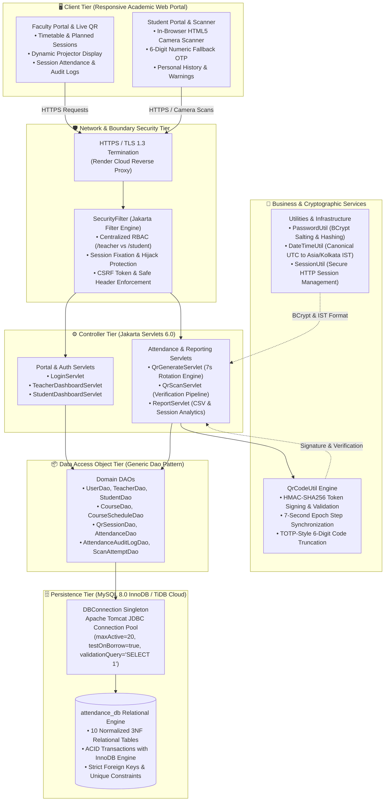
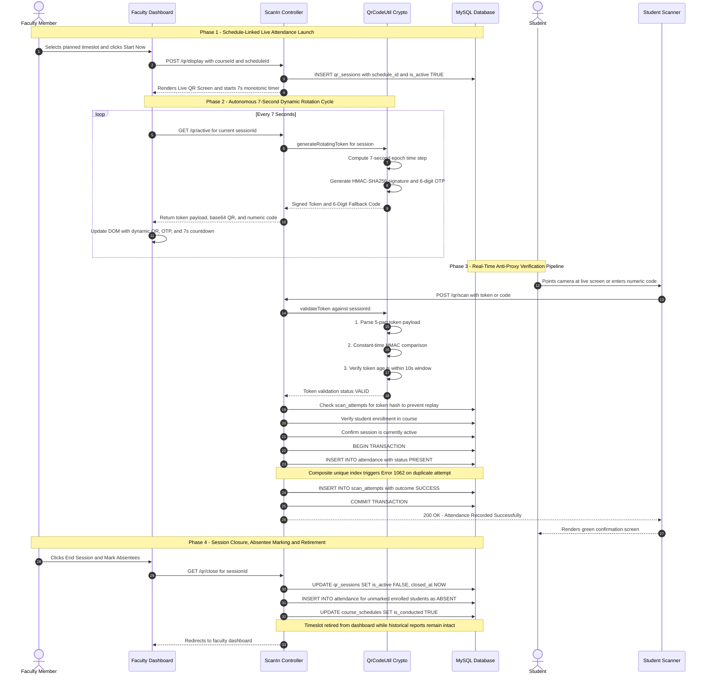

# ⚡ ScanIn — Smart Attendance Marking System
### Dynamic QR Attendance with 7-Second Cryptographic Rotation & Anti-Proxy Architecture

[](https://scanin-attendance.onrender.com/)
[](https://www.oracle.com/java/)
[](https://tomcat.apache.org/)
[](https://jakarta.ee/)
[](https://www.mysql.com/)
[](https://www.docker.com/)
[](/)

---

## 🌐 Live Production Deployment

| Detail | Value |
|---|---|
| **Production URL** | [https://scanin-attendance.onrender.com/](https://scanin-attendance.onrender.com/) |
| **Hosting Platform** | Render Web Service (Dockerized Apache Tomcat 10.1 / OpenJDK 21) |
| **Database Engine** | TiDB Cloud Serverless (MySQL 8.0 Protocol Compatible, TLS/SSL Encrypted) |
| **QR Rotation** | **7 seconds** (10-second validity window with 3-second transmission leeway) |
| **Timezone Strategy** | Canonical UTC Storage (`+00:00`) with Indian Standard Time (IST, UTC+05:30) presentation via `DateTimeUtil` |
| **Self-Healing Schema** | Auto-migrations on container startup via [`AppContextListener`](src/main/java/com/attendance/listener/AppContextListener.java) |
| **Test Coverage** | 85 / 85 automated tests — 100% PASS |

---

## 📋 Executive Overview

**ScanIn** is an academic attendance management system built in **Java 21 LTS**, **Jakarta Servlet 6.0**, and **MySQL 8.0 / TiDB Cloud**, containerized with **Docker** and deployed on **Apache Tomcat 10.1**.

The system prevents proxy attendance and screenshot reuse through:

1. **7-Second Dynamic HMAC-SHA256 QR Tokens** — Cryptographically signed tokens rotate continuously every 7 seconds. Tokens expire strictly after 10 seconds (7-second display + 3-second transmission leeway).
2. **6-Digit Session-Bound Numeric Fallback Code** — A TOTP-style OTP derived from dynamic HMAC truncation, rotating every 7 seconds alongside the QR code, for students without camera access.
3. **Throttled Camera Scanner & Anti-Flicker Protection** — Client-side scanner pauses during token submission and enforces a 2.5-second cooling-off period on invalid scan attempts.
4. **Database-Backed Rate Limiting** — MySQL `scan_attempts` table blocks accounts after ≥ 5 failed scans within 60 seconds, persisting across server restarts.
5. **ACID Concurrency Safety** — `UNIQUE KEY (student_id, qr_session_id)` prevents race-condition double-marking; rollbacks happen automatically on duplicate key error (code 1062).
6. **Append-Only Audit Trail** — Manual status overrides (OD, EXCUSED, LATE, PRESENT, ABSENT) are permanently logged with actor, timestamp, and mandatory justification text.
7. **Centralized Server-Side RBAC** — `SecurityFilter` enforces role boundaries; students receive HTTP 403 Forbidden on any faculty resource.
8. **Planned Lecture Schedules & Live QR Binding** — Faculty can define weekly course timeslots and launch scheduled QR attendance with one click ("Start Now"); completed sessions automatically retire from active planned lists while preserving historical report labels.
9. **Session-Wise Attendance Analytics** — Faculty reports allow consolidated course-level review as well as granular, single-session inspection (`#SES-XXXXX`) with responsive search and timeslot badge metadata.
10. **IST Presentation Standardization** — Centralized `DateTimeUtil` converts canonical server UTC timestamps to Indian Standard Time (`Asia/Kolkata`, UTC+05:30) across faculty reports, student history, and CSV exports.

---

## 🏛️ System Architecture & Engineering Blueprint

ScanIn implements a resilient, multi-tiered enterprise architecture separating presentation, security boundary enforcement, application controllers, cryptographic services, and connection-pooled relational storage.



---

## 🔄 End-to-End System Flow Diagram

The diagram below details the complete lifecycle from schedule creation and dynamic rotating QR generation to multi-step anti-proxy token verification, ACID attendance persistence, and automated session closure.



---

## 🏛️ Object-Oriented Architecture

```
com.attendance
├── model/          User (abstract), Teacher, Student, Course, QrSession, Attendance, ...
├── dao/            Dao<T> interface + implementations (UserDao, QrSessionDao, AttendanceDao, ...)
├── servlet/        LoginServlet, QrGenerateServlet, QrScanServlet, ReportServlet, ...
├── filter/         SecurityFilter (RBAC enforcement)
├── listener/       AppContextListener (startup migrations)
└── util/           DBConnection, QrCodeUtil, PasswordUtil, SessionUtil
```

### OOP Principles to Code Mapping

| Principle | Concrete Implementation | File |
|---|---|---|
| **Abstraction** | `User` abstract class hides role-routing via `getDashboardPath()` and `getRoleInfo()` template methods | [`User.java`](src/main/java/com/attendance/model/User.java) |
| **Inheritance** | `Teacher` and `Student` extend `User`, inheriting identity fields while adding domain fields (`employeeId`, `rollNumber`, `semester`) | [`Teacher.java`](src/main/java/com/attendance/model/Teacher.java), [`Student.java`](src/main/java/com/attendance/model/Student.java) |
| **Polymorphism** | `user.getDashboardPath()` dynamically dispatches to the correct dashboard at runtime; `Attendable.canMarkAttendance()` contract on `Student` | [`LoginServlet.java`](src/main/java/com/attendance/servlet/LoginServlet.java) |
| **Encapsulation** | All model fields are `private`, exposed only through validated getters/setters; password hashes and HMAC secrets never leak | Model package |
| **Interface (Abstraction Contract)** | Generic `Dao<T>` interface (`findById`, `findAll`, `save`, `update`, `delete`) applied by all DAO classes; `Attendable` interface for scanner contract | [`Dao.java`](src/main/java/com/attendance/dao/Dao.java), [`Attendable.java`](src/main/java/com/attendance/model/Attendable.java) |
| **Singleton** | `DBConnection.getInstance()` manages the single connection pool instance for the JVM lifetime | [`DBConnection.java`](src/main/java/com/attendance/util/DBConnection.java) |
| **Centralized Utility** | `DateTimeUtil` encapsulates UTC canonical conversion to Indian Standard Time (`Asia/Kolkata`) | [`DateTimeUtil.java`](src/main/java/com/attendance/util/DateTimeUtil.java) |

---

## 🗄️ Relational Database Schema

The database `attendance_db` uses **MySQL 8.0 InnoDB** with strict foreign key constraints, composite unique indices, and connection pooling via Apache Tomcat JDBC Pool (`maxActive=20`, `testOnBorrow=true`).

```
users ──────┬──── teachers ──── courses ──┬──── enrollments ──── students
            │                             │
            └──── students ───────────────┼──── course_schedules 
                                          │         │ (schedule_id)
                              qr_sessions ┴─────────┘
                                          ├──── attendance ──── attendance_audit_log
                                          └──── scan_attempts
```

| Table | Purpose | Key Constraints |
|---|---|---|
| `users` | Base identity for all actors | `UNIQUE(email)`, BCrypt password |
| `teachers` | Faculty profile extending `users` | `UNIQUE(user_id)`, `UNIQUE(employee_id)` |
| `students` | Student profile extending `users` | `UNIQUE(user_id)`, `UNIQUE(roll_number)` |
| `courses` | Course catalogue | `UNIQUE(course_code)`, FK → `teachers` |
| `enrollments` | Student ↔ Course membership | `UNIQUE(student_id, course_id)` |
| `course_schedules` | Planned semester lecture timetable | FK → `courses(id)`, `is_conducted` flag |
| `qr_sessions` | Active attendance session per class | `UNIQUE(session_token)`, FK → `course_schedules(id)`, `is_active` |
| `attendance` | Per-student per-session record | `UNIQUE(student_id, qr_session_id)` |
| `attendance_audit_log` | Immutable override audit trail | Append-only (INSERT + SELECT only) |
| `scan_attempts` | Fraud evidence & rate-limiting | Indexed on `(student_id, session_id)` |

---

## 🔒 Security Architecture

### HMAC-SHA256 Token Lifecycle

```
Server generates token every 7 seconds:
  payload  = sessionId:courseId:timestampMs:nonce
  token    = sessionId.courseId.timestampMs.nonce.HMAC-SHA256(payload)

Student scans → Server verifies:
  1. Parse token (5 parts) — reject malformed
  2. Recompute HMAC — constant-time comparison — reject tampered
  3. Check age ≤ 10 000 ms — reject EXPIRED
  4. Lookup token_hash in scan_attempts — reject REPLAYED
  5. Verify student enrolled in course — reject WRONG_COURSE
  6. Check session is_active — reject CLOSED_SESSION
  7. INSERT attendance in transaction — catch duplicate key → DUPLICATE
  8. Record outcome in scan_attempts (SHA-256 hash only, never raw token)
```

### Rate Limiting
- After **5 failed scans** within any **60-second sliding window** for the same `student_id`, subsequent requests return `RATE_LIMITED` without processing.
- Counters persist in MySQL — survive server restarts.

### RBAC via `SecurityFilter`
| Route Pattern | Allowed Roles | Violation Response |
|---|---|---|
| `/teacher/*`, `/qr/generate`, `/reports` | `TEACHER`, `ADMIN` | **HTTP 403 Forbidden** |
| `/student/*`, `/qr/scan` | `STUDENT` | **HTTP 403 Forbidden** |
| `/admin/*` | `ADMIN` | **HTTP 403 Forbidden** |
| `/login`, `/logout`, static assets | Public | Allowed |

---

## 📊 Attendance Percentage Formula

Applied uniformly across all dashboards, reports, and database queries:

$$\text{Attendance \%} = \frac{\text{PRESENT} + \text{LATE} + \text{OD}}{\text{Total Sessions} - \text{EXCUSED}} \times 100$$

- **OD (On-Duty):** Counts as attended (numerator).
- **EXCUSED (Medical/Formal Leave):** Deducted from total sessions (denominator relief).
- **Compliance Threshold:** 75.0% minimum. Badges alert students below threshold.

---

## 🚀 Deployment

### Option A: Cloud (Render + TiDB Cloud)
Render auto-deploys on every push to `main` using [`Dockerfile`](Dockerfile) and [`render.yaml`](render.yaml).

**Required environment variables on Render dashboard:**
| Variable | Description |
|---|---|
| `DB_URL` | `jdbc:mysql://<host>:4000/attendance_db?sslMode=VERIFY_IDENTITY` |
| `DB_USER` | TiDB database username |
| `DB_PASSWORD` | TiDB database password |

```
git push origin main   # triggers automatic Render build & deploy
```

**Live:** [https://scanin-attendance.onrender.com/](https://scanin-attendance.onrender.com/)

### Option B: Local (Windows)
**Prerequisites:** Java 21 on `PATH`, MySQL 8.0 on `localhost:3306` with `root/root`.

```bat
.\build.bat
.\run.bat
```
App launches at: **[http://localhost:8080/attendance/login](http://localhost:8080/attendance/login)**

---

## 🔑 Demo Credentials

| Role | Name | Email | Password |
|---|---|---|---|
| Faculty | Prof. Ramesh Kumar | `teacher@attendance.com` | `teacher123` |
| Faculty | Prof. Sunita Sharma | `sunita@attendance.com` | `teacher123` |
| Student | Aarav Singh | `aarav@student.com` | `student123` |
| Student | Priya Sharma | `priya@student.com` | `student123` |
| Student | Rahul Verma | `rahul@student.com` | `student123` |

> The login page includes one-click credential autofill buttons for quick demonstration.

---

## ⏱️ Evaluator Demo Script (5 Minutes)

### Phase 1 — Authentication & Role Isolation (1 min)
1. Open [https://scanin-attendance.onrender.com/login](https://scanin-attendance.onrender.com/login), autofill **Teacher**, sign in.
2. Open an Incognito window, sign in as `aarav@student.com`.
3. In the student window, attempt `/attendance/reports` or `/attendance/teacher/dashboard`.
4. **Show evaluators:** Immediate **HTTP 403 Forbidden** from `SecurityFilter`.

### Phase 2 — Dynamic QR & Anti-Proxy (2 min)
1. Faculty: Click **📱 Launch Live QR Session** for CS501.
2. Watch the 7-second countdown and QR code + 6-digit fallback code regenerate together.
3. Student: Scan the QR code or type the numeric fallback code.
4. **Show:** Student receives *"Attendance successfully marked PRESENT!"* and faculty counter increments live.
5. Submit the same code again → *"Already marked"* (duplicate rejection).
6. Submit expired/random codes rapidly → *"Rapid guessing blocked"* (rate limiting).

### Phase 3 — Audit Trail & Manual Overrides (2 min)
1. Faculty: Click **⏹ End Session & Mark Absentees** — all unmarked students auto-marked ABSENT atomically.
2. Navigate to **📊 Reports & Audit Trail** → click **✏️ Edit Status**.
3. Change a student's status to `OD`, enter reason → Save.
4. Scroll to **🛡️ Immutable Attendance Audit History** — show timestamp, actor, transition, reason.
5. Click **📥 Download CSV Report** for export.
6. Switch to Student Dashboard to show updated attendance percentage.

---

## 🧪 Automated Test Evidence

| Suite | Coverage | Tests | Result |
|---|---|---|---|
| `Stage2VerificationTest` | Connection pooling, BCrypt, schema constraints, concurrency rollback | 7 | ✅ PASS |
| `Stage3VerificationTest` | Authentication, legacy migration, RBAC 403 | 7 | ✅ PASS |
| `Stage4VerificationTest` | Student records, enrollment, timetable, low-attendance warning | 7 | ✅ PASS |
| `Stage5VerificationTest` | Faculty CRUD, cross-faculty blocking, roster auth | 7 | ✅ PASS |
| `Stage6VerificationTest` | 7s HMAC rotation, expired/replay/duplicate rejection, concurrent scans | 11 | ✅ PASS |
| `Stage7VerificationTest` | Session reopen/reclose, manual overrides, audit trail, CSV export | 8 | ✅ PASS |
| `Stage8VerificationTest` | 6-digit fallback, rate limiting, formula uniformity | 5 | ✅ PASS |
| `ClassMeetingAttendanceVerificationTest` | Persistent meetings, UTC timezone, reporting invariance | 10 | ✅ PASS |
| `QrTimingVerificationTest` | 7s rotation, 10s validity, monotonic sync, security regressions | 23 | ✅ PASS |
| **Total** | **All layers** | **85 / 85** | **✅ 100%** |

---

## ⚠️ Known Limitations

1. **Live screen relay:** Short-lived 7-second tokens prevent screenshot reuse, but cannot block live video streaming of the teacher's screen by an in-class student.
2. **Physical device sharing:** No biometric binding or geofencing; a present student could use their device to mark an absent peer logged into the same device.
3. **Database-level immutability:** The audit log is append-only at the application layer, but MySQL administrators with direct access retain raw DML rights unless table privileges are restricted.
4. **Rate limiting scope:** Rate limiting is per `student_id`. Client-IP limiting is intentionally omitted for student privacy.

---

## 📂 Documentation

| File | Contents |
|---|---|
| [`docs/java.md`](docs/java.md) | Java concepts & implementation — OOP, Servlets, JDBC, filters, generics, cryptography |
| [`docs/dbms.md`](docs/dbms.md) | DBMS concepts & implementation — schema design, normalization, SQL, transactions, indexing |

---

## 👥 Authors & Academic Context

- **Project:** ScanIn Smart Attendance Marking System
- **Stack:** OpenJDK 21 LTS, Apache Tomcat 10.1, Jakarta Servlet 6.0, MySQL 8.0, Docker, TiDB Cloud
- **Course:** Object-Oriented Programming & Database Management Systems Project
