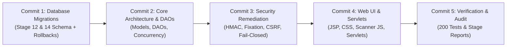

# ScanIn — Stage 17: Final Git Audit, Change Classification & Commit Preparation Report

**Date:** 2026-11-01  
**Project Root:** `C:\java_dbms_project`  
**Git Branch:** `main`  
**Git HEAD:** `9b59559e0ef5c5a5e3e29be1eaf131fad8442d0b`  
**Expected HEAD:** `9b59559e0ef5c5a5e3e29be1eaf131fad8442d0b` (MATCHED)  
**Overall Verdict:** **`PASS — Repository audited and ready for commit review`**

---

## 1. Git Baseline Inventory

A complete, non-destructive audit of the Git working tree was performed. The repository baseline matches the expected Git HEAD with zero staged changes, zero deletions, and zero renames.

- **Current Branch:** `main`
- **Current HEAD SHA:** `9b59559e0ef5c5a5e3e29be1eaf131fad8442d0b`
- **Staged Changes Count:** `0`
- **Deleted Files Count:** `0`
- **Renamed Files Count:** `0`
- **Total Tracked Modified Files:** `26`
- **Total Untracked Entries:** `26`

---

## 2. Complete Tracked Modified Files List (26 Files)

| # | File Path | Functional Scope |
|---|---|---|
| 1 | `PROJECT_PROGRESS.md` | Living progress tracker and stage evidence reports |
| 2 | `dist/attendance.war` | Packaged binary archive (Stage 13-X1 build: 3,225,858 bytes) |
| 3 | `src/main/java/com/attendance/dao/AttendanceDao.java` | ACID transaction `recordPlannedAttendanceTransaction`, FOR UPDATE locking |
| 4 | `src/main/java/com/attendance/dao/CourseDao.java` | Course retrieval queries and teacher course association |
| 5 | `src/main/java/com/attendance/dao/CourseScheduleDao.java` | Timetable schedule query null safety |
| 6 | `src/main/java/com/attendance/dao/QrSessionDao.java` | Planned session QR lookup, session closing, monotonic timestamps |
| 7 | `src/main/java/com/attendance/dao/StudentDao.java` | Student profile lookup null safety |
| 8 | `src/main/java/com/attendance/dao/UserDao.java` | Removed SQL disclosure `lastSqlError`; added safe boolean flag |
| 9 | `src/main/java/com/attendance/listener/AppContextListener.java` | Session timeout listener, dynamic cookie flags, startup self-healing |
| 10 | `src/main/java/com/attendance/model/QrSession.java` | Added `plannedSessionId` field, getter, and setter |
| 11 | `src/main/java/com/attendance/servlet/LoginServlet.java` | Sanitized login errors; pending token redirect for scanned links |
| 12 | `src/main/java/com/attendance/servlet/QrGenerateServlet.java` | 7s dynamic QR rotation, planned session activation, numeric TOTP fallback |
| 13 | `src/main/java/com/attendance/servlet/QrScanServlet.java` | Constant-time CSRF validation, scanner execution, error sanitization |
| 14 | `src/main/java/com/attendance/servlet/StudentDashboardServlet.java` | Student timetable data delivery, course enrollment integration |
| 15 | `src/main/java/com/attendance/servlet/TeacherDashboardServlet.java` | Planned session management, roster modal endpoints, soft-drop filtering |
| 16 | `src/main/java/com/attendance/util/DBConnection.java` | Fail-closed DB connection; removed hardcoded `root`/`root` defaults |
| 17 | `src/main/java/com/attendance/util/QrCodeUtil.java` | Enforced HMAC secret entropy ($H \ge 2.5$), length $\ge 32$, fallback TOTP |
| 18 | `src/main/java/com/attendance/util/SessionUtil.java` | Session fixation rotation (`changeSessionId`), session-bound CSRF |
| 19 | `src/main/webapp/WEB-INF/views/qr-display.jsp` | Projector display with dynamic SVG QR, 7s countdown, 6-digit fallback |
| 20 | `src/main/webapp/WEB-INF/views/qr-scan.jsp` | Scanner viewfinder, camera selector, manual 6-digit fallback, CSRF meta |
| 21 | `src/main/webapp/WEB-INF/views/student-dashboard.jsp` | Daily timetable table, enrolled courses, attendance metrics |
| 22 | `src/main/webapp/WEB-INF/views/teacher-dashboard.jsp` | Planned session cards, roster modal markup, activation controls |
| 23 | `src/main/webapp/WEB-INF/web.xml` | Reduced session timeout to 30 min, `<tracking-mode>COOKIE</tracking-mode>` |
| 24 | `src/main/webapp/css/style.css` | Styles for timetable, planned cards, roster modal, scanner viewfinder |
| 25 | `src/main/webapp/js/qr-scanner.js` | Client-side scanner, ZXing integration, CSRF header attachment |
| 26 | `tomcat/webapps/attendance.war` | Packaged binary archive (Stage 13-X1 build: 3,225,858 bytes) |

---

## 3. Complete Untracked Files List (26 Entries)

| # | File / Directory Path | Category | Description |
|---|---|---|---|
| 1 | `Stage14_Security_Remediation_Report.md` | Documentation | Stage 14 security remediation evidence report |
| 2 | `Stage15_Build_And_Release_Verification_Report.md` | Documentation | Stage 15 packaging and bytecode audit report |
| 3 | `Stage16_Controlled_Deployment_And_HTTP_Verification_Report.md` | Documentation | Stage 16 deployment and HTTP/CDP smoke report |
| 4 | `build/` | Generated Artifact | Staging directory (`build/staging-war/`) used for packaging |
| 5 | `database/migration_stage12_planned_sessions.sql` | Database Files | Stage 12 additive schema migration (planned sessions) |
| 6 | `database/migration_stage14_historical_enrollments.sql` | Database Files | Stage 14 additive schema migration (soft-drop enrollment) |
| 7 | `database/rollback_stage12_planned_sessions.sql` | Database Files | Stage 12 rollback script |
| 8 | `database/rollback_stage14_historical_enrollments.sql` | Database Files | Stage 14 rollback script |
| 9 | `dist/attendance-stage15-candidate.war` | Generated Artifact | Verified Stage 15 candidate WAR (3,061,197 bytes) |
| 10 | `dist/backups/` | Generated Artifact | Pre-Stage 15 WAR backups (dist and tomcat copies) |
| 11 | `src/main/java/com/attendance/dao/PlannedSessionDao.java` | Application Source | DAO for planned sessions, status lifecycle, idempotent closure |
| 12 | `src/main/java/com/attendance/model/PlannedSession.java` | Application Source | Domain model for planned session entities |
| 13 | `src/main/java/com/attendance/model/SessionRosterItem.java` | Application Source | Domain model for session attendance roster items |
| 14 | `src/main/java/com/attendance/model/SessionRosterMetrics.java` | Application Source | Aggregation model for session attendance metrics |
| 15 | `src/main/webapp/js/session-roster.js` | Frontend | Client script for faculty session roster modal and keyboard accessibility |
| 16 | `src/test/java/com/attendance/Stage12LifecycleVerificationTest.java` | Tests | Unit test suite for planned session lifecycle transitions (10 tests) |
| 17 | `src/test/java/com/attendance/Stage13BackendContractTest.java` | Tests | Unit test suite for backend DAO contracts (23 tests) |
| 18 | `src/test/java/com/attendance/Stage13PhaseC2ContractTest.java` | Tests | Unit test suite for Phase C2 faculty UI contracts (19 tests) |
| 19 | `src/test/java/com/attendance/Stage13PhaseC3ContractTest.java` | Tests | Unit test suite for Phase C3 student timetable contracts (18 tests) |
| 20 | `src/test/java/com/attendance/Stage13PhaseC43Test.java` | Tests | Unit test suite for Phase C4.3 roster metrics (37 tests) |
| 21 | `src/test/java/com/attendance/Stage13PhaseC44FrontendContractTest.java` | Tests | Unit test suite for Phase C4.4 frontend contracts (27 tests) |
| 22 | `src/test/java/com/attendance/Stage13PhaseC46Test.java` | Tests | Unit test suite for Phase C4.6 ACID transaction concurrency (16 tests) |
| 23 | `src/test/java/com/attendance/Stage13PhaseC4Test.java` | Tests | Unit test suite for Phase C4 roster functionality (25 tests) |
| 24 | `src/test/java/com/attendance/Stage14SecurityRemediationTest.java` | Tests | Unit test suite for Stage 14 security remediations (15 tests) |
| 25 | `src/test/java/com/attendance/Stage15ReleaseVerificationTest.java` | Tests | Unit test suite for Stage 15 packaging and hygiene (10 tests) |
| 26 | `tomcat/webapps/attendance.war.bak_20261101_175124` | Generated Artifact | Local backup of original tomcat WAR |

---

## 4. Comprehensive File Classification

### A. Application Source
- [`src/main/java/com/attendance/dao/AttendanceDao.java`](src/main/java/com/attendance/dao/AttendanceDao.java)
- [`src/main/java/com/attendance/dao/CourseDao.java`](src/main/java/com/attendance/dao/CourseDao.java)
- [`src/main/java/com/attendance/dao/CourseScheduleDao.java`](src/main/java/com/attendance/dao/CourseScheduleDao.java)
- [`src/main/java/com/attendance/dao/PlannedSessionDao.java`](src/main/java/com/attendance/dao/PlannedSessionDao.java)
- [`src/main/java/com/attendance/dao/QrSessionDao.java`](src/main/java/com/attendance/dao/QrSessionDao.java)
- [`src/main/java/com/attendance/dao/StudentDao.java`](src/main/java/com/attendance/dao/StudentDao.java)
- [`src/main/java/com/attendance/dao/UserDao.java`](src/main/java/com/attendance/dao/UserDao.java)
- [`src/main/java/com/attendance/listener/AppContextListener.java`](src/main/java/com/attendance/listener/AppContextListener.java)
- [`src/main/java/com/attendance/model/PlannedSession.java`](src/main/java/com/attendance/model/PlannedSession.java)
- [`src/main/java/com/attendance/model/QrSession.java`](src/main/java/com/attendance/model/QrSession.java)
- [`src/main/java/com/attendance/model/SessionRosterItem.java`](src/main/java/com/attendance/model/SessionRosterItem.java)
- [`src/main/java/com/attendance/model/SessionRosterMetrics.java`](src/main/java/com/attendance/model/SessionRosterMetrics.java)
- [`src/main/java/com/attendance/servlet/LoginServlet.java`](src/main/java/com/attendance/servlet/LoginServlet.java)
- [`src/main/java/com/attendance/servlet/QrGenerateServlet.java`](src/main/java/com/attendance/servlet/QrGenerateServlet.java)
- [`src/main/java/com/attendance/servlet/QrScanServlet.java`](src/main/java/com/attendance/servlet/QrScanServlet.java)
- [`src/main/java/com/attendance/servlet/StudentDashboardServlet.java`](src/main/java/com/attendance/servlet/StudentDashboardServlet.java)
- [`src/main/java/com/attendance/servlet/TeacherDashboardServlet.java`](src/main/java/com/attendance/servlet/TeacherDashboardServlet.java)
- [`src/main/java/com/attendance/util/DBConnection.java`](src/main/java/com/attendance/util/DBConnection.java)
- [`src/main/java/com/attendance/util/QrCodeUtil.java`](src/main/java/com/attendance/util/QrCodeUtil.java)
- [`src/main/java/com/attendance/util/SessionUtil.java`](src/main/java/com/attendance/util/SessionUtil.java)

### B. Database Files
- [`database/migration_stage12_planned_sessions.sql`](database/migration_stage12_planned_sessions.sql)
- [`database/migration_stage14_historical_enrollments.sql`](database/migration_stage14_historical_enrollments.sql)
- [`database/rollback_stage12_planned_sessions.sql`](database/rollback_stage12_planned_sessions.sql)
- [`database/rollback_stage14_historical_enrollments.sql`](database/rollback_stage14_historical_enrollments.sql)

### C. Automated Verification Tests (200 Tests Total)
- [`src/test/java/com/attendance/Stage12LifecycleVerificationTest.java`](src/test/java/com/attendance/Stage12LifecycleVerificationTest.java)
- [`src/test/java/com/attendance/Stage13BackendContractTest.java`](src/test/java/com/attendance/Stage13BackendContractTest.java)
- [`src/test/java/com/attendance/Stage13PhaseC2ContractTest.java`](src/test/java/com/attendance/Stage13PhaseC2ContractTest.java)
- [`src/test/java/com/attendance/Stage13PhaseC3ContractTest.java`](src/test/java/com/attendance/Stage13PhaseC3ContractTest.java)
- [`src/test/java/com/attendance/Stage13PhaseC4Test.java`](src/test/java/com/attendance/Stage13PhaseC4Test.java)
- [`src/test/java/com/attendance/Stage13PhaseC43Test.java`](src/test/java/com/attendance/Stage13PhaseC43Test.java)
- [`src/test/java/com/attendance/Stage13PhaseC44FrontendContractTest.java`](src/test/java/com/attendance/Stage13PhaseC44FrontendContractTest.java)
- [`src/test/java/com/attendance/Stage13PhaseC46Test.java`](src/test/java/com/attendance/Stage13PhaseC46Test.java)
- [`src/test/java/com/attendance/Stage14SecurityRemediationTest.java`](src/test/java/com/attendance/Stage14SecurityRemediationTest.java)
- [`src/test/java/com/attendance/Stage15ReleaseVerificationTest.java`](src/test/java/com/attendance/Stage15ReleaseVerificationTest.java)

### D. Frontend (JSP, CSS, JavaScript & Descriptors)
- [`src/main/webapp/WEB-INF/views/qr-display.jsp`](src/main/webapp/WEB-INF/views/qr-display.jsp)
- [`src/main/webapp/WEB-INF/views/qr-scan.jsp`](src/main/webapp/WEB-INF/views/qr-scan.jsp)
- [`src/main/webapp/WEB-INF/views/student-dashboard.jsp`](src/main/webapp/WEB-INF/views/student-dashboard.jsp)
- [`src/main/webapp/WEB-INF/views/teacher-dashboard.jsp`](src/main/webapp/WEB-INF/views/teacher-dashboard.jsp)
- [`src/main/webapp/WEB-INF/web.xml`](src/main/webapp/WEB-INF/web.xml)
- [`src/main/webapp/css/style.css`](src/main/webapp/css/style.css)
- [`src/main/webapp/js/qr-scanner.js`](src/main/webapp/js/qr-scanner.js)
- [`src/main/webapp/js/session-roster.js`](src/main/webapp/js/session-roster.js)

### E. Documentation
- [`PROJECT_PROGRESS.md`](PROJECT_PROGRESS.md)
- [`Stage14_Security_Remediation_Report.md`](Stage14_Security_Remediation_Report.md)
- [`Stage15_Build_And_Release_Verification_Report.md`](Stage15_Build_And_Release_Verification_Report.md)
- [`Stage16_Controlled_Deployment_And_HTTP_Verification_Report.md`](Stage16_Controlled_Deployment_And_HTTP_Verification_Report.md)

### F. Generated Artifacts & Backups (Local Only)
- `build/staging-war/` (Temporary staging exploded webapp)
- `dist/attendance-stage15-candidate.war` (Release candidate WAR archive)
- `dist/backups/attendance-dist-pre-stage15-20261101_1950.war` (Pre-build dist backup)
- `dist/backups/attendance-tomcat-pre-stage15-20261101_1950.war` (Pre-build tomcat backup)
- `tomcat/webapps/attendance.war.bak_20261101_175124` (Pre-deployment tomcat backup)
- `dist/attendance.war` & `tomcat/webapps/attendance.war` (Binary WAR files tracked in repository)

### G. Sensitive or Local-Only Files
- `scratch/.attendance_test_env` (Resides in user appData directory, **completely external to git workspace**)
- Zero `.env`, `.properties`, or credential files exist inside `C:\java_dbms_project`.

---

## 5. Security Audit Before Committing

A comprehensive scan was conducted across all modified tracked files, untracked files, and candidate archive entries:

1. **Exposed Passwords & Credentials:**
   - Zero production or test database passwords exist in source code, SQL migrations, or markdown documentation.
   - All references to rotated passwords in test reports are explicitly redacted (`IDENTIFIED BY '...'`).
   - Legacy hardcoded credentials in `DBConnection.java` (`DEFAULT_USER = "root"`, `DEFAULT_PASSWORD = "root"`) have been **completely eliminated**.
2. **HMAC Secrets:**
   - `QrCodeUtil.java` does **not** contain any hardcoded HMAC secret. It requires runtime environment variables (`QR_HMAC_SECRET` or `HMAC_SECRET`) and fails closed with an `IllegalStateException` if missing or under-entropy.
   - Test suites use synthetic ephemeral test keys (`"A_Strong_Cryptographically_Secure_Secret_Key_32+Chars!"`) that are cleared in `finally` blocks.
3. **Environment Configuration Files:**
   - `scratch/.attendance_test_env` is **not tracked** in Git (stored in appData scratch space).
   - Zero `.env` files are tracked or present in the working tree.
4. **Candidate Archive Hygiene:**
   - `dist/attendance-stage15-candidate.war` was inspected entry-by-entry.
   - Zero `.class` test files, zero secret files, and zero configuration environment files were packaged into the candidate archive.
5. **SQL Error Leakage:**
   - Verified removal of `UserDao.lastSqlError` and replaced with generic user-facing error messages in `LoginServlet.java`.

---

## 6. Review of Git Diffs

### Tracked File Review
1. **`DBConnection.java`:** Removed hardcoded defaults (`root`/`root`/`attendance_db`). Added strict fail-closed validation for `DB_URL`, `DB_USER`, and `DB_PASSWORD`. Added `resetInstanceForTesting()`. No hardcoded credentials. Belongs to Stage 14.
2. **`QrCodeUtil.java`:** Replaced hardcoded default HMAC secret with dynamic environment resolution. Added Shannon entropy threshold ($H \ge 2.5$), length verification ($\ge 32$ chars), diversity check ($\ge 10$ unique bytes), and 6-digit numeric fallback derivation. No temporary code. Belongs to Stage 14.
3. **`SessionUtil.java`:** Added `request.changeSessionId()` defense against session fixation. Added session-bound CSRF token generation and constant-time validation (`MessageDigest.isEqual`). Added `escapeHtmlAttribute()` for XSS prevention. Belongs to Stage 14.
4. **`UserDao.java` & `LoginServlet.java`:** Replaced public mutable `lastSqlError` string disclosure with safe boolean flag and generic user-facing message. Added safe redirect for scanned QR tokens. Belongs to Stage 14.
5. **`AppContextListener.java` & `web.xml`:** Added `HttpSessionListener` with 30-minute default session timeout, dynamic cookie security (`HttpOnly=true`, configurable `Secure`), and self-healing migrations for `enrollments.status` and `enrollments.dropped_at`. Belongs to Stage 14.
6. **`AttendanceDao.java`:** Added concurrency-hardened `recordPlannedAttendanceTransaction` with row-level locks (`FOR UPDATE`), active enrollment checks, and soft-drop status filtering. Belongs to Stage 13-C4.6 and Stage 14.
7. **`QrGenerateServlet.java`, `QrScanServlet.java`, `TeacherDashboardServlet.java`, `StudentDashboardServlet.java`:** Handled planned session lifecycle, dynamic 7s QR rotation, scanner validation, timetable integration, and faculty roster endpoints. Belongs to Stage 13.
8. **Views (`*.jsp`), `style.css`, `qr-scanner.js`:** User interface implementation for planned sessions, projector display, responsive timetables, roster modal, and scanner viewfinder. Belongs to Stage 13.
9. **`PROJECT_PROGRESS.md`:** Stage-by-stage evidence documentation updated through Stage 16. Belongs to release audit tracking.

---

## 7. WAR and Backup Handling

- **Candidate Release Archive:**
  - Path: `dist/attendance-stage15-candidate.war`
  - Size: 3,061,197 bytes
  - SHA-256: `3637897BA009A476F1C793B5A3406F08CC6390AD2F5EF7990BB63BEE885B922B`
  - Recommendation: **Retain locally as the verified release candidate.**
- **Existing Tracked WARs:**
  - `dist/attendance.war` (3,225,858 bytes, SHA-256 `C80AC9FB...`)
  - `tomcat/webapps/attendance.war` (3,225,858 bytes, SHA-256 `C80AC9FB...`)
  - Note: These WARs reflect the Stage 13-X1 build. In standard Git practices, compiled binary WAR files should not be checked into source control. They should either be excluded or managed via release tags/releases.
- **Local Backups (Must Not Be Committed):**
  - `dist/backups/attendance-dist-pre-stage15-20261101_1950.war`
  - `dist/backups/attendance-tomcat-pre-stage15-20261101_1950.war`
  - `tomcat/webapps/attendance.war.bak_20261101_175124`
  - `build/staging-war/`

---

## 8. Recommended `.gitignore` Updates

To prevent future staging of build artifacts, backups, or candidate WARs, the following rules are recommended for `.gitignore` (not modified during this stage):

```gitignore
# Build output and staging
build/
dist/*-candidate.war
dist/backups/

# Local backup files
*.bak*

# Environment and secrets
*.env
.attendance_test_env
```

---

## 9. Project Documentation Completeness Check

| Documentation Item | Present | File Reference / Assessment |
|---|---|---|
| **README.md** | ✅ YES | Comprehensive project overview, badges, architecture diagrams, Render live links |
| **PROJECT_PROGRESS.md** | ✅ YES | Living audit log containing complete evidence through Stage 16 |
| **Database Setup Instructions** | ✅ YES | Documented in `README.md` and `database/schema.sql` |
| **Migration Instructions** | ✅ YES | Individual migration scripts present in `database/` |
| **Application Configuration Instructions** | ✅ YES | Documented in `README.md` (environment variables `DB_URL`, `DB_USER`, `DB_PASSWORD`, `QR_HMAC_SECRET`) |
| **Build & Packaging Instructions** | ⚠️ PARTIAL | Build steps documented in Stage reports; dedicated `BUILD.md` or Ant/Maven/Gradle wrapper recommended |
| **Test Execution Instructions** | ⚠️ PARTIAL | Detailed in Stage 13/14/15 reports; standard test runner script recommended |
| **Architecture Description** | ✅ YES | Detailed in `README.md` (OOP hierarchy, session lifecycle, sequence flows) |
| **ER Diagram** | ✅ YES | Schema relationships documented in `README.md` and `schema.sql` |
| **Deployment Instructions** | ✅ YES | Render Docker deployment and local Tomcat deployment documented |
| **Known Limitations** | ✅ YES | Physical camera headless limitation documented in Stage 16 report |

---

## 10. Proposed Logical Commit Plan (5 Atomic Commits)

The proposed commit plan organizes all changes into 5 clean, logical, and self-contained commits. **Zero files were staged or committed during this stage.**



---

### Commit 1: Database Schema & Migration Scripts
**Message:** `feat(db): add Stage 12 planned sessions and Stage 14 historical enrollment migrations`  
**Files (4):**
- `database/migration_stage12_planned_sessions.sql`
- `database/migration_stage14_historical_enrollments.sql`
- `database/rollback_stage12_planned_sessions.sql`
- `database/rollback_stage14_historical_enrollments.sql`

---

### Commit 2: Core Domain Models & Data Access Objects
**Message:** `feat(backend): add planned session models, DAO lifecycle management, and ACID concurrency`  
**Files (9):**
- `src/main/java/com/attendance/model/PlannedSession.java`
- `src/main/java/com/attendance/model/QrSession.java`
- `src/main/java/com/attendance/model/SessionRosterItem.java`
- `src/main/java/com/attendance/model/SessionRosterMetrics.java`
- `src/main/java/com/attendance/dao/AttendanceDao.java`
- `src/main/java/com/attendance/dao/CourseDao.java`
- `src/main/java/com/attendance/dao/CourseScheduleDao.java`
- `src/main/java/com/attendance/dao/PlannedSessionDao.java`
- `src/main/java/com/attendance/dao/QrSessionDao.java`
- `src/main/java/com/attendance/dao/StudentDao.java`

---

### Commit 3: Security Remediation & Runtime Configuration
**Message:** `security: enforce dynamic HMAC entropy, session fixation defense, CSRF protection, and fail-closed DB`  
**Files (7):**
- `src/main/java/com/attendance/util/DBConnection.java`
- `src/main/java/com/attendance/util/QrCodeUtil.java`
- `src/main/java/com/attendance/util/SessionUtil.java`
- `src/main/java/com/attendance/dao/UserDao.java`
- `src/main/java/com/attendance/listener/AppContextListener.java`
- `src/main/java/com/attendance/servlet/LoginServlet.java`
- `src/main/webapp/WEB-INF/web.xml`

---

### Commit 4: Web Servlets, Frontend Views, Styling & Scanner Integration
**Message:** `feat(frontend): implement planned session UI, responsive timetable, roster modal, and throttled QR scanner`  
**Files (9):**
- `src/main/java/com/attendance/servlet/QrGenerateServlet.java`
- `src/main/java/com/attendance/servlet/QrScanServlet.java`
- `src/main/java/com/attendance/servlet/StudentDashboardServlet.java`
- `src/main/java/com/attendance/servlet/TeacherDashboardServlet.java`
- `src/main/webapp/WEB-INF/views/qr-display.jsp`
- `src/main/webapp/WEB-INF/views/qr-scan.jsp`
- `src/main/webapp/WEB-INF/views/student-dashboard.jsp`
- `src/main/webapp/WEB-INF/views/teacher-dashboard.jsp`
- `src/main/webapp/css/style.css`
- `src/main/webapp/js/qr-scanner.js`
- `src/main/webapp/js/session-roster.js`

---

### Commit 5: Automated Verification Test Suites & Milestone Documentation
**Message:** `test & docs: add comprehensive unit test suites (200 tests) and Stage 14-16 audit reports`  
**Files (14):**
- `src/test/java/com/attendance/Stage12LifecycleVerificationTest.java`
- `src/test/java/com/attendance/Stage13BackendContractTest.java`
- `src/test/java/com/attendance/Stage13PhaseC2ContractTest.java`
- `src/test/java/com/attendance/Stage13PhaseC3ContractTest.java`
- `src/test/java/com/attendance/Stage13PhaseC4Test.java`
- `src/test/java/com/attendance/Stage13PhaseC43Test.java`
- `src/test/java/com/attendance/Stage13PhaseC44FrontendContractTest.java`
- `src/test/java/com/attendance/Stage13PhaseC46Test.java`
- `src/test/java/com/attendance/Stage14SecurityRemediationTest.java`
- `src/test/java/com/attendance/Stage15ReleaseVerificationTest.java`
- `PROJECT_PROGRESS.md`
- `Stage14_Security_Remediation_Report.md`
- `Stage15_Build_And_Release_Verification_Report.md`
- `Stage16_Controlled_Deployment_And_HTTP_Verification_Report.md`

---

## 11. Files That Must Remain Local (Excluded from Commits)

The following files are local build outputs, backups, and candidate binaries that must **NOT** be committed to Git:
1. `build/` (and all compiled `.class` staging trees)
2. `dist/attendance-stage15-candidate.war` (local candidate artifact)
3. `dist/backups/attendance-dist-pre-stage15-20261101_1950.war`
4. `dist/backups/attendance-tomcat-pre-stage15-20261101_1950.war`
5. `tomcat/webapps/attendance.war.bak_20261101_175124`
6. `dist/attendance.war` & `tomcat/webapps/attendance.war` (existing binary WAR modifications; recommended to keep unstaged or reverted to baseline commit state)

---

## 12. Final Git Integrity Verification

A post-audit check was executed to guarantee complete read-only adherence:
- **`git status --short` Check:** Tracked modifications remain exactly at 26 files; untracked entries remain at 26 entries.
- **Git HEAD:** `9b59559e0ef5c5a5e3e29be1eaf131fad8442d0b` (Unchanged).
- **Files Staged:** `0` (Zero files staged).
- **Files Deleted / Overwritten:** `0` (Zero modifications made).
- **Commits Created:** `0` (Zero commits created).
- **WAR Checksums:**
  - `dist/attendance.war`: `C80AC9FBDAFBC326E3AADACACC720D93C105B40D460848385C0A10A608673E33` (Match)
  - `dist/attendance-stage15-candidate.war`: `3637897BA009A476F1C793B5A3406F08CC6390AD2F5EF7990BB63BEE885B922B` (Match)

---

## 13. Outstanding Issues & Recommendations

1. **WAR Version Control Strategy:** The repository currently tracks binary WAR files (`dist/attendance.war` and `tomcat/webapps/attendance.war`). It is recommended to update `.gitignore` to exclude WAR files or retain binary releases exclusively via Git tags / GitHub Releases.
2. **Dedicated Build Tooling:** Consider introducing a standard `pom.xml` (Maven) or `build.gradle` (Gradle) in a future stage to formalize dependency management and eliminate manual staging scripts.
3. **Approval Required:** The commit groupings are prepared and verified. Awaiting explicit user authorization before staging and committing.

