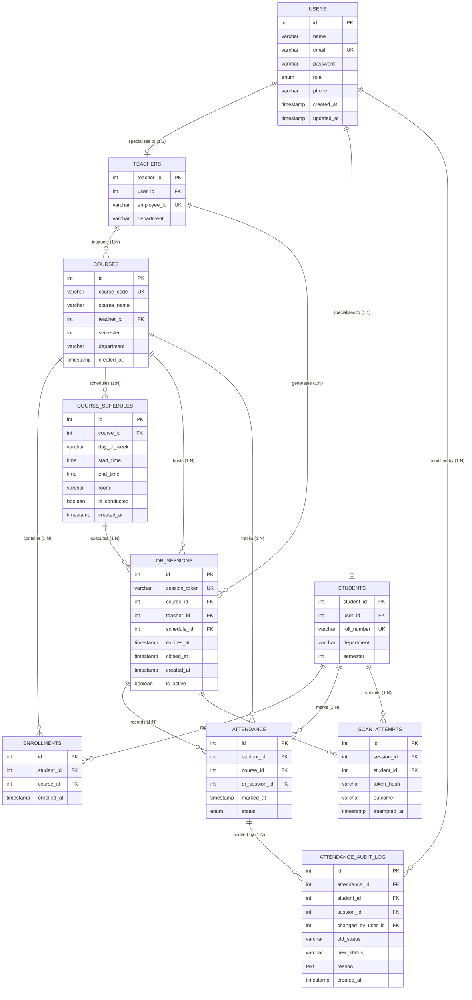

# 🗄️ Database Management Systems (DBMS) Implementation Guide — ScanIn

This comprehensive technical document provides a clean, in-depth, and well-structured explanation of the **Relational Database Management System (RDBMS) architecture**, **Entity-Relationship (ER) modeling**, **relational mapping rules**, **normalization (1NF to 3NF)**, **ACID transaction guarantees**, **indexing strategies**, **concurrency control**, and **audit telemetry** implemented across the **ScanIn Smart Attendance Marking System**.

Use this document as an authoritative technical reference for project presentations, viva defenses, architectural reviews, and developer onboarding.

---

## 📑 Table of Contents
1. [Executive Summary & Database Architecture](#1-executive-summary--database-architecture)
2. [Relational Topology & 3-Tier Functional Blueprint](#2-relational-topology--3-tier-functional-blueprint)
3. [Table Design & Data Dictionary (10 Tables)](#3-table-design--data-dictionary-10-tables)
4. [Entity-Relationship (ER) Model & Visual ER Diagram](#4-entity-relationship-er-model--visual-er-diagram)
   - 4.1 [Mermaid ER Diagram](#41-mermaid-er-diagram)
   - 4.2 [Cardinality Analysis & Relational Mapping Rules](#42-cardinality-analysis--relational-mapping-rules)
5. [Database Normalization Deep-Dive (1NF, 2NF, 3NF)](#5-database-normalization-deep-dive-1nf-2nf-3nf)
   - 5.1 [First Normal Form (1NF)](#51-first-normal-form-1nf)
   - 5.2 [Second Normal Form (2NF)](#52-second-normal-form-2nf)
   - 5.3 [Third Normal Form (3NF)](#53-third-normal-form-3nf)
6. [Integrity Constraints & Referential Actions](#6-integrity-constraints--referential-actions)
   - 6.1 [Entity & Domain Integrity](#61-entity--domain-integrity)
   - 6.2 [Referential Integrity (`CASCADE` vs. `SET NULL`)](#62-referential-integrity-cascade-vs-set-null)
   - 6.3 [Composite Uniqueness Constraints](#63-composite-uniqueness-constraints)
7. [Transactions, ACID Properties & Concurrency Control](#7-transactions-acid-properties--concurrency-control)
   - 7.1 [Atomicity & Rollback Mechanics](#71-atomicity--rollback-mechanics)
   - 7.2 [Consistency Guarantees](#72-consistency-guarantees)
   - 7.3 [Isolation & Row-Level Locking (InnoDB Engine)](#73-isolation--row-level-locking-innodb-engine)
   - 7.4 [Durability & Write-Ahead Logging (WAL)](#74-durability--write-ahead-logging-wal)
   - 7.5 [Concurrency Race Condition Defense (MySQL Error Code 1062)](#75-concurrency-race-condition-defense-mysql-error-code-1062)
8. [Advanced SQL Queries & Analytics in ScanIn](#8-advanced-sql-queries--analytics-in-scanin)
   - 8.1 [Multi-Table Reporting Join](#81-multi-table-reporting-join)
   - 8.2 [Aggregate Percentage with Division-By-Zero Protection](#82-aggregate-percentage-with-division-by-zero-protection)
   - 8.3 [Sliding-Window Rate Limiting Query](#83-sliding-window-rate-limiting-query)
   - 8.4 [Atomic Bulk Reconciliation (`INSERT ... SELECT`)](#84-atomic-bulk-reconciliation-insert--select)
9. [Indexing Topology & Query Optimization](#9-indexing-topology--query-optimization)
10. [Soft Deletion & State Lifecycle Pattern](#10-soft-deletion--state-lifecycle-pattern)
11. [Canonical Timezone Architecture (UTC Storage vs. IST Presentation)](#11-canonical-timezone-architecture-utc-storage-vs-ist-presentation)
12. [Enterprise Connection Pooling (Apache Tomcat JDBC Pool)](#12-enterprise-connection-pooling-apache-tomcat-jdbc-pool)
13. [Zero-Config Self-Healing Migrations (`AppContextListener`)](#13-zero-config-self-healing-migrations-appcontextlistener)
14. [Summary Mapping (DBMS Concept → Application Location)](#14-summary-mapping-dbms-concept--application-location)
15. [Viva Defense / Interview Questions & Master Answers](#15-viva-defense--interview-questions--master-answers)

---

## 1. Executive Summary & Database Architecture

ScanIn is backed by an enterprise-grade relational database architecture implemented using **MySQL 8.0 / TiDB Serverless Cloud** (MySQL 8.0 wire-protocol compatible) running on top of the **InnoDB Storage Engine**.

### Core DBMS Architectural Highlights
| Parameter | Specification | Purpose in ScanIn |
| :--- | :--- | :--- |
| **Database Engine** | **InnoDB** | Full ACID transactions, row-level locking, foreign key integrity, and MVCC (Multi-Version Concurrency Control). |
| **Character Set / Collation** | `utf8mb4` / `utf8mb4_unicode_ci` | Universal 4-byte UTF-8 encoding supporting student names, mathematical symbols, and cryptographic hashes. |
| **Total Normalized Tables** | **10 Tables** | Normalized up to Third Normal Form (3NF) to eliminate insert, update, and deletion anomalies. |
| **Temporal Standard** | **Canonical UTC (`+00:00`)** | Stored universally in UTC to prevent daylight-savings or server migration clock drifts; converted to `Asia/Kolkata` (IST, UTC+05:30) dynamically at presentation. |
| **Connection Pooling** | **Apache Tomcat JDBC Pool** | Pre-warmed pool (`initialSize=5`, `maxActive=20`, `testOnBorrow=true`, `validationQuery="SELECT 1"`). |
| **Security & Transport** | **TLS 1.3 / SSL (`VERIFY_IDENTITY`)** | All remote communication with cloud database instances is fully encrypted in transit. |

---

## 2. Relational Topology & 3-Tier Functional Blueprint

The relational schema is partitioned into three distinct functional tiers:
1. **Identity & Specialization Tier:** The base `users` entity specialized into `teachers` and `students` via 1:1 foreign key relationships.
2. **Academic Catalogue & Timetable Tier:** Courses, student registrations (`enrollments`), and planned weekly lecture timeslots (`course_schedules`).
3. **Dynamic Attendance & Security Tier:** Live rotating meetings (`qr_sessions`), scan fraud evidence logs (`scan_attempts`), persistent attendance records (`attendance`), and an append-only audit trail (`attendance_audit_log`).

```
[ Tier 1: Identity & Profiles ]
  users (Base Authentication)
    ├── 1:1 (user_id) ──► teachers (Faculty Details)
    └── 1:1 (user_id) ──► students (Academic Details)

[ Tier 2: Academic Curriculum & Timetables ]
  teachers ── 1:N ──► courses (Subjects)
  courses  ── 1:N ──► course_schedules (Weekly Lecture Timeslots)
  students ── M:N (via enrollments) ── courses

[ Tier 3: Attendance Lifecycle & Audit Defense ]
  courses          ── 1:N ──► qr_sessions (Live Dynamic QR Class Meetings)
  course_schedules ── 1:N ──► qr_sessions (Bound Schedule Reference)
  qr_sessions      ── 1:N ──► attendance (Validated Attendance Records)
  students         ── 1:N ──► attendance (Student Attendance History)
  attendance       ── 1:N ──► attendance_audit_log (Immutable Override Trail)
  students         ── 1:N ──► scan_attempts (Rate-Limiting & Anti-Replay Telemetry)
```

---

## 3. Table Design & Data Dictionary (10 Tables)

The database consists of **10 normalized tables**, engineered with explicit data types, surrogate primary keys, cascading foreign keys, domain constraints, and indexing.

### Table 1: `users` (Base Identity & Authentication)
Base authentication and profile table implementing table-per-type inheritance.
| Column | Data Type | Nullable | Default | Constraints | Description |
|---|---|:---:|---|---|---|
| `id` | `INT` | NO | Auto Increment | **PRIMARY KEY** | Unique surrogate ID |
| `name` | `VARCHAR(100)` | NO | None | None | Full legal user name |
| `email` | `VARCHAR(150)` | NO | None | **UNIQUE** | Unique institutional login email |
| `password` | `VARCHAR(255)` | NO | None | None | BCrypt salted hash (`$2a$10$...`) |
| `role` | `ENUM` | NO | None | `'TEACHER','STUDENT'` | Role-based authorization type |
| `phone` | `VARCHAR(20)` | YES | NULL | None | Contact telephone number |
| `created_at`| `TIMESTAMP` | NO | `CURRENT_TIMESTAMP` | None | Account creation timestamp |
| `updated_at`| `TIMESTAMP` | NO | `CURRENT_TIMESTAMP` | `ON UPDATE CURRENT_TIMESTAMP` | Last profile update timestamp |

### Table 2: `teachers` (Faculty Specialization)
Extends `users` with faculty-specific employee attributes.
| Column | Data Type | Nullable | Default | Constraints | Description |
|---|---|:---:|---|---|---|
| `teacher_id` | `INT` | NO | Auto Increment | **PRIMARY KEY** | Surrogate teacher ID |
| `user_id` | `INT` | NO | None | **UNIQUE**, **FK** $\rightarrow$ `users(id)` | 1:1 link to base user record (`ON DELETE CASCADE`) |
| `employee_id`| `VARCHAR(20)` | NO | None | **UNIQUE** | Institutional faculty ID (e.g. `EMP001`) |
| `department` | `VARCHAR(100)` | YES | NULL | None | Academic department (e.g. `Computer Science`) |

### Table 3: `students` (Student Specialization)
Extends `users` with academic enrollment attributes.
| Column | Data Type | Nullable | Default | Constraints | Description |
|---|---|:---:|---|---|---|
| `student_id` | `INT` | NO | Auto Increment | **PRIMARY KEY** | Surrogate student ID |
| `user_id` | `INT` | NO | None | **UNIQUE**, **FK** $\rightarrow$ `users(id)` | 1:1 link to base user record (`ON DELETE CASCADE`) |
| `roll_number` | `VARCHAR(20)` | NO | None | **UNIQUE** | Official university roll (e.g. `CS2021001`) |
| `department` | `VARCHAR(100)` | YES | NULL | None | Department of study |
| `semester` | `INT` | YES | NULL | None | Current semester number (1 to 8) |

### Table 4: `courses` (Curriculum Catalogue)
Academic courses taught by faculty.
| Column | Data Type | Nullable | Default | Constraints | Description |
|---|---|:---:|---|---|---|
| `id` | `INT` | NO | Auto Increment | **PRIMARY KEY** | Unique surrogate course ID |
| `course_code` | `VARCHAR(20)` | NO | None | **UNIQUE** | Subject code (e.g. `CS501`, `CS23332`) |
| `course_name` | `VARCHAR(150)` | NO | None | None | Descriptive course title |
| `teacher_id` | `INT` | NO | None | **FK** $\rightarrow$ `teachers(teacher_id)` | Faculty member owning course (`ON DELETE SET NULL`) |
| `semester` | `INT` | YES | NULL | None | Target curriculum semester |
| `department` | `VARCHAR(100)` | YES | NULL | None | Offering academic department |
| `created_at` | `TIMESTAMP` | NO | `CURRENT_TIMESTAMP` | None | Course creation date |

### Table 5: `enrollments` (Student-Course M:N Association)
Junction table resolving the Many-to-Many ($M:N$) relationship between `students` and `courses`.
| Column | Data Type | Nullable | Default | Constraints | Description |
|---|---|:---:|---|---|---|
| `id` | `INT` | NO | Auto Increment | **PRIMARY KEY** | Surrogate enrollment ID |
| `student_id` | `INT` | NO | None | **FK** $\rightarrow$ `students(student_id)` | Enrolled student reference (`ON DELETE CASCADE`) |
| `course_id` | `INT` | NO | None | **FK** $\rightarrow$ `courses(id)` | Registered course reference (`ON DELETE CASCADE`) |
| `enrolled_at` | `TIMESTAMP` | NO | `CURRENT_TIMESTAMP` | None | Timestamp when student joined |
| — | — | — | — | **UNIQUE(`student_id`, `course_id`)** | Prevents duplicate student registrations |

### Table 6: `course_schedules` (Weekly Timetable & Planned Sessions)
Defines planned weekly lecture timeslots for courses with state lifecycle tracking.
| Column | Data Type | Nullable | Default | Constraints | Description |
|---|---|:---:|---|---|---|
| `id` | `INT` | NO | Auto Increment | **PRIMARY KEY** | Unique timeslot schedule ID |
| `course_id` | `INT` | NO | None | **FK** $\rightarrow$ `courses(id)` | Course reference (`ON DELETE CASCADE`) |
| `day_of_week` | `VARCHAR(15)` | NO | None | None | Day of lecture (e.g. `'Monday'`) |
| `start_time` | `TIME` | NO | None | None | Scheduled start time (e.g. `15:00:00`) |
| `end_time` | `TIME` | NO | None | None | Scheduled end time (e.g. `16:00:00`) |
| `room` | `VARCHAR(50)` | YES | NULL | None | Assigned lecture hall (e.g. `'ANEW202'`) |
| `is_conducted`| `BOOLEAN` | NO | `FALSE` | None | Lifecycle flag: soft state transition |
| `created_at` | `TIMESTAMP` | NO | `CURRENT_TIMESTAMP` | **INDEX**(`course_id`) | Schedule creation timestamp |

### Table 7: `qr_sessions` (Live Dynamic QR Class Meetings)
Represents a physical class session during which attendance is dynamically captured.
| Column | Data Type | Nullable | Default | Constraints | Description |
|---|---|:---:|---|---|---|
| `id` | `INT` | NO | Auto Increment | **PRIMARY KEY** | Session ID (e.g. `#SES-570001`) |
| `session_token`| `VARCHAR(255)`| NO | None | **UNIQUE** | Active rotating cryptographic token |
| `course_id` | `INT` | NO | None | **FK** $\rightarrow$ `courses(id)` | Associated course ID (`ON DELETE CASCADE`) |
| `teacher_id` | `INT` | NO | None | **FK** $\rightarrow$ `teachers(teacher_id)` | Faculty host ID (`ON DELETE CASCADE`) |
| `schedule_id` | `INT` | YES | NULL | **FK** $\rightarrow$ `course_schedules(id)` | Bound timetable lecture slot (`ON DELETE SET NULL`) |
| `expires_at` | `TIMESTAMP` | NO | None | None | Overall meeting expiration timestamp |
| `closed_at` | `TIMESTAMP` | YES | NULL | None | Timestamp when session was finalized |
| `created_at` | `TIMESTAMP` | NO | `CURRENT_TIMESTAMP` | None | Meeting launch timestamp |
| `is_active` | `BOOLEAN` | NO | `TRUE` | None | Session state (TRUE = open, FALSE = closed) |

### Table 8: `attendance` (ACID Attendance Fact Ledger)
Stores validated attendance records marked during live QR sessions or manual overrides.
| Column | Data Type | Nullable | Default | Constraints | Description |
|---|---|:---:|---|---|---|
| `id` | `INT` | NO | Auto Increment | **PRIMARY KEY** | Unique attendance entry ID |
| `student_id` | `INT` | NO | None | **FK** $\rightarrow$ `students(student_id)` | Attending student ID (`ON DELETE CASCADE`) |
| `course_id` | `INT` | NO | None | **FK** $\rightarrow$ `courses(id)` | Subject reference for analytics (`CASCADE`) |
| `qr_session_id`| `INT` | NO | None | **FK** $\rightarrow$ `qr_sessions(id)` | Class session meeting reference (`CASCADE`) |
| `marked_at` | `TIMESTAMP` | NO | `CURRENT_TIMESTAMP` | None | Canonical UTC verification timestamp |
| `status` | `ENUM` | NO | `'PRESENT'` | `'PRESENT','ABSENT','LATE','OD','EXCUSED'` | Verified attendance status |
| — | — | — | — | **UNIQUE(`student_id`, `qr_session_id`)** | **Core ACID Constraint (Error Code 1062 catch)** |

### Table 9: `scan_attempts` (Security, Fraud Evidence & Anti-Replay)
High-throughput telemetry log recording every cryptographic scan attempt.
| Column | Data Type | Nullable | Default | Constraints | Description |
|---|---|:---:|---|---|---|
| `id` | `INT` | NO | Auto Increment | **PRIMARY KEY** | Scan audit attempt ID |
| `session_id` | `INT` | YES | NULL | None | Target session ID |
| `student_id` | `INT` | YES | NULL | None | Scanning student ID |
| `token_hash` | `VARCHAR(64)` | NO | None | **INDEX**(`token_hash`) | SHA-256 hash of token (sub-ms anti-replay lookup) |
| `outcome` | `VARCHAR(50)` | NO | None | None | `'SUCCESS'`,`'EXPIRED'`,`'REPLAYED'`, etc. |
| `attempted_at`| `TIMESTAMP` | NO | `CURRENT_TIMESTAMP` | **INDEX**(`student_id`, `session_id`) | Sliding-window rate limit timestamp |

### Table 10: `attendance_audit_log` (Immutable Change History)
Append-only ledger recording all manual attendance modifications.
| Column | Data Type | Nullable | Default | Constraints | Description |
|---|---|:---:|---|---|---|
| `id` | `INT` | NO | Auto Increment | **PRIMARY KEY** | Unique audit log ID |
| `attendance_id`| `INT` | YES | NULL | None | Modified attendance row ID |
| `student_id` | `INT` | NO | None | **INDEX**(`student_id`) | Affected student ID |
| `session_id` | `INT` | YES | NULL | **INDEX**(`session_id`) | Affected meeting session ID |
| `changed_by_user_id`| `INT` | NO | None | **FK** $\rightarrow$ `users(id)` | User ID of faculty member making override |
| `old_status` | `VARCHAR(20)` | YES | NULL | None | Previous attendance state |
| `new_status` | `VARCHAR(20)` | NO | None | None | New attendance state (`OD`, `PRESENT`, etc.) |
| `reason` | `TEXT` | NO | None | None | Mandatory administrative justification text |
| `created_at` | `TIMESTAMP` | NO | `CURRENT_TIMESTAMP` | None | Immutable tamper-evident timestamp |

---

## 4. Entity-Relationship (ER) Model & Visual ER Diagram

### 4.1 Mermaid ER Diagram



---

### 4.2 Cardinality Analysis & Relational Mapping Rules

| Relationship | Cardinality | Parent Table | Child Table | Foreign Key & Referential Action | Description |
|---|:---:|---|---|---|---|
| User Specialization | **1:1** | `users` | `teachers` | `user_id` $\rightarrow$ `users(id)` `ON DELETE CASCADE` | Each faculty member has exactly one base user identity. |
| User Specialization | **1:1** | `users` | `students` | `user_id` $\rightarrow$ `users(id)` `ON DELETE CASCADE` | Each student has exactly one base user identity. |
| Faculty Course Ownership | **1:N** | `teachers` | `courses` | `teacher_id` $\rightarrow$ `teachers(teacher_id)` `SET NULL` | One professor instructs multiple courses; each course has one owner. |
| Student Course Registration | **M:N** | `students` / `courses` | `enrollments` | `student_id` & `course_id` `CASCADE` | Resolved via associative table `enrollments` with `UNIQUE(student_id, course_id)`. |
| Course Lecture Timetable | **1:N** | `courses` | `course_schedules`| `course_id` $\rightarrow$ `courses(id)` `CASCADE` | A course has multiple weekly timeslots (e.g. Mon 15:00, Wed 10:00). |
| Scheduled Session Execution | **1:N** | `course_schedules`| `qr_sessions` | `schedule_id` $\rightarrow$ `course_schedules(id)` `SET NULL`| Live QR session bound to a planned lecture slot. |
| Course Session Hosting | **1:N** | `courses` | `qr_sessions` | `course_id` $\rightarrow$ `courses(id)` `CASCADE` | A course holds multiple live class meetings over the semester. |
| Session Attendance Records | **1:N** | `qr_sessions` | `attendance` | `qr_session_id` $\rightarrow$ `qr_sessions(id)` `CASCADE`| Class meeting contains one attendance record per attending student. |
| Student Attendance Records | **1:N** | `students` | `attendance` | `student_id` $\rightarrow$ `students(student_id)` `CASCADE`| Student maintains an attendance history across courses. |
| Immutable Audit Tracking | **1:N** | `attendance` | `attendance_audit_log`| `attendance_id` $\rightarrow$ `attendance(id)` | Every manual override is logged as an immutable historical record. |
| Scan Attempt Fraud Evidence | **1:N** | `students` / `qr_sessions` | `scan_attempts` | `student_id` & `session_id` | Sliding-window rate limit and cryptographic replay attack evidence. |

---

## 5. Database Normalization Deep-Dive (1NF, 2NF, 3NF)

Normalization eliminates data redundancy, prevents insertion/update/deletion anomalies, and ensures data integrity.

### 5.1 First Normal Form (1NF)
- **Theoretical Rule:** Every column must hold atomic (indivisible) values, and there must be no repeating groups or arrays.
- **ScanIn Application:** 
  - In `students`, we do not store registered courses as a comma-separated string (`"CS501,CS502,CS503"`). Instead, enrollments are decoupled into atomic rows in `enrollments`.
  - Name, phone, and role attributes are separated into distinct atomic columns.

```sql
-- VIOLATION of 1NF (Un-normalized):
-- students: (id=1, name="Aarav Sharma", courses="CS501,CS502")

-- SATISFIED in 1NF (ScanIn):
-- enrollments: (student_id=1, course_id=101)
-- enrollments: (student_id=1, course_id=102)
```

---

### 5.2 Second Normal Form (2NF)
- **Theoretical Rule:** Must satisfy 1NF, and every non-prime attribute must depend on the **entire** candidate key (elimination of partial dependencies on composite keys).
- **ScanIn Application:**
  - In the associative table `enrollments`, the natural candidate key is the composite pair `(student_id, course_id)`.
  - If we had included `student_name` or `course_name` in `enrollments`, `student_name` would depend solely on `student_id`, creating a partial dependency.
  - ScanIn restricts `enrollments` strictly to `(id, student_id, course_id, enrolled_at)`. All descriptive metadata resides strictly in `students` and `courses`.

---

### 5.3 Third Normal Form (3NF)
- **Theoretical Rule:** Must satisfy 2NF, and no non-prime attribute may depend transitively on the primary key ($X \rightarrow Y$ and $Y \rightarrow Z$, meaning non-key attributes must only depend on candidate keys).
- **ScanIn Application:**
  - In the `attendance` table, fields are `(id, student_id, course_id, qr_session_id, marked_at, status)`.
  - We do **not** store `teacher_id`, `department`, or `room` inside `attendance`. Storing `teacher_id` in `attendance` would introduce a transitive dependency: $\text{attendance\_id} \rightarrow \text{qr\_session\_id} \rightarrow \text{course\_id} \rightarrow \text{teacher\_id}$.
  - Any change to instructor assignments automatically propagates through relational `JOIN` queries without risking update anomalies.

---

## 6. Integrity Constraints & Referential Actions

### 6.1 Entity & Domain Integrity
1. **Entity Integrity:** Every table enforces a surrogate Primary Key (`id INT AUTO_INCREMENT`), ensuring every record is uniquely addressable.
2. **Domain Integrity:** Enforced using explicit SQL data types and constrained sets:
   - `role ENUM('TEACHER', 'STUDENT')`
   - `status ENUM('PRESENT', 'ABSENT', 'LATE', 'OD', 'EXCUSED')`
   - `is_conducted BOOLEAN DEFAULT FALSE`

---

### 6.2 Referential Integrity (`CASCADE` vs. `SET NULL`)

ScanIn selects referential actions based on the lifecycle semantics of each entity:

```sql
-- 1. ON DELETE CASCADE: Parent deletion completely purges child records
FOREIGN KEY (user_id) REFERENCES users(id) ON DELETE CASCADE
FOREIGN KEY (course_id) REFERENCES courses(id) ON DELETE CASCADE

-- 2. ON DELETE SET NULL: Historical preservation when parent is retired
FOREIGN KEY (teacher_id) REFERENCES teachers(teacher_id) ON DELETE SET NULL
FOREIGN KEY (schedule_id) REFERENCES course_schedules(id) ON DELETE SET NULL
```

- **Why `CASCADE` on `students.user_id`?** A student profile cannot logically exist without a user authentication account.
- **Why `SET NULL` on `qr_sessions.schedule_id`?** If an administrative timetable slot is reorganized or deleted, the actual attendance session that was conducted during that lecture must remain permanently preserved in historical university archives.

---

### 6.3 Composite Uniqueness Constraints

ScanIn relies on two critical multi-column unique constraints:
1. `UNIQUE KEY unique_enrollment (student_id, course_id)`: Prevents a student from being registered twice in the same course.
2. `UNIQUE KEY unique_attendance (student_id, qr_session_id)`: Prevents multiple attendance marks for the same student in the same lecture.

---

## 7. Transactions, ACID Properties & Concurrency Control

In high-concurrency environments (e.g. 100 students scanning a 7-second rotating QR code within the same second), database integrity is protected under the ACID model:

### 7.1 Atomicity & Rollback Mechanics
All operations in an explicit transaction either all succeed or all fail together. In `AttendanceManualServlet.java`:
```java
Connection conn = DBConnection.getInstance().getConnection();
try {
    conn.setAutoCommit(false); // Begin ACID Transaction boundary

    // Step 1: Update attendance record
    attendanceDao.updateStatus(conn, attendanceId, newStatus);

    // Step 2: Insert mandatory audit log entry
    auditLogDao.insertRecord(conn, attendanceId, teacherId, oldStatus, newStatus, reason);

    conn.commit(); // Atomic commit: Both operations persist simultaneously
} catch (SQLException ex) {
    conn.rollback(); // Rollback: Zero changes persist on failure
    throw ex;
} finally {
    conn.setAutoCommit(true);
    conn.close(); // Released back to Tomcat JDBC Pool
}
```

### 7.2 Consistency Guarantees
Database constraints (Foreign Keys, Uniqueness, ENUM domains) are evaluated on every statement. If an operation would violate a constraint, the database engine aborts the transaction, preserving consistency.

### 7.3 Isolation & Row-Level Locking (InnoDB Engine)
MySQL InnoDB uses **row-level locking** and **Multi-Version Concurrency Control (MVCC)** under the `REPEATABLE READ` default isolation level. When Student A scans, the engine locks only Student A's row—concurrent scans by Student B, C, and D proceed without table-level contention.

### 7.4 Durability & Write-Ahead Logging (WAL)
When `conn.commit()` succeeds, InnoDB flushes transaction operations to the **Redo Log (Write-Ahead Log)** on disk before acknowledging the commit. Even if power fails immediately after commit, the database recovers cleanly on restart.

---

### 7.5 Concurrency Race Condition Defense (MySQL Error Code 1062)

If a student attempts rapid duplicate scans, application-level checks (`if (!isMarked)`) suffer from a Time-Of-Check to Time-Of-Use (TOCTOU) race condition.

ScanIn offloads concurrency control to the database using:
```sql
CONSTRAINT unique_attendance UNIQUE (student_id, qr_session_id)
```

```
Student Scan Request 1 ─────┐
                             ├─► Concurrent Threads ─► INSERT INTO attendance (student_id=5, qr_session_id=101)
Student Scan Request 2 ─────┘                                │
                                                             ▼
                                              InnoDB Unique B-Tree Index Check
                                                             │
                                            ┌────────────────┴────────────────┐
                                            ▼                                 ▼
                                      Thread 1: WINS                   Thread 2: BLOCKS
                                   Status: 200 SUCCESS              MySQL Error Code 1062
                                                                 Duplicate Entry Caught &
                                                                 Handled in Java Exception
```

`AttendanceDao.java` intercepts this error code cleanly:
```java
try {
    ps.executeUpdate();
    return AttendanceResult.SUCCESS;
} catch (SQLException ex) {
    if (ex.getErrorCode() == 1062) { // ER_DUP_ENTRY
        LOGGER.warn("Duplicate attendance attempt blocked at DB level for student: {}", studentId);
        return AttendanceResult.ALREADY_MARKED;
    }
    throw ex;
}
```

---

## 8. Advanced SQL Queries & Analytics in ScanIn

### 8.1 Multi-Table Reporting Join
The faculty summary query in `AttendanceDao.java` calculates live aggregates across 4 joined tables in a single optimized query:

```sql
SELECT 
    s.student_id,
    u.name AS student_name,
    s.roll_number,
    COUNT(CASE WHEN a.status = 'PRESENT' THEN 1 END) AS attended_classes,
    COUNT(DISTINCT qs.id) AS total_sessions,
    ROUND((COUNT(CASE WHEN a.status = 'PRESENT' THEN 1 END) * 100.0) / 
          NULLIF(COUNT(DISTINCT qs.id), 0), 2) AS attendance_percentage
FROM enrollments e
JOIN students s ON e.student_id = s.student_id
JOIN users u ON s.user_id = u.id
LEFT JOIN qr_sessions qs ON e.course_id = qs.course_id AND qs.is_active = FALSE
LEFT JOIN attendance a ON a.student_id = s.student_id AND a.qr_session_id = qs.id
WHERE e.course_id = ?
GROUP BY s.student_id, u.name, s.roll_number
ORDER BY s.roll_number ASC;
```

---

### 8.2 Aggregate Percentage with Division-By-Zero Protection

In the student dashboard query, `NULLIF(..., 0)` prevents division-by-zero errors when a newly created course has zero completed lectures:

```sql
SELECT
    c.course_name,
    COUNT(CASE WHEN a.status IN ('PRESENT','LATE','OD') THEN 1 END) AS attended,
    COUNT(CASE WHEN a.status != 'EXCUSED' THEN 1 END) AS total_eligible,
    ROUND(
        COUNT(CASE WHEN a.status IN ('PRESENT','LATE','OD') THEN 1 END) * 100.0 /
        NULLIF(COUNT(CASE WHEN a.status != 'EXCUSED' THEN 1 END), 0)
    , 2) AS percentage
FROM attendance a
JOIN courses c ON a.course_id = c.id
WHERE a.student_id = ?
GROUP BY c.id, c.course_name;
```

---

### 8.3 Sliding-Window Rate Limiting Query

To protect the server against brute-force attacks and denial-of-service, `QrScanServlet` runs a sliding-window rate limit query:

```sql
SELECT COUNT(*) AS recent_failures
FROM scan_attempts
WHERE student_id = ?
  AND session_id = ?
  AND outcome NOT IN ('SUCCESS', 'DUPLICATE')
  AND attempted_at >= UTC_TIMESTAMP() - INTERVAL 60 SECOND;
```
If `recent_failures >= 5`, the incoming scan is rejected immediately with HTTP 429 (`RATE_LIMITED`).

---

### 8.4 Atomic Bulk Reconciliation (`INSERT ... SELECT`)

When a faculty member clicks **"End Session & Mark Absentees"**, ScanIn reconciles absentees in a single atomic SQL statement without running looping application queries:

```sql
INSERT INTO attendance (student_id, course_id, qr_session_id, status)
SELECT e.student_id, ?, ?, 'ABSENT'
FROM enrollments e
WHERE e.course_id = ?
  AND e.student_id NOT IN (
      SELECT a.student_id FROM attendance a WHERE a.qr_session_id = ?
  );
```

---

## 9. Indexing Topology & Query Optimization

| Table | Index Name | Type | Indexed Columns | Justification / Query Profile |
| :--- | :--- | :--- | :--- | :--- |
| `attendance` | `PRIMARY` | Clustered B-Tree | `id` | Fast row lookup by surrogate ID. |
| `attendance` | `unique_attendance` | Unique B-Tree | `(student_id, qr_session_id)` | Enforces single mark per session; speeds up validation in $O(\log n)$. |
| `scan_attempts` | `idx_token_hash` | Non-Clustered B-Tree | `token_hash` | **Anti-Replay Defense:** Sub-millisecond lookup to check if a rotating token was already consumed. |
| `scan_attempts` | `idx_student_session` | Composite B-Tree | `(student_id, session_id)` | Rapid rate-limiting checks per student per session. |
| `attendance_audit_log` | `idx_audit_student` | B-Tree | `student_id` | Speeds up student dispute and history queries. |
| `course_schedules` | `idx_sched_course_day` | Composite B-Tree | `(course_id, day_of_week)` | Instant resolution of faculty timetable slots on the dashboard. |

### Anti-Replay Verification Query ($O(\log n)$ via Index)
```sql
SELECT outcome FROM scan_attempts 
WHERE token_hash = ? AND outcome = 'SUCCESS' 
LIMIT 1;
```
Because `token_hash` is indexed, MySQL avoids an expensive full-table scan over hundreds of thousands of historical attempts, resolving the verification in $\approx 1\text{ ms}$.

---

## 10. Soft Deletion & State Lifecycle Pattern

Academic timetable slots in `course_schedules` follow a soft lifecycle transition rather than hard deletions:

```
Faculty Closes Session ──► UPDATE qr_sessions SET is_active=FALSE, closed_at=NOW()
                                    │
                                    ▼
                         UPDATE course_schedules 
                         SET is_conducted = TRUE 
                         WHERE id = ? (Soft State Transition)
```

### Why NOT use `DELETE FROM course_schedules`?
1. **Preserving Historical Referential Integrity:** `qr_sessions` maintains `schedule_id REFERENCES course_schedules(id)`. Executing a hard `DELETE` would break foreign keys or set references to `NULL`, corrupting past attendance reports.
2. **Dashboard Query Performance:** Active schedules are retrieved cleanly:
   ```sql
   SELECT * FROM course_schedules 
   WHERE course_id = ? AND is_conducted = FALSE;
   ```
3. **Auditing & Accreditations:** Preserves the exact scheduled room, day, and planned start/end times alongside actual session timestamps for academic accreditation compliance.

---

## 11. Canonical Timezone Architecture (UTC Storage vs. IST Presentation)

Distributed cloud databases (e.g. TiDB Cloud in AWS) operate in UTC, while physical classrooms operate in Indian Standard Time (IST, UTC+05:30).

```
[Browser / Faculty Device] (IST: UTC+05:30)
          │
          ▼
[Java Application Layer] ──► DateTimeUtil.toUtc()
          │
          ▼
[MySQL / TiDB Storage] (Canonical UTC: +00:00)
          │
          ▼
[Java Application Layer] ──► DateTimeUtil.toIst()
          │
          ▼
[Student / Faculty UI] (Rendered in IST)
```

### Advantages of this DBMS Architecture:
1. **Zero Drift across Daylight Savings Time (DST) or Cloud Migration:** Storing server local time causes ambiguity during timezone migrations. UTC provides a monotonic, universally unambiguous reference point.
2. **Timestamp Consistency:** Token rotation algorithms compare `System.currentTimeMillis()` directly against epoch UTC timestamps, preventing attendance rejection due to server-client clock skew.

---

## 12. Enterprise Connection Pooling (Apache Tomcat JDBC Pool)

Opening a new database TCP connection takes ~100ms. In high-frequency environments, opening a new connection per HTTP request would exhaust file descriptors and degrade performance.

ScanIn implements connection pooling via **Apache Tomcat JDBC Pool** in [`DBConnection.java`](../src/main/java/com/attendance/util/DBConnection.java):
```java
PoolProperties p = new PoolProperties();
p.setUrl(Config.get("db.url"));
p.setUsername(Config.get("db.user"));
p.setPassword(Config.get("db.password"));
p.setDriverClassName("com.mysql.cj.jdbc.Driver");
p.setInitialSize(5);                      // 5 pre-warmed connections on startup
p.setMaxActive(20);                       // Max 20 simultaneous active connections
p.setMaxIdle(10);
p.setMinIdle(5);
p.setMaxWait(10000);                      // Wait up to 10s if all connections busy
p.setTestOnBorrow(true);                  // Validate connection health before lending
p.setValidationQuery("SELECT 1");         // Lightweight ping query
p.setTimeBetweenEvictionRunsMillis(30000); // Reclaim idle connections every 30s
```

`testOnBorrow=true` with `SELECT 1` ensures that stale or severed cloud connections (e.g. TiDB idle timeouts) are evicted and replaced before reaching application code.

---

## 13. Zero-Config Self-Healing Migrations (`AppContextListener`)

On container boot, [`AppContextListener.java`](../src/main/java/com/attendance/listener/AppContextListener.java) verifies and executes idempotent DDL migrations:
```sql
CREATE TABLE IF NOT EXISTS scan_attempts (...);
CREATE TABLE IF NOT EXISTS attendance_audit_log (...);
CREATE TABLE IF NOT EXISTS course_schedules (...);
ALTER TABLE qr_sessions ADD COLUMN IF NOT EXISTS schedule_id INT NULL;
ALTER TABLE course_schedules ADD COLUMN IF NOT EXISTS is_conducted BOOLEAN DEFAULT FALSE;
ALTER TABLE qr_sessions MODIFY COLUMN session_token VARCHAR(255);
ALTER TABLE attendance MODIFY COLUMN status ENUM('PRESENT','ABSENT','LATE','OD','EXCUSED');
```
This ensures zero-downtime, automated schema self-healing when deploying fresh instances to cloud platforms like Render and TiDB Cloud.

---

## 14. Summary Mapping (DBMS Concept → Application Location)

| DBMS Concept | Where it's applied in ScanIn |
| :--- | :--- |
| **Relational Model (10 Tables)** | [`database/schema.sql`](../database/schema.sql) |
| **ER Diagram & Cardinality** | [`docs/dbms.md`](dbms.md#4-entity-relationship-er-model--visual-er-diagram) |
| **First Normal Form (1NF)** | Atomic rows in `enrollments`, no comma-delimited courses |
| **Second Normal Form (2NF)** | Full functional dependency in `enrollments` |
| **Third Normal Form (3NF)** | Zero transitive dependencies in `attendance` |
| **Primary Keys (Surrogate)** | `INT AUTO_INCREMENT PRIMARY KEY` on all 10 tables |
| **Foreign Keys + CASCADE** | `students.user_id → users.id`, `courses.id → enrollments.course_id` |
| **Foreign Keys + SET NULL** | `qr_sessions.schedule_id → course_schedules.id`, `courses.teacher_id` |
| **Composite UNIQUE Constraint** | `attendance(student_id, qr_session_id)`, `enrollments(student_id, course_id)` |
| **Domain Integrity (ENUM)** | `users.role`, `attendance.status` |
| **ACID Transaction Management** | `AttendanceManualServlet.java` (`setAutoCommit(false)`, `commit()`, `rollback()`) |
| **Concurrency (Error Code 1062)** | `AttendanceDao.java` duplicate key handling |
| **Anti-Replay B-Tree Index** | `scan_attempts.token_hash` index for sub-ms lookup |
| **Sliding-Window Rate Limiting** | `QrScanServlet.java` querying `scan_attempts` over 60-second window |
| **Bulk Reconciliation** | `INSERT ... SELECT` in `QrSessionDao.java` for absentee marking |
| **Connection Pooling** | [`DBConnection.java`](../src/main/java/com/attendance/util/DBConnection.java) (Tomcat JDBC Pool) |
| **Canonical UTC Standard** | Storage in UTC (`+00:00`), view formatting via `DateTimeUtil.java` |
| **Automated Schema Migration** | [`AppContextListener.java`](../src/main/java/com/attendance/listener/AppContextListener.java) |

---

## 15. Viva Defense / Interview Questions & Master Answers

### Q1: "Why did you choose a Relational Database (MySQL) over NoSQL (MongoDB) for ScanIn?"
> **Master Answer:**  
> *"ScanIn's domain requires strict transactional consistency and relational integrity. Attendance marking involves strict academic accounting rules: a student must exist, must be enrolled in the course, and must never be marked present twice for the same lecture. MySQL's InnoDB storage engine provides ACID transactions, foreign key cascades, and unique composite constraints `(student_id, qr_session_id)` that prevent race conditions at the database level. NoSQL databases prioritize horizontal scalability and eventual consistency, which could allow window vulnerabilities where concurrent scans mark attendance twice."*

---

### Q2: "How does your database handle concurrency when 100 students scan the QR code at the exact same millisecond?"
> **Master Answer:**  
> *"Concurrency is handled at three layers: First, Tomcat JDBC connection pooling manages up to 20 concurrent active database worker threads. Second, the InnoDB engine uses row-level locking rather than table-level locking, allowing concurrent inserts for different students without contention. Third, duplicate requests from the same student are governed by the composite unique index `unique_attendance (student_id, qr_session_id)`. If two identical requests hit the engine simultaneously, the unique B-Tree constraint forces one to succeed and instantly aborts the other with MySQL Error Code 1062 (Duplicate Entry). Our Java DAO catches Error 1062 and returns an `ALREADY_MARKED` status code, guaranteeing consistency without deadlocks."*

---

### Q3: "Explain how your schema satisfies Third Normal Form (3NF)."
> **Master Answer:**  
> *"Our schema satisfies 1NF because all attributes are atomic (no repeating arrays or delimited strings). It satisfies 2NF because all non-key attributes are fully dependent on the primary key, eliminating partial dependencies in junction tables like `enrollments`. Finally, it satisfies 3NF because there are zero transitive dependencies: non-key attributes depend strictly on candidate keys. For example, in the `attendance` table, we store `(id, student_id, course_id, qr_session_id, marked_at, status)`. We intentionally do not store `teacher_id` or `student_name` in `attendance`, because `teacher_id` depends on `course_id`, which in turn depends on `qr_session_id`. Any transitive metadata is fetched using relational `JOIN` operations."*

---

### Q4: "What is the purpose of the `scan_attempts` table, and how is it optimized?"
> **Master Answer:**  
> *"The `scan_attempts` table is an immutable security telemetry log that records every single scan transaction, including invalid signatures, expired tokens, and successful entries. Crucially, it serves as our cryptographic anti-replay filter: when a student scans a rotating QR token, the SHA-256 hash of that token is queried in `scan_attempts`. To ensure this check runs in $O(\log n)$ time rather than performing a table scan across millions of historical attempts, we created a secondary B-Tree index on `token_hash`. This allows our application to detect replay attacks in under 2 milliseconds."*

---

### Q5: "What is the difference between `ON DELETE CASCADE` and `ON DELETE SET NULL` in your schema?"
> **Master Answer:**  
> *"We apply them based on the lifecycle dependency of the entity. We use `ON DELETE CASCADE` for parent-child ownership relationships: if a `course` or `student` is deleted, their corresponding `enrollments` and `attendance` rows lose their semantic meaning and must be purged to maintain referential integrity. Conversely, we use `ON DELETE SET NULL` on `courses.teacher_id` and `qr_sessions.schedule_id`. If a faculty profile is removed or a planned timetable slot is retired, the historical course catalog and the completed attendance sessions must remain intact for auditing purposes, with the referencing pointer simply set to `NULL`."*

---

### Q6: "Why did you implement a separate `attendance_audit_log` table instead of just updating `attendance`?"
> **Master Answer:**  
> *"In enterprise educational and ERP systems, regulatory standards require an immutable audit trail. When a faculty member manually alters an attendance record from 'ABSENT' to 'PRESENT', simply mutating the record loses the historical context. The `attendance_audit_log` records the `attendance_id`, `changed_by_user_id`, `old_status`, `new_status`, a mandatory `reason`, and a server-generated `TIMESTAMP`. Both the `UPDATE` on `attendance` and the `INSERT` into `attendance_audit_log` are wrapped in an atomic transaction (`conn.setAutoCommit(false)`), guaranteeing that no status can ever change without an audit trail entry."*

---

### Q7: "Why use `is_conducted` boolean flag instead of deleting rows from `course_schedules`?"
> **Master Answer:**  
> *"This is a soft lifecycle state transition. If we executed `DELETE FROM course_schedules`, foreign key constraints would break the `schedule_id` reference in `qr_sessions`, corrupting session history. By updating `is_conducted = TRUE`, the session is retired from the teacher's active 'Upcoming Classes' dashboard while preserving complete historical referential integrity for accreditation reporting."*
