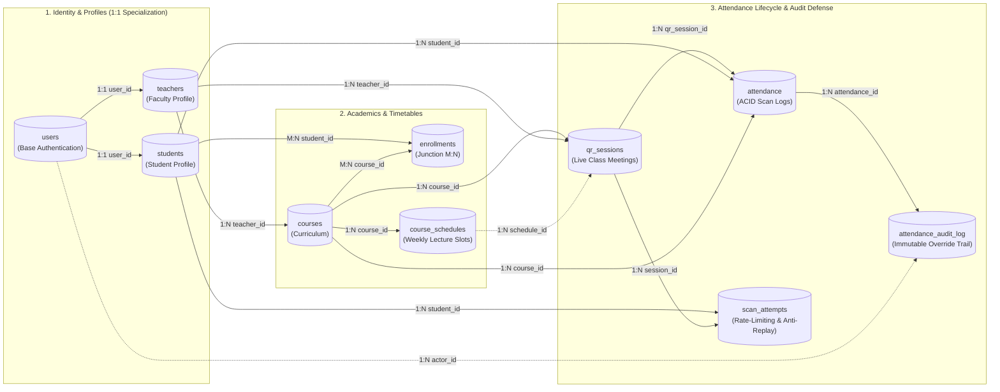
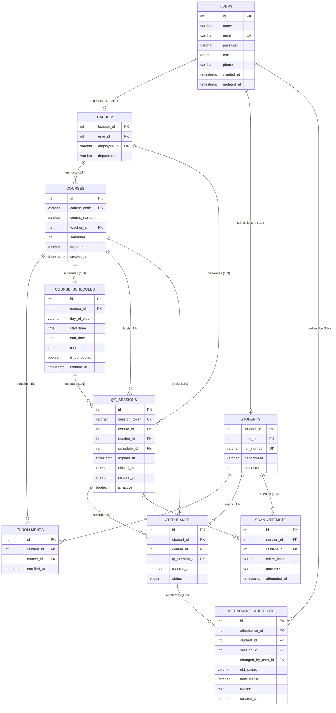

# DBMS Concepts & Implementation — ScanIn

This document explains every core Database Management System concept used in the ScanIn project — what the concept is, why it was used, and exactly where it appears in the schema and code. Use this as your presentation reference.

---

## 1. Relational Database Model & Database Design

ScanIn uses **MySQL 8.0 / TiDB Cloud** (MySQL 8.0 protocol-compatible), a Relational Database Management System (RDBMS).

**Core idea:** Data is organised in **tables** (relations). Each table has a fixed set of columns (attributes), and rows (tuples) represent individual records. Relationships between tables are expressed through **foreign keys**.

* **Database Name:** `attendance_db`
* **Storage Engine:** MySQL InnoDB (ACID compliant, row-level locking, foreign key enforcement)
* **Character Set & Collation:** `utf8mb4` with `utf8mb4_unicode_ci` (full multilingual and emoji support)
* **Timezone Governance:** Canonical UTC (`+00:00`) for storage; presentation dynamically converts to Indian Standard Time (`Asia/Kolkata`, UTC+05:30)
* **Connection Pooling:** Apache Tomcat JDBC Pool (`maxActive=20`, `testOnBorrow=true`, `validationQuery="SELECT 1"`)
* **Schema Definition File:** [`database/schema.sql`](../database/schema.sql)

### 1.1 Database Architecture & Relational Topology

The database architecture is structured into 3 distinct functional tiers:
1. **Identity & Specialization Tier:** The parent `users` entity specialized into `teachers` and `students` via 1:1 foreign key relationships.
2. **Academic Catalogue & Timetable Tier:** Courses, student registrations (`enrollments`), and weekly timetable slots (`course_schedules`).
3. **Dynamic Attendance & Security Tier:** Live rotating meetings (`qr_sessions`), scan fraud evidence logs (`scan_attempts`), persistent attendance records (`attendance`), and an append-only audit trail (`attendance_audit_log`).



---

## 2. Table Design & Data Dictionary

The database consists of **10 normalized tables**, engineered with explicit data types, primary keys, cascading foreign keys, domain constraints, and indexing.

### Table 1: `users` (Base Identity)
Base authentication and profile table implementing object-oriented abstraction.
| Column | Data Type | Nullable | Default | Constraints | Description |
|---|---|:---:|---|---|---|
| `id` | `INT` | NO | Auto Increment | **PRIMARY KEY** | Unique surrogate ID |
| `name` | `VARCHAR(100)` | NO | None | None | Full legal user name |
| `email` | `VARCHAR(150)` | NO | None | **UNIQUE** | Unique institutional login email |
| `password` | `VARCHAR(255)` | NO | None | None | BCrypt salted hash (`$2a$10$...`) |
| `role` | `ENUM` | NO | None | `'TEACHER','STUDENT'` | Role-based authorization type |
| `phone` | `VARCHAR(20)` | YES | NULL | None | Contact telephone number |
| `created_at`| `TIMESTAMP` | NO | `CURRENT_TIMESTAMP` | None | Account creation timestamp |
| `updated_at`| `TIMESTAMP` | NO | `CURRENT_TIMESTAMP` | `ON UPDATE CURRENT_TIMESTAMP` | Last profile update timestamp |

### Table 2: `teachers` (Faculty Specialization)
Extends `users` with faculty-specific employee attributes.
| Column | Data Type | Nullable | Default | Constraints | Description |
|---|---|:---:|---|---|---|
| `teacher_id` | `INT` | NO | Auto Increment | **PRIMARY KEY** | Surrogate teacher ID |
| `user_id` | `INT` | NO | None | **UNIQUE**, **FK** $\rightarrow$ `users(id)` | 1:1 link to base user record |
| `employee_id`| `VARCHAR(20)` | NO | None | **UNIQUE** | Institutional faculty ID (e.g. `EMP001`) |
| `department` | `VARCHAR(100)` | YES | NULL | None | Academic department (e.g. `Computer Science`) |

### Table 3: `students` (Student Specialization)
Extends `users` with academic enrollment attributes.
| Column | Data Type | Nullable | Default | Constraints | Description |
|---|---|:---:|---|---|---|
| `student_id` | `INT` | NO | Auto Increment | **PRIMARY KEY** | Surrogate student ID |
| `user_id` | `INT` | NO | None | **UNIQUE**, **FK** $\rightarrow$ `users(id)` | 1:1 link to base user record |
| `roll_number` | `VARCHAR(20)` | NO | None | **UNIQUE** | Official university roll (e.g. `CS2021001`) |
| `department` | `VARCHAR(100)` | YES | NULL | None | Department of study |
| `semester` | `INT` | YES | NULL | None | Current semester number (1 to 8) |

### Table 4: `courses` (Curriculum Catalogue)
Academic courses taught by faculty.
| Column | Data Type | Nullable | Default | Constraints | Description |
|---|---|:---:|---|---|---|
| `id` | `INT` | NO | Auto Increment | **PRIMARY KEY** | Unique surrogate course ID |
| `course_code` | `VARCHAR(20)` | NO | None | **UNIQUE** | Subject code (e.g. `CS501`, `CS23332`) |
| `course_name` | `VARCHAR(150)` | NO | None | None | Descriptive course title |
| `teacher_id` | `INT` | NO | None | **FK** $\rightarrow$ `teachers(teacher_id)` | Faculty member owning the course |
| `semester` | `INT` | YES | NULL | None | Target curriculum semester |
| `department` | `VARCHAR(100)` | YES | NULL | None | Offering academic department |
| `created_at` | `TIMESTAMP` | NO | `CURRENT_TIMESTAMP` | None | Course creation date |

### Table 5: `enrollments` (Student-Course Association)
Junction table resolving the Many-to-Many ($M:N$) relationship between `students` and `courses`.
| Column | Data Type | Nullable | Default | Constraints | Description |
|---|---|:---:|---|---|---|
| `id` | `INT` | NO | Auto Increment | **PRIMARY KEY** | Surrogate enrollment ID |
| `student_id` | `INT` | NO | None | **FK** $\rightarrow$ `students(student_id)` | Enrolled student reference |
| `course_id` | `INT` | NO | None | **FK** $\rightarrow$ `courses(id)` | Registered course reference |
| `enrolled_at` | `TIMESTAMP` | NO | `CURRENT_TIMESTAMP` | None | Timestamp when student joined |
| — | — | — | — | **UNIQUE(`student_id`, `course_id`)** | Prevents duplicate student registrations |

### Table 6: `course_schedules` (Weekly Timetable & Planned Sessions)
Defines planned weekly lecture timeslots for courses with state lifecycle tracking.
| Column | Data Type | Nullable | Default | Constraints | Description |
|---|---|:---:|---|---|---|
| `id` | `INT` | NO | Auto Increment | **PRIMARY KEY** | Unique timeslot schedule ID |
| `course_id` | `INT` | NO | None | **FK** $\rightarrow$ `courses(id)` | Course this lecture belongs to |
| `day_of_week` | `VARCHAR(15)` | NO | None | None | Day of lecture (e.g. `'Monday'`) |
| `start_time` | `TIME` | NO | None | None | Scheduled start time (e.g. `15:00:00`) |
| `end_time` | `TIME` | NO | None | None | Scheduled end time (e.g. `16:00:00`) |
| `room` | `VARCHAR(50)` | YES | NULL | None | Assigned lecture hall (e.g. `'ANEW202'`) |
| `is_conducted`| `BOOLEAN` | NO | `FALSE` | None | Lifecycle flag: retired from planned dashboard |
| `created_at` | `TIMESTAMP` | NO | `CURRENT_TIMESTAMP` | **INDEX**(`course_id`) | Schedule creation timestamp |

### Table 7: `qr_sessions` (Live Dynamic QR Class Meetings)
Represents a physical class session during which attendance is dynamically captured.
| Column | Data Type | Nullable | Default | Constraints | Description |
|---|---|:---:|---|---|---|
| `id` | `INT` | NO | Auto Increment | **PRIMARY KEY** | Session ID (e.g. `#SES-570001`) |
| `session_token`| `VARCHAR(255)`| NO | None | **UNIQUE** | Active rotating cryptographic token |
| `course_id` | `INT` | NO | None | **FK** $\rightarrow$ `courses(id)` | Associated course ID |
| `teacher_id` | `INT` | NO | None | **FK** $\rightarrow$ `teachers(teacher_id)` | Faculty host ID |
| `schedule_id` | `INT` | YES | NULL | **FK** $\rightarrow$ `course_schedules(id)` | Bound timetable lecture slot (SET NULL) |
| `expires_at` | `TIMESTAMP` | NO | None | None | Overall meeting expiration timestamp |
| `closed_at` | `TIMESTAMP` | YES | NULL | None | Timestamp when session was finalized |
| `created_at` | `TIMESTAMP` | NO | `CURRENT_TIMESTAMP` | None | Meeting launch timestamp |
| `is_active` | `BOOLEAN` | NO | `TRUE` | None | Session state (TRUE = open, FALSE = closed) |

### Table 8: `attendance` (ACID Attendance Records)
Stores validated attendance records marked during live QR sessions or manual overrides.
| Column | Data Type | Nullable | Default | Constraints | Description |
|---|---|:---:|---|---|---|
| `id` | `INT` | NO | Auto Increment | **PRIMARY KEY** | Unique attendance entry ID |
| `student_id` | `INT` | NO | None | **FK** $\rightarrow$ `students(student_id)` | Attending student ID |
| `course_id` | `INT` | NO | None | **FK** $\rightarrow$ `courses(id)` | Subject reference for analytics |
| `qr_session_id`| `INT` | NO | None | **FK** $\rightarrow$ `qr_sessions(id)` | Class session meeting reference |
| `marked_at` | `TIMESTAMP` | NO | `CURRENT_TIMESTAMP` | None | UTC verification timestamp |
| `status` | `ENUM` | NO | `'PRESENT'` | `'PRESENT','ABSENT','LATE','OD','EXCUSED'` | Verified attendance status |
| — | — | — | — | **UNIQUE(`student_id`, `qr_session_id`)** | **Core ACID Constraint (Code 1062 duplicate catch)** |

### Table 9: `scan_attempts` (Security, Fraud Evidence & Rate Limiting)
High-throughput audit log recording every cryptographic scan attempt.
| Column | Data Type | Nullable | Default | Constraints | Description |
|---|---|:---:|---|---|---|
| `id` | `INT` | NO | Auto Increment | **PRIMARY KEY** | Scan audit attempt ID |
| `session_id` | `INT` | YES | NULL | None | Target session ID |
| `student_id` | `INT` | YES | NULL | None | Scanning student ID |
| `token_hash` | `VARCHAR(64)` | NO | None | **INDEX**(`token_hash`) | SHA-256 hash of token (anti-replay lookup) |
| `outcome` | `VARCHAR(50)` | NO | None | None | `'SUCCESS'`,`'EXPIRED'`,`'REPLAYED'`, etc. |
| `attempted_at`| `TIMESTAMP` | NO | `CURRENT_TIMESTAMP` | **INDEX**(`student_id`, `session_id`) | Sliding-window rate limit timestamp |

### Table 10: `attendance_audit_log` (Immutable Change History)
Append-only ledger recording all manual attendance modifications.
| Column | Data Type | Nullable | Default | Constraints | Description |
|---|---|:---:|---|---|---|
| `id` | `INT` | NO | Auto Increment | **PRIMARY KEY** | Unique audit log ID |
| `attendance_id`| `INT` | YES | NULL | None | Modified attendance row ID |
| `student_id` | `INT` | NO | None | **INDEX**(`student_id`) | Affected student ID |
| `session_id` | `INT` | YES | NULL | **INDEX**(`session_id`) | Affected meeting session ID |
| `changed_by_user_id`| `INT` | NO | None | **FK** $\rightarrow$ `users(id)` | User ID of faculty member making override |
| `old_status` | `VARCHAR(20)` | YES | NULL | None | Previous attendance state |
| `new_status` | `VARCHAR(20)` | NO | None | None | New attendance state (`OD`, `PRESENT`, etc.) |
| `reason` | `TEXT` | NO | None | None | Mandatory administrative justification text |
| `created_at` | `TIMESTAMP` | NO | `CURRENT_TIMESTAMP` | None | Immutable tamper-evident timestamp |

---

## 3. Entity-Relationship (ER) Model & Visual ER Diagram

The ScanIn relational schema models the academic domain with strict cardinality, referential integrity, and composite uniqueness rules.



### 3.1 ER Mapping Rules & Cardinality Analysis

| Relationship | Cardinality | Parent Table | Child Table | Foreign Key & Referential Action | Description |
|---|:---:|---|---|---|---|
| User Specialization | **1:1** | `users` | `teachers` | `user_id` $\rightarrow$ `users(id)` `ON DELETE CASCADE` | Each faculty member has exactly one base user identity. |
| User Specialization | **1:1** | `users` | `students` | `user_id` $\rightarrow$ `users(id)` `ON DELETE CASCADE` | Each student has exactly one base user identity. |
| Faculty Course Ownership | **1:N** | `teachers` | `courses` | `teacher_id` $\rightarrow$ `teachers(teacher_id)` `CASCADE` | One professor instructs multiple courses; each course has one owner. |
| Student Course Registration | **M:N** | `students` / `courses` | `enrollments` | `student_id` & `course_id` `CASCADE` | Resolved via associative table `enrollments` with `UNIQUE(student_id, course_id)`. |
| Course Lecture Timetable | **1:N** | `courses` | `course_schedules`| `course_id` $\rightarrow$ `courses(id)` `CASCADE` | A course has multiple weekly timeslots (e.g. Mon 15:00, Wed 10:00). |
| Scheduled Session Execution | **1:N** | `course_schedules`| `qr_sessions` | `schedule_id` $\rightarrow$ `course_schedules(id)` `SET NULL`| Live QR session bound to a planned lecture slot. |
| Course Session Hosting | **1:N** | `courses` | `qr_sessions` | `course_id` $\rightarrow$ `courses(id)` `CASCADE` | A course holds multiple live class meetings over the semester. |
| Session Attendance Records | **1:N** | `qr_sessions` | `attendance` | `qr_session_id` $\rightarrow$ `qr_sessions(id)` `CASCADE`| Class meeting contains one attendance record per attending student. |
| Student Attendance Records | **1:N** | `students` | `attendance` | `student_id` $\rightarrow$ `students(student_id)` `CASCADE`| Student maintains an attendance history across courses. |
| Immutable Audit Tracking | **1:N** | `attendance` | `attendance_audit_log`| `attendance_id` $\rightarrow$ `attendance(id)` | Every manual override is logged as an immutable historical record. |
| Scan Attempt Fraud Evidence | **1:N** | `students` / `qr_sessions` | `scan_attempts` | `student_id` & `session_id` | Sliding-window rate limit and cryptographic replay attack evidence. |

---

## 4. Normalization

Normalization is the process of organizing a database to reduce redundancy and improve data integrity. ScanIn's schema is in **Third Normal Form (3NF)**.

### 4.1 First Normal Form (1NF)
**Rule:** Every cell contains a single atomic value. No repeating groups.

**Applied:** Every column in every ScanIn table holds a single value. For example, a student's courses are not stored as a comma-separated string in the `students` table — they are stored as separate rows in `enrollments`.

```sql
-- WRONG (not 1NF): storing multiple courses in one column
students: id=1, name="Aarav", courses="CS501,CS502"

-- CORRECT (1NF): separate rows in enrollments table
enrollments: (student_id=1, course_id=1)
enrollments: (student_id=1, course_id=2)
```

### 4.2 Second Normal Form (2NF)
**Rule:** Must be in 1NF, and every non-key column must depend on the **entire** primary key (no partial dependencies — applies to composite keys).

**Applied in `enrollments`:** The PK is `(student_id, course_id)`. The only data stored is `enrolled_at` — which depends on both columns (when did this specific student enroll in this specific course). No column partially depends on just `student_id` or just `course_id` alone.

### 4.3 Third Normal Form (3NF)
**Rule:** Must be in 2NF, and no non-key column should depend on another non-key column (no transitive dependencies).

**Applied in `attendance`:**
```sql
-- attendance table: id (PK), student_id, course_id, qr_session_id, status
-- course_id is denormalized here for fast reporting queries
-- But course_name, teacher_name, etc. are NOT stored here
-- They are always joined from the courses table when needed
```
Student `name` and `department` are NOT repeated inside `attendance` — they are always retrieved by joining `students` and `users`. This avoids update anomalies (e.g., if a student's name changes, it only needs to change in one place: `users.name`).

---

## 5. Keys and Constraints

### 5.1 Primary Key (PK)
Uniquely identifies every row. ScanIn uses `INT AUTO_INCREMENT PRIMARY KEY` everywhere.
```sql
CREATE TABLE users (
    id INT AUTO_INCREMENT PRIMARY KEY,
    ...
);
```

### 5.2 Foreign Key (FK)
Enforces referential integrity — a value in a FK column must exist in the referenced table.

```sql
-- students.user_id must reference a row that exists in users.id
CREATE TABLE students (
    user_id INT NOT NULL UNIQUE,
    FOREIGN KEY (user_id) REFERENCES users(id) ON DELETE CASCADE
);
```
`ON DELETE CASCADE` means: if a `users` row is deleted, the corresponding `students` row is automatically deleted too. No orphaned student records.

### 5.3 UNIQUE Constraint
Prevents duplicate values in a column.

```sql
email VARCHAR(150) NOT NULL UNIQUE,          -- no two users share an email
roll_number VARCHAR(20) NOT NULL UNIQUE,     -- no two students share a roll number
```

### 5.4 Composite UNIQUE Constraint (Most Important for Attendance)
```sql
-- attendance table: a student can only be marked once per session
UNIQUE KEY unique_attendance (student_id, qr_session_id)
```
This is the **most critical constraint** in the whole schema. Even if two tabs or two devices try to mark the same student simultaneously (race condition), the database will accept only the first INSERT and reject the second with **error code 1062**. The application catches this and returns `DUPLICATE` — no double-marking is ever possible, even under concurrent load.

```sql
-- enrollments: a student can only be enrolled once per course
UNIQUE KEY unique_enrollment (student_id, course_id)
```

---

## 6. SQL Queries Used in ScanIn

### 6.1 SELECT with JOIN
Used in reports to show student name, course name, and attendance status together:

```sql
-- ReportServlet / AttendanceDao
SELECT
    u.name           AS student_name,
    s.roll_number,
    c.course_name,
    a.status,
    a.marked_at
FROM attendance a
JOIN students s  ON a.student_id      = s.student_id
JOIN users u     ON s.user_id         = u.id
JOIN courses c   ON a.course_id       = c.id
WHERE a.qr_session_id = ?
ORDER BY u.name ASC;
```
- `JOIN` combines rows from multiple tables where the join condition matches.
- `?` is a parameter placeholder (PreparedStatement) — prevents SQL injection.

### 6.2 Subquery for Attendance Percentage

```sql
-- Student dashboard: attendance % per course
SELECT
    c.course_name,
    COUNT(CASE WHEN a.status IN ('PRESENT','LATE','OD') THEN 1 END)       AS attended,
    COUNT(CASE WHEN a.status != 'EXCUSED' THEN 1 END)                      AS total_eligible,
    ROUND(
        COUNT(CASE WHEN a.status IN ('PRESENT','LATE','OD') THEN 1 END)
        * 100.0 /
        NULLIF(COUNT(CASE WHEN a.status != 'EXCUSED' THEN 1 END), 0)
    , 2) AS percentage
FROM attendance a
JOIN courses c ON a.course_id = c.id
WHERE a.student_id = ?
GROUP BY c.id, c.course_name;
```
- `CASE WHEN` acts as conditional counting — counts only rows that match the condition.
- `NULLIF(..., 0)` prevents division-by-zero when a student has no eligible sessions.
- `GROUP BY` aggregates attendance data per course.

### 6.3 INSERT with Conflict Detection (ACID Duplicate Handling)

```sql
-- AttendanceDao: mark student present
INSERT INTO attendance (student_id, course_id, qr_session_id, status)
VALUES (?, ?, ?, 'PRESENT');
-- Throws MySQL error 1062 if UNIQUE KEY (student_id, qr_session_id) is violated
```

### 6.4 UPDATE with Audit Log (Two Statements in a Transaction)

```sql
-- Step 1: update the attendance record
UPDATE attendance
SET status = ?, marked_at = UTC_TIMESTAMP()
WHERE id = ?;

-- Step 2: log the change immutably
INSERT INTO attendance_audit_log
    (attendance_id, student_id, session_id, changed_by_user_id, old_status, new_status, reason)
VALUES
    (?, ?, ?, ?, ?, ?, ?);
```
Both statements execute in a single ACID transaction — either both succeed or both roll back.

### 6.5 Rate-Limiting Query (Sliding Window)

```sql
-- QrScanServlet: count failed scans in last 60 seconds for this student
SELECT COUNT(*) AS recent_failures
FROM scan_attempts
WHERE student_id = ?
  AND session_id = ?
  AND outcome NOT IN ('SUCCESS', 'DUPLICATE')
  AND attempted_at >= UTC_TIMESTAMP() - INTERVAL 60 SECOND;
```
If `recent_failures >= 5`, the scan is rejected with `RATE_LIMITED` before any verification is attempted.

### 6.6 Absentee Reconciliation (Bulk INSERT)

```sql
-- QrScanServlet / QrSessionDao: when teacher ends session, mark all unmarked students ABSENT
INSERT INTO attendance (student_id, course_id, qr_session_id, status)
SELECT e.student_id, ?, ?, 'ABSENT'
FROM enrollments e
WHERE e.course_id = ?
  AND e.student_id NOT IN (
      SELECT a.student_id FROM attendance a WHERE a.qr_session_id = ?
  );
```
- `INSERT ... SELECT` inserts multiple rows in one atomic statement.
- The subquery `NOT IN (SELECT ...)` excludes students who already marked attendance.
- This runs as a single SQL statement — all absences are recorded atomically.

---

## 7. Transactions & ACID Properties

**ACID** stands for Atomicity, Consistency, Isolation, Durability — the guarantees that make database operations reliable.

### 7.1 Atomicity
All operations in a transaction either all succeed or all fail — no partial results.

**Example in ScanIn:**
```java
// AttendanceManualServlet.java — status override + audit log in one transaction
conn.setAutoCommit(false);   // start transaction
try {
    attendanceDao.updateStatus(attendanceId, newStatus);        // UPDATE
    auditLogDao.insert(attendanceId, oldStatus, newStatus, reason);  // INSERT
    conn.commit();           // both succeeded — commit
} catch (Exception e) {
    conn.rollback();         // one failed — undo everything
}
```
If the audit log INSERT fails after the UPDATE succeeded, the rollback reverses the UPDATE too. The database never ends up in a state where a status was changed but not logged.

### 7.2 Consistency
Every transaction brings the database from one valid state to another. Constraints (FK, UNIQUE, NOT NULL) are enforced — a transaction that would violate them is rejected.

**Example:** Inserting an `attendance` row with a `qr_session_id` that doesn't exist in `qr_sessions` violates the FK constraint and is rejected.

### 7.3 Isolation
Concurrent transactions don't interfere with each other. MySQL InnoDB uses **row-level locking** — two students scanning simultaneously lock their own rows without blocking each other.

**Race condition scenario:**
```
Thread A (Student 1) → INSERT attendance (student_id=1, qr_session_id=100) → SUCCESS
Thread B (Student 1, different tab) → INSERT attendance (student_id=1, qr_session_id=100)
         → UNIQUE KEY violation → error 1062 → caught → returns DUPLICATE
```
The UNIQUE constraint + InnoDB isolation ensures only one record is ever created.

### 7.4 Durability
Once a transaction is committed, it survives crashes. InnoDB writes committed transactions to its **redo log (WAL — Write-Ahead Log)** before confirming. Even if the server crashes immediately after `COMMIT`, the data is not lost.

---

## 8. Indexing

Indexes speed up `SELECT` queries by allowing the database to find rows without scanning the entire table.

### 8.1 Automatic Indexes (created by PRIMARY KEY and UNIQUE)
MySQL automatically creates a B-Tree index for every `PRIMARY KEY` and `UNIQUE` constraint.

```sql
-- These implicitly create indexes:
id INT AUTO_INCREMENT PRIMARY KEY             -- clustered B-Tree index on id
email VARCHAR(150) NOT NULL UNIQUE            -- secondary B-Tree index on email
UNIQUE KEY unique_attendance (student_id, qr_session_id)   -- composite index
```

### 8.2 Explicit Indexes for Performance

```sql
-- scan_attempts: fast lookup by token hash (rate limiting, replay detection)
INDEX idx_scan_token_hash (token_hash)

-- scan_attempts: fast lookup by student + session (rate limiting query)
INDEX idx_scan_student_session (student_id, session_id)

-- attendance_audit_log: fast lookup by student or session in reports
INDEX idx_audit_student (student_id)
INDEX idx_audit_session (session_id)
```

**Why `token_hash` is indexed:**
On every scan, the server checks if a token has been used before:
```sql
SELECT COUNT(*) FROM scan_attempts WHERE token_hash = ?
```
Without the index, MySQL would scan every row in `scan_attempts`. With the index, it performs a B-Tree lookup in O(log n) time — essentially instant even with millions of rows.

---

## 9. Views and Stored Logic (Application-Layer Equivalent)

ScanIn does not use SQL Views or Stored Procedures (the assignment did not require them). Instead, the equivalent logic is in Java DAO methods that compose SQL queries. This keeps the database portable (works with TiDB Cloud which has limited SP support) while providing the same query abstraction.

The complex reporting query in `AttendanceDao.getAttendanceSummaryByCourse()` is equivalent to what would be a view — it encapsulates the multi-table join and conditional COUNT logic behind a single Java method call.

---

## 10. Connection Pooling (Advanced DBMS Topic)

**What is connection pooling?** Opening a new database TCP connection takes ~100ms (DNS, TCP handshake, authentication). For a web application handling 50 requests/second, that would be 5 seconds of connection overhead per second — catastrophic.

A **connection pool** keeps a fixed number of connections permanently open and lends them to threads:

```
                    ┌─────────────────────────────┐
Request Thread A ──►│  Pool (5–20 connections)    │◄── TiDB Cloud TCP connection
Request Thread B ──►│  [conn1] [conn2] [conn3]... │◄── TiDB Cloud TCP connection
Request Thread C ──►│  (waiting if all busy)       │
                    └─────────────────────────────┘
```

**ScanIn's pool configuration (Apache Tomcat JDBC Pool):**
```java
p.setMaxActive(20);                    // max 20 simultaneous DB connections
p.setInitialSize(5);                   // 5 connections opened on startup
p.setMaxWait(10000);                   // wait up to 10s for a free connection
p.setTestOnBorrow(true);               // validate connection before lending
p.setValidationQuery("SELECT 1");      // keep-alive check
p.setTimeBetweenEvictionRunsMillis(30000);  // reclaim idle connections every 30s
```

**Why `testOnBorrow=true`?** Cloud databases (like TiDB Cloud) close idle connections after a timeout. Without this check, a servlet would get a stale connection and fail. The pool runs `SELECT 1` before lending — if it fails, it creates a fresh connection.

**File:** [`src/main/java/com/attendance/util/DBConnection.java`](../src/main/java/com/attendance/util/DBConnection.java)

---

## 11. Data Integrity Strategies

### 11.1 Entity Integrity
Every table has a NOT NULL primary key. No row is anonymous.

### 11.2 Referential Integrity
Foreign keys with `ON DELETE CASCADE` ensure no orphaned records:
- Delete a user → their teacher/student profile is deleted.
- Delete a course → its sessions, enrollments, attendance records cascade-delete.

### 11.3 Domain Integrity
`ENUM` types restrict columns to only valid values:
```sql
role   ENUM('TEACHER', 'STUDENT')   -- only these two values allowed
status ENUM('PRESENT','ABSENT','LATE','OD','EXCUSED')  -- no typos possible
```

### 11.4 Application-Level Integrity (DAO Layer)
- `scan_attempts` stores only the **SHA-256 hash** of the token, never the raw token. Even if the table is compromised, no token can be extracted and replayed.
- `attendance_audit_log` DAO only implements `INSERT` and `SELECT`. There is no `UPDATE` or `DELETE` method — the audit trail is immutable at the application layer.

### 11.5 Soft Deletion & Referential Preservation vs. Hard Deletion
In academic reporting systems, historical records must never lose their context. When a planned lecture timeslot is finished, hard-deleting the row (`DELETE FROM course_schedules WHERE id = ?`) would cause any historical query using:
```sql
LEFT JOIN course_schedules cs ON qs.schedule_id = cs.id
```
to return `NULL` for `cs.day_of_week`, `cs.start_time`, `cs.end_time`, and `cs.room`. Past attendance reports would lose the timeslot label.

**The Solution:**
1. A lifecycle state column `is_conducted BOOLEAN DEFAULT FALSE` is added to `course_schedules`.
2. When the faculty finishes marking attendance and closes the QR session, `QrSessionDao.closeSession()` marks `course_schedules.is_conducted = TRUE`.
3. The faculty dashboard queries only active/pending schedules using:
   ```sql
   WHERE cs.course_id = ?
     AND (cs.is_conducted IS NULL OR cs.is_conducted = FALSE)
     AND cs.id NOT IN (
         SELECT qs.schedule_id FROM qr_sessions qs 
         WHERE qs.schedule_id IS NOT NULL AND qs.is_active = FALSE
     )
   ```
4. Even if faculty attempts to delete a timeslot via the UI, `CourseScheduleDao.delete()` detects if `qr_sessions` references it: if historical attendance exists, it soft-retires the record rather than executing a hard SQL `DELETE`, guaranteeing 100% referential integrity for all past reports.

---

## 12. Database Configuration & Deployment

### Local Development
```
URL:  jdbc:mysql://localhost:3306/attendance_db
User: root
Pass: root
```

### Production (Render + TiDB Cloud)
```
URL:  jdbc:mysql://<tidb-host>:4000/attendance_db?sslMode=VERIFY_IDENTITY
User: <env: DB_USER>
Pass: <env: DB_PASSWORD>
```
- `sslMode=VERIFY_IDENTITY` enforces TLS certificate validation — the connection is encrypted and the client verifies it's talking to the real TiDB server (not a man-in-the-middle).
- Credentials are injected at runtime from Render environment variables — never hardcoded in source code.

### Zero-Config Self-Healing (AppContextListener)
On every container startup, `AppContextListener` runs:
```sql
CREATE TABLE IF NOT EXISTS scan_attempts (...);
CREATE TABLE IF NOT EXISTS attendance_audit_log (...);
CREATE TABLE IF NOT EXISTS course_schedules (...);
ALTER TABLE qr_sessions ADD COLUMN IF NOT EXISTS schedule_id INT NULL;
ALTER TABLE course_schedules ADD COLUMN IF NOT EXISTS is_conducted BOOLEAN DEFAULT FALSE;
ALTER TABLE qr_sessions MODIFY COLUMN session_token VARCHAR(255);
ALTER TABLE attendance MODIFY COLUMN status ENUM('PRESENT','ABSENT','LATE','OD','EXCUSED');
```
This ensures the schema is always current even when deploying to a fresh database — no manual migration steps needed.

---

## 13. Summary: DBMS Concept → Application Location

| DBMS Concept | Where it's applied |
|---|---|
| Relational model | Entire `attendance_db` schema (10 tables) |
| ER diagram (entities, relationships) | [`database/schema.sql`](../database/schema.sql) |
| 1NF | Atomic values, no repeating groups (`enrollments` table) |
| 2NF | No partial dependencies (`enrollments.enrolled_at` depends on full composite key) |
| 3NF | No transitive dependencies (student name not stored in `attendance`) |
| Primary keys | `INT AUTO_INCREMENT PRIMARY KEY` on all tables |
| Foreign keys + CASCADE | `students.user_id → users.id ON DELETE CASCADE`, `course_schedules.course_id → courses.id` |
| Foreign keys + SET NULL | `qr_sessions.schedule_id → course_schedules.id` |
| UNIQUE constraint | `users.email`, `students.roll_number`, `unique_attendance`, `unique_enrollment` |
| ENUM domain integrity | `users.role`, `attendance.status` |
| SELECT with LEFT JOIN | `AttendanceDao` & `QrSessionDao` report queries joining `course_schedules` |
| Soft Deletion / State Lifecycle | `course_schedules.is_conducted` preserving report referential integrity |
| Aggregate functions (COUNT, ROUND) | Attendance % query in `StudentDashboardServlet` |
| Transactions (ACID) | Manual override in `AttendanceManualServlet` |
| Atomic INSERT on conflict | `AttendanceDao` duplicate-key catch (error 1062) |
| Bulk INSERT...SELECT | Absentee reconciliation in `QrSessionDao` |
| Indexing | `scan_attempts` token hash index, audit log indexes |
| Connection pooling | [`DBConnection.java`](../src/main/java/com/attendance/util/DBConnection.java) |
| SSL/TLS encrypted connection | TiDB Cloud production URL with `sslMode=VERIFY_IDENTITY` |
| Self-healing migrations | [`AppContextListener.java`](../src/main/java/com/attendance/listener/AppContextListener.java) |
